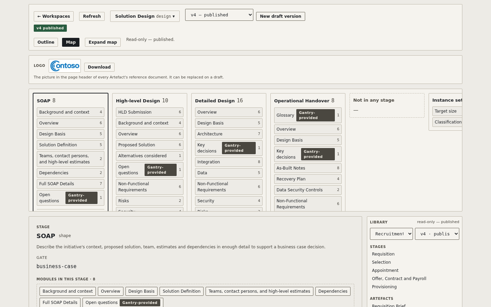

# Introduction

**Gantry turns the evidence you gather into the documents a gated process asks for. You bring good inputs; the AI interview drafts from them, asks you about the gaps and contradictions, and holds the work to the process's standards; you decide what is saved.**

Most people use Gantry through its web UI and its **AI interview**. Your job is to gather high-quality inputs (a client brief, requirements, meeting notes, an earlier design, a web page, the code itself) and give them to Gantry as **Source documents**. The AI interview reads them, drafts each Stage's Fields, cites the document every fact came from, and asks you about whatever is missing or doesn't agree. It holds the draft to the process's quality bar: what each Gate requires, how much to write in each Field, a source for every figure, and a Key decision only where there is a real trade-off.

You stay in the driver's seat. You answer the questions, edit the drafts and save. Nothing the AI writes is saved until you confirm it, AI-written content stays `draft` until a person agrees it, and the AI never passes a Gate that needs a person's approval. The AI does the transcribing; you do the judging.

Underneath is one idea: Gantry separates the *content* of a process from the *documents* it produces. A process is described once as a **Definition** (its stages, its gates, its modules), each initiative's content is captured once as **Modules**, and every document a gate asks for (a Solution on a Page, a business case, a handover pack) is rendered from that data on demand. There is one set of data, not five documents that drift apart.

Gantry itself knows nothing about design, recruitment or anything else. Every use case is a Definition, and Definitions are configuration. Gantry ships with two, `design` and `recruitment-onboarding`.

The web UI and the AI are not the only way in. Modules are plain Markdown files you can edit by hand, the `gantry` CLI checks and renders them, and an outside agent such as Claude Code can do what the web UI does through the Gantry MCP server (see [Working with agents](#working-with-agents)).

The thinking behind Gantry is set out in [*The Organisation as Code*](https://agentics.org.nz/blog/the-organisation-as-code/), an essay on running work the way good software is built. Gantry is one of its worked examples.

Jump to [Try it](#try-it), the [User Guide](docs/user-guide/index.md) or the [Executive Summary](docs/exec-summary.md).


## The problem this solves

Most governance processes accrete documents. Each gate demands its own artefact, each artefact re-states 60% of the last one in a slightly different shape, and every one of them is a separate Office file living in a separate library with a separate owner. Six months in, nobody can tell you which version is true.

The usual response is to rationalise the document set. That works for about a year.

Gantry attacks the coupling instead. The document is a *view*. The data is the thing. If a gate needs a two-page summary and the delivery team needs a detailed spec, those are two renderings of the same underlying modules — not two documents to keep in sync.

The other cost is the writing itself. Someone reads the brief, the minutes and the last design and transcribes them into each template, and the gaps and contradictions between those inputs surface late, in review. The AI interview does the transcribing from the evidence you give it, and puts the gaps and contradictions to you as questions while the stage is still being written, each with the document it rests on.

Because the shape of that problem is not unique to any one process, the engine is deliberately empty. Anything with stages, gates and repeated content is a candidate.

## How it works

```
  inputs                  AI interview              you                    documents
  Source documents ──►    drafts each Field,  ──►   answer, edit,   ──►    rendered at each
  (files, web pages,      asks about gaps and       save; a person         Gate from the
   code repositories)     contradictions, holds     agrees and passes      saved Modules
          ▲               the Definition's bar      the Gate
          │                                            │
          └──── an input changes: its Fields are flagged Out of date ──► Bring up to date
```

1. **Gather the inputs.** Add Source documents to an Instance: upload files (Word, PowerPoint, spreadsheets, PDFs, Markdown, text and images), add a web page by its address (the server keeps a snapshot), or point at a code repository on GitHub, Azure DevOps, GitLab or Bitbucket, which the AI reads live.
2. **Run the AI interview.** Connect an AI Provider (its key stays in your browser) and open **✦ AI interview** on a Stage. The AI drafts every Field the inputs support into a live preview, asks question cards in rounds, settles preferred terms, offers Key decisions and records open questions. It works to the Definition's own Interview instructions and to Gantry's rules, which no Definition can override.
3. **Decide and save.** Choose answers, edit drafts by hand, keep what is already saved or take the AI's version. Saving writes the Stage's Modules and its decisions log together. A Stage moves on once its Gate passes; on a Provider workspace, only once its Pull Request is approved.
4. **Keep it current.** When a Source document is replaced, removed or read again with different text, or a file the AI drew on in a code repository changes, the Fields that drew on it are flagged **Out of date**. **Bring up to date** works through exactly those Fields with you, a card each.
5. **Render at the gate.** Render the documents the Gate asks for, to Word and Markdown, whenever you need them. They are derived from the Modules, so you change the Modules and render again rather than edit the document. When a reviewer sends a Word document back with comments, bring it in as a **Reviewed copy** and work through the comments with the AI.

On a Provider workspace, Git is the audit trail: each Stage's work is committed to its own branch and approved through a Pull Request, so who changed what, when, and why is a `git log`, not a version-history table nobody maintains.

The [User Guide](docs/user-guide/index.md) walks through all of this, starting with [The AI interview](docs/user-guide/index.md#the-ai-interview) and [Source documents](docs/user-guide/index.md#source-documents).

## Try it

1. **Install and start Gantry** (see [Installation](#installation)): clone the repository, `npm install` and `npm link`, then `gantry serve`, and open the address it prints.
2. **Look at a finished example.** The Workspaces page shows the bundled **Examples** workspace. Open `gantry`, Gantry's own hosting proposal written as a Full Solution on a Page on `design` version 4, or `kiwi-cover-mutual`, a fictitious insurer's design that also shows the interview's evidence: four Source documents, citations, a decisions log on every Stage and a Reviewed copy. A third, `platform-engineer`, is a hire on `recruitment-onboarding`. See [Example instances](docs/user-guide/index.md#example-instances) in the User Guide.
3. **Connect an AI Provider.** Under **Global Settings → AI Providers**, add Anthropic, OpenAI, OpenRouter, Ollama, LM Studio or any OpenAI-compatible service, and press **Test connection**. The key stays in your browser. See [AI Providers](docs/user-guide/index.md#ai-providers) in the User Guide and, for whoever runs the server, [AI Providers and the AI relay](#ai-providers-and-the-ai-relay).
4. **Start your own.** **+ New Workspace** creates an Instance (by default in a folder on your own machine, which needs Chrome or Edge; turn on **Advanced mode** in Global Settings for a workspace on the server or on a Provider). Add your Source documents, then open **✦ AI interview**.

## Concepts

The terms below are the ones the app uses. [`CONTEXT.md`](CONTEXT.md) has the full glossary.

| Term | What it is |
|---|---|
| **Definition** | A reusable, versioned description of a process: its Stages, Gates, Modules and the documents it renders. Each version is a numbered folder (`definitions/<id>/<n>/`), and a published version never changes. |
| **Stage** | A phase of the process. Stages are ordered, and each ends at a Gate. |
| **Gate** | The decision point at the end of a Stage. It passes when one of the Artefacts that count toward it has every Field it requires filled in. |
| **Module** | A self-contained piece of the process's content, such as Background or Non-functional requirements, made up of Fields. Modules are the source of truth. |
| **Instance** | One run of a Definition for one initiative, such as one project or one hire. It has its own Modules, current Stage, Source documents and settings. |
| **Workspace** | Where Instances' data lives: a repository on a Provider, a folder on the Gantry server (or in an Azure Blob container), or a folder on your own machine (a Local workspace). |
| **Provider** | The suite a remote workspace's repository and work items both come from: Azure DevOps, GitHub, GitLab or Atlassian (Bitbucket and Jira). Each Stage on a Provider workspace is approved through a Pull Request (a Merge Request on GitLab). |
| **AI Provider** | The AI service the interview uses: Anthropic, OpenAI, OpenRouter, Ollama, LM Studio or any OpenAI-compatible service. It is set up in your own browser and has nothing to do with a Provider. |
| **Source document** | Evidence an Instance's content is drawn from: an uploaded file, a snapshot of a web page fetched from its address, or a pointer to a code repository the AI reads live. Content cites it, and each document lists what it cites in a Sources appendix. |
| **AI interview** | Drafting a Stage with an AI from its Source documents. The AI asks question cards about gaps and contradictions and works to the Definition's rules; nothing is saved until you confirm the Stage. |
| **Key decisions** | A Module Gantry provides for the decisions that matter: hard to reverse, surprising without their context, and a real trade-off. Each keeps the number it was given (`AD01`, `AD02`, …). |
| **Decisions log** | Each Stage's record of what was decided in the interview, with your answers in your own words. It is saved with the Stage's content, as `interview/<stage>.yaml`, and never printed in a document. |
| **Out of date** / **Bring up to date** | A Field is Out of date when something it drew on has changed: a Source document replaced, removed or read again, or a file it used in a code repository. Bring up to date works through those Fields with you, one card each. |
| **Artefact** | A document rendered from the Modules for a Gate, such as a Solution on a Page, as Word (`.docx`) and Markdown. It is generated, never hand-edited. |
| **Reviewed copy** | A Word document Gantry rendered that came back with comments and tracked changes. Brought into the Instance, its comments are worked through with the AI, and a Review response list goes back to the reviewers. |
| **Stage advancement** | On a Local or server workspace, a Stage moves on self-serve once its Gate passes. On a Provider workspace it moves on only when its Pull Request is approved on the Provider (see [Stage advancement and approval](#stage-advancement-and-approval)). |

The key rule: **artefacts are derived, modules are authored.** If you find yourself editing a rendered artefact, something is wrong with the module spec.

### The Definitions page

Definitions are versioned (numbered `definitions/<id>/<n>/` dirs — see "Definition schema" below). The **Definitions** page at `/definitions` — linked from the Workspaces page header as "Definitions" — is a first-class editor: an Outline/Map view switch over one focus pane (stage/artefact/module, with compact one-at-a-time field rows) and a docked, read-only Library panel. A published version is read-only, with a **View template source** button per artefact; a *draft* version is directly editable — every element can be reordered or moved between a stage, an artefact and a module by drag or an equivalent button, template editing opens as its own focus-pane view, and the toolbar shows a live problems count sharing the server's own validation rules. Also: creating a new draft version, a new definition (Blank or Clone), archiving/restoring, and publishing a draft. Save follows the stage Save convention: one Save for everything changed, with a Save/Discard/Cancel prompt on leaving with unsaved changes.



## Principles

**Data over documents.** If content lives in two places, one of them is a rendering.

**The AI drafts; people decide.** The AI interview works from the evidence you give it and marks every fact with where it came from. It changes saved content only through a question you answer, and nothing it writes can pass a Gate that needs approval.

**Flat files, no database.** Git gives history, review, branching, access control and offline work for free. A database would give you a migration problem and a backup schedule.

**Proportionate by design.** The definition declares what each gate genuinely requires. Completeness is checked against that, not against the full module set.

**Process-agnostic engine.** Nothing in Gantry knows what a SOAP is. Design is a definition, and definitions are configuration.

**Several front ends, one store.** The web UI, a text editor, the CLI and an outside agent over MCP all read and write the same Module files. There is no synchronisation step, because there is nothing to synchronise.

---

# Getting Started

## Installation

Gantry runs anywhere Node.js does, including Windows — you don't need WSL. Pandoc is only needed for the `gantry render` CLI command or the web UI's native-rendering toggle (see step 2). It's built and CI-tested on Linux, so Windows works in principle but is unverified in practice; WSL is the safer bet if you want the exact environment this project is tested against.

**1. Install Node.js 24+** (`package.json` `engines.node` is `>=24`)

- **Linux (Debian/Ubuntu)**:
  ```bash
  curl -fsSL https://deb.nodesource.com/setup_lts.x | sudo -E bash -
  sudo apt-get install -y nodejs
  ```
- **Windows**: download the 64-bit **Windows Installer (`.msi`)** from https://nodejs.org/en/download and run it (standard wizard), then restart your terminal so `node`/`npm` are on PATH.

**2. Install Pandoc 3.x** (optional if you only use the web UI — see below)

Rendering from the web UI (`gantry serve`, both local-folder and Azure-DevOps-backed instances) goes through an in-browser WASM build of Pandoc by default, so a native Pandoc install isn't required just to use Gantry that way — Settings has a toggle to the native engine, and Gantry falls back to it automatically if the WASM engine ever fails to load. The **`gantry render` CLI command** is a separate path (used e.g. by `npm run render:examples`) that always shells out to native Pandoc — install it if you'll use that command directly.

- **Linux (Debian/Ubuntu)**:
  ```bash
  sudo apt-get install -y pandoc
  ```
  Or grab the latest `.deb` from the [Pandoc releases page](https://github.com/jgm/pandoc/releases/latest) if your distro's version lags.
- **Windows**: download `pandoc-<version>-windows-x86_64.msi` from https://github.com/jgm/pandoc/releases/latest and run it.

**3. Install Git** (needed to clone the source below. Gantry also runs `git` to read the checkout's current commit when it renders an Instance kept on the server's own disk, so the document can name it. Workspaces on a Provider don't need it: Gantry reaches Azure DevOps, GitHub, GitLab and Atlassian over their web APIs.)

- **Linux (Debian/Ubuntu)**:
  ```bash
  sudo apt-get install -y git
  ```
- **Windows**: download the 64-bit standalone installer from https://git-scm.com/download/win and run it.

Already have winget? `winget install OpenJS.NodeJS.LTS` and `winget install --exact --id JohnMacFarlane.Pandoc` also work.

> **Corporate proxy / TLS inspection (Windows).** If `npm install` fails with `UNABLE_TO_GET_ISSUER_CERT_LOCALLY` for `registry.npmjs.org`, `github.com`, or both, your network is doing HTTPS inspection (Zscaler, Netskope, a corporate firewall) with a CA that Windows trusts but Node doesn't. Tell Node to use the Windows certificate store:
>
> ```powershell
> setx NODE_USE_SYSTEM_CA 1
> ```
>
> Then open a **new terminal** (`setx` only affects new sessions — a terminal or Explorer window that was already open keeps the old environment, which is the usual reason this looks like it didn't work) and re-run `npm install`. For a single session instead: `set NODE_USE_SYSTEM_CA=1` (cmd) or `$env:NODE_USE_SYSTEM_CA=1` (PowerShell). `NODE_USE_SYSTEM_CA` needs Node 22+ (already required above).
>
> If an install still fails after that, your proxy's CA isn't in the Windows root store — ask IT where it lives and point `NODE_EXTRA_CA_CERTS` at a PEM copy of it before re-running.

**4. Clone and install Gantry** (same on both platforms)

```bash
git clone <repo-url>
cd gantry
npm install          # installs the engine's deps AND the web form's browser deps (preact, preact-iso, @preact/signals, htm, codemirror, markdown-it, dompurify) into node_modules/
npm link             # makes `gantry` available on your PATH
```

> **TODO:** publish to an npm feed (`npx gantry`) too, for people who only ever consume definitions and don't want a clone-and-install step at all.

**5. Optional: let `gantry render` draw Mermaid diagrams.** The web UI's Render draws Mermaid diagrams in your own browser and needs nothing extra. The `gantry render` command needs a headless Chromium to draw them, which is optional and only used by the CLI (docs/adr/0055):

```bash
npx playwright install chromium   # the headless browser `gantry render` draws Mermaid diagrams in
```

Step 4's `npm install` already installed Playwright, the package that runs it. If you installed with `--omit=optional`, run `npm install --include=optional` first. On Linux, `npx playwright install --with-deps chromium` also installs the system libraries Chromium needs. Skip this step and `gantry render` still works: it leaves each diagram as Mermaid source text and prints a warning with these commands.

**6. Run it.** `gantry serve` (from step 4's `npm link`), then open the URL it prints in your browser. Same on all platforms.

## Software dependencies

| Dependency | Version | Why |
|---|---|---|
| Node.js | 24+ | Engine runtime and CLI (`package.json` `engines.node` is `>=24`) |
| `pandoc` | 3.x confirmed (3.1.3) | **Required for the `gantry render` CLI command** (shells out to it unconditionally). Optional for the web UI — `gantry serve` renders via an in-browser WASM Pandoc by default; native Pandoc is only needed there if you use Settings' native-engine toggle, or as the automatic fallback if WASM fails to load |
| Playwright's headless Chromium | the `playwright` version in `package.json` (`optionalDependencies`) | **Optional, `gantry render` only.** Draws Mermaid diagrams into the CLI's `.docx` with the browser export's own code, so both match (docs/adr/0055). Install with `npx playwright install chromium`. Without it, `gantry render` leaves diagrams as source text and warns. Never needed by `gantry serve`; the container images leave it out (`npm ci --omit=dev --omit=optional`) |
| Git | 2.x+ | Needed to clone the source, and read by renders of Instances on the server's own disk to name the commit they came from. Not needed for Provider-backed workspaces, which Gantry reaches over each Provider's web API |
| A text editor | any | Modules are markdown; no tooling required to author them |

The web form (`web/`) is a static page with no build step — but it is **not** dependency-free: `gantry serve` generates a browser import map that serves Preact, `preact-iso`, `@preact/signals`, `htm`, CodeMirror 6, `markdown-it`, `DOMPurify`, pandoc-wasm and Mermaid straight out of `node_modules/` (see `docs/adr/0006-preact-frontend-framework.md`). That directory must exist wherever `gantry serve` runs — don't `npm prune --production` or ship without it.

Backing an instance with a remote Provider needs nothing installed locally — no Azure CLI, no `az` login, no `gh`, no local Git. It needs that workspace's own **Personal Access Token** (two for Atlassian, one for Bitbucket and one for Jira), entered once through the browser when prompted; the scopes each Provider needs are listed under "Backing an instance with a remote workspace" below.

Backing an instance with a local folder needs nothing installed either — just a Chromium browser (Chrome or Edge; see "Backing an instance with a local folder" below).

Visually verifying a rendered `.docx` (not required to *use* Gantry, only to sanity-check output during development) additionally needs LibreOffice (`soffice`) and Poppler (`pdftoppm`).

## Latest releases

Release notes live in **[CHANGELOG.md](CHANGELOG.md)** — one section per tagged release, newest first. It's the one place a user can see what changed without reading commit messages or having access to this repo's own issue tracker.

Releases are tagged `v<version>` on their merge commit on `main`. Every version bump adds a changelog section in the same commit — `tests/changelog.test.js` fails the build otherwise. Full process: [`docs/agents/release-process.md`](docs/agents/release-process.md).

Gantry is under active development, and releases come often; read [CHANGELOG.md](CHANGELOG.md) before you upgrade, especially its **For operators** notes. Your content is protected from that churn by Definition versioning: a published Definition version never changes, so an Instance keeps rendering the same until you move it, and **Move to v<N>…** in its Instance Settings moves it to the latest published version in one step, showing first what the move removes (see [Definition versions](docs/user-guide/index.md#definition-versions-and-the-definitions-page) in the User Guide).

## Repository layout

A map of where things are, not a file inventory:

```
gantry/
├── bin/gantry.js            # the CLI entrypoint (see "CLI" below)
├── lib/                     # the engine and the web server: definitions, instances, gates, render,
│                            # the Provider clients (Azure DevOps, GitHub, GitLab, Bitbucket, Jira),
│                            # stage branches and sign-off, Source documents, decisions logs, Blob storage
├── web/                     # the web UI, served as-is by `gantry serve` (no build step)
│   ├── pages/               # the dashboard, New Workspace wizard, Settings, Definitions page, User Guide
│   ├── lib/                 # the editor, the AI interview, AI Providers, Source documents, Out of date
│   └── interview-skills/    # the interviewing skills the AI follows, bundled at a pinned release
├── definitions/             # the bundled Definitions, one numbered folder per version
│   ├── design/1 … 4/        # definition.yaml, modules/, templates/, CHANGELOG.md in each
│   └── recruitment-onboarding/1 … 4/
├── workspaces/              # the workspaces root `gantry serve` and the CLI read by default
│   └── examples/            # the bundled Examples workspace: kiwi-cover-mutual, gantry, platform-engineer
├── mcp-server/              # the Gantry MCP server, a separate package and service (see its README)
├── docs/
│   ├── user-guide/          # the User Guide, also served in the app at /user-guide
│   ├── adr/                 # architecture decision records
│   ├── agents/              # how this repo is worked on: issue tracker, release process
│   └── images/              # this README's screenshots (scripts/capture-readme-screenshots.mjs)
├── scripts/                 # maintenance scripts: the example's evidence, README and User Guide screenshots, live checks
├── tests/                   # unit, integration and Playwright browser tests
├── ContainerFile            # the container image, with its test and render stages
└── CHANGELOG.md             # release notes for people running Gantry
```

Inside the workspaces root, the registries (`instance-registry.json`, `workspace-registry.json`, `number-registry.json`) are application state and gitignored. A server workspace is a folder with a `workspace.json` and one folder per Instance: `instance.yaml`, `modules/`, and, when used, `assets/`, `sources/`, `interview/`, `reviews/` and `out/` (rendered documents, gitignored by default). An Instance on a Provider keeps the same layout at `gantry-workspace/<slug>/` in its own repository instead.

Definitions sit side by side, and adding one requires no change to the engine. `design` and `recruitment-onboarding` are the two bundled today.

## Ways to work

**The web UI and the AI interview (the main path).** `gantry serve` opens a dashboard of every Instance this server knows about — on a Provider, on the server, or in a Local workspace on your own machine (see below). Opening one walks you through the process Stage by Stage, with each Field's guidance inline; a Stage switcher jumps to any Gate's screen, not just the current one. Add Source documents, run the AI interview, edit and save, then render. Under the hood it writes the same files to the same place (or the same Provider repository) a person editing by hand would — there is no second store, and no import/export step. To see what a finished Instance looks like, `gantry serve` and open `kiwi-cover-mutual` or `gantry` in the **Examples** workspace.

Each Stage screen also has a "Clear all fields" button, blanking every field shown for that Stage without touching the saved files until you save.

**Clone and write.** The Modules are flat Markdown files. Clone the repository holding them, read the Definition, and fill in the module files in your editor. Every module carries its own spec and guidance, so you're not guessing at what "Background" is supposed to contain. This is the path for architects who'd rather write Markdown than use a form; the CLI (below) checks and renders what you wrote.

**An outside agent over MCP.** An agent such as Claude Code can do what the web UI does, including running a whole AI interview session, through the Gantry MCP server (see "Working with agents" below).

None of these is the "real" one. They're front ends onto the same data.

## Backing an instance with a remote workspace

An instance's data doesn't have to live on the machine running `gantry serve` — it can live in a repo on a **Provider** instead, with gantry acting as a form over it. This is useful when the people filling in modules aren't the people running the server. The "+ New Workspace" wizard offers four Providers when you register a new workspace: **Azure DevOps** (Repos + Boards), **GitHub** (repos + Issues), **GitLab** (Projects + Issues, `gitlab.com` or self-hosted CE/EE, `docs/adr/0041-gitlab-as-third-provider.md`) and **Atlassian** (Bitbucket Cloud for the repo, Jira Cloud for work items, `docs/adr/0042-atlassian-as-fourth-provider.md`) — see `CONTEXT.md`'s **Provider** entry and `docs/adr/0037-provider-as-a-suite-one-per-workspace.md`. **Azure DevOps and GitHub are complete.** GitLab and Atlassian are not finished: you can register a workspace on either, but the wizard can't yet create a new Instance in one. A GitLab workspace's Instances come from a Project that already holds Instance data, which Gantry finds once the workspace is registered; their stage branches, Merge Request sign-off, work items and reviewers work, but saving Modules from the editor doesn't yet, so GitLab has no Source documents, AI interview or decisions log so far. On Atlassian, nothing beyond registering a workspace (and adding an Atlassian Library repo from **Settings**) works yet, because an Atlassian workspace can't hold an Instance.

A repo backing instance data this way is a **workspace**: `instance.yaml` and `modules/` live at `gantry-workspace/<slug>/` inside it, not at repo root — so one workspace (one repo) can hold more than one instance, each in its own slug-named subdirectory, rather than being permanently tied to exactly one.

The landing page's sole creation entry point is **"+ New Workspace"** (`/new-workspace`) — a single wizard that covers both registering a brand-new workspace and adding another instance to one that already exists (there is no separate "+ New instance" action, and no paste-a-URL-first flow any more):

1. **Pick an existing workspace** from those this server already knows, or **register a new one**. Registering starts with a **Provider** choice, which drives everything after it: Azure DevOps collects `https://dev.azure.com/{organization}/{project}/_git/{repository}`-shaped fields (Organization/Project/Repository; an on-premises Azure DevOps Server base URL isn't supported here yet), GitHub collects Owner/Repository (with an optional GitHub Enterprise Server base URL, gated behind an explicit server-side allow flag, the same SSRF protection an on-premises Azure DevOps Server base URL already has), GitLab collects Namespace/Project (with an optional self-hosted base URL, gated the same way), and Atlassian collects a Bitbucket Account and Repository plus a Jira Site, Jira Project and Jira issue type, with one token for each product. Registering also sets that workspace's **Owner** in the same step — nothing else asks for it ahead of an instance existing in it. The PAT you're prompted for here proves real access to that exact repo before anything is recorded, and becomes that workspace's own PAT once registration succeeds (see the credentials paragraph below) — a failed registration discards it rather than storing it anywhere.
2. **Instance fields** — Name, Directory (defaulting to the slugified Name, overridable), and an initial Assignee.
3. **Work-item link** — every remote workspace tracks work items on its own Provider (a suite always supplies both halves — ADR-0037), so this step always runs for a Server-hosted workspace and never for a Local one: an Azure DevOps parent-work-item link with Organization *and* Project auto-filled read-only, Parent work item id / Work item type as real PAT-backed lookups; a GitHub parent-issue link the same way but with no Work item type field at all, since GitHub issues are untyped (`docs/adr/0040-github-work-item-and-review-model.md`).

**Credentials are per workspace, with no global fallback** (`docs/adr/0038-per-workspace-pat-no-global-credential.md`). The first request against a workspace with no PAT stored prompts for one, naming that workspace and its Provider; the PAT is stored in the browser (`localStorage`), scoped to that one workspace's slot, sent only to your own gantry server, and forwarded from there to the Provider as an HTTP Basic credential — gantry's own server never persists it. There is no default token that could be sent to the wrong Provider by accident. The scopes/permissions needed differ by Provider:

- **Azure DevOps**: **Code (Read & write)**, **Work Items (Read & write)**, and **Identity (Read)**.
- **GitHub**: a fine-grained token with **Contents**, **Issues** and **Pull requests** set to Read & write, and **Metadata** set to Read-only. A token missing one of these reports the repository itself as **not found** (GitHub's own documented behaviour — a permissions problem and a missing repository are indistinguishable from the HTTP response alone), so a bare "repository not found" is worth re-checking the token's permissions for before assuming the owner/repository name is wrong.
- **GitLab**: a Personal, Project or Group Access Token with the **api** scope (or, narrower, **read_repository** and **write_repository** together with API access to Issues and Merge Requests). GitLab, like GitHub, reports a Project as **not found** for a token missing a required scope, the same response a genuinely missing namespace/project produces.
- **Atlassian**: two tokens, both kept in the workspace's one slot. The Bitbucket token needs **Repositories** and **Pull requests** (Read & Write); the Jira token needs Read & write access to Jira issues. Each is sent only to its own product.

If you upgrade from a version that stored a single global PAT, it's copied automatically into every workspace registered at the time, once, on first load — nothing needs re-entering, and the old global entry is then removed.

Settings is three separate, tab-free screens, reached differently depending on where you are:

- From the dashboard (Home), **Settings** goes straight to **Global Settings** (`/settings`) — no intermediate step.
- From an open instance, **Settings** opens a dropdown offering **Global Settings**, **Workspace Settings**, and **Instance Settings**.

Each screen's own back control returns to wherever it was actually opened from (Home, or that same instance screen) — not browser history — falling back to Home for a direct/bookmarked Settings URL.

- **Global Settings** (`/settings`) — the **Advanced mode** toggle, off by default (see "Backing an instance with a local folder" below); the **Render engine** (the in-browser WASM Pandoc, or the server's native one); your **AI Providers** (see "AI Providers and the AI relay" below); the **Blob containers** the operator declared, read-only (see "Blob containers" below); and, with Advanced mode on, the server's **Library repos**. There is no global PAT control here any more, for any Provider — see the credentials paragraph above.
- **Workspace Settings** (`/settings/workspace`, from an instance's own Settings dropdown) — the workspace *behind that one instance* (never a picker across every registered workspace): its Provider and repo location, a free-text **owner** label, and that workspace's own **PAT** — set, replace or clear it, with no effect on any other workspace. There is no separate ticketing-system choice: a workspace's tracker is fixed by its Provider. It also offers **Archive** — a reversible "set aside" that drops the workspace out of the default dashboard and API listings without deleting anything on disk or on the Provider (blocked while it still has an active instance; `?archived=1` reveals archived rows for a per-row Restore). A local instance has no workspace, so this screen reports that instead.
- **Instance Settings** (`/settings/instance`, from an instance's own Settings dropdown) — that instance's own stored **Assignee** and **Required reviewer** (editable); its **Instance settings**, as its Definition declares them: **Size** (shown only when the Definition sets `target-words`), **Classification** (shown only when the Definition declares markings) and its own **Logo** (replace, download, or go back to the Definition's); read-only instance info (slug, definition, version, current stage), with **Move to v<N>…** under the version when a newer published version of the Definition exists; and a read-only view of its linked work item (organization/project or owner/repository, parent work item/issue, type where the Provider has one, and each stage's own child work item id). Re-linking isn't supported here or anywhere else after creation — linking happens only at instance creation (see "Linking an instance to a tracked work item" below). This screen also offers **Archive** for the instance itself — the same reversible set-aside as for a workspace; an archived instance still resolves read-only at its direct URL.

Once registered, a server-workspace-backed and a remote-workspace-backed instance are indistinguishable from the dashboard's point of view — same listing, same module editor, same render command, regardless of which Provider a remote workspace uses. Where each one's data actually lives is tracked server-side across three registry files at the workspaces root (`workspaces/instance-registry.json`: slug -> workspace; `workspaces/workspace-registry.json`: workspace -> provider/location/owner/`archived`, for a remote workspace, or -> its own `workspace.json`, for a server workspace directory; `workspaces/number-registry.json`: the scoped numeric ordinals of ADR-0024 — all gitignored, application state, not source), not in any client-visible config. A flat, pre-Provider record is read forward into the nested `{provider, location}` shape automatically the first time it's touched, and rewritten in that shape on next write — there is no separate migration step to run.

## Backing an instance with a local folder

An instance's data doesn't have to live on the machine running `gantry serve`, or in a repo on a Provider either — it can live in a folder on the *browser user's own machine* instead, picked directly through the browser (`docs/adr/0029-local-workspaces-client-filesystem.md`; see also the "Workspace location" entry in `CONTEXT.md`'s glossary). Choose this when you want your data to never leave your machine: gantry's server keeps no registry entry, no row and no numeric reference for a Local workspace — the folder itself, plus this browser's own cache of it, is the only record that it exists anywhere.

This needs **Chrome or Edge**. It's built on the File System Access API (`showDirectoryPicker()`), which is Chromium-only; in Firefox and Safari the wizard still offers the Local option but disables it, with "Local workspaces need Chrome or Edge" shown in its place. Server-hosted workspaces have no such restriction.

By default the "+ New Workspace" wizard skips the location question entirely and takes you straight into this flow — the Server-hosted option, and the rest of the Provider / work-item / sign-off UI, only appears once **Advanced mode** is turned on from Global Settings (`/settings`). With Advanced mode on, the wizard's first step becomes an explicit **Workspace location: Server-hosted | Local** choice.

**Creating one.** Choose **Local**, then:

1. **Pick a new or empty folder.** Gantry writes `gantry-workspace/` inside it — a folder that already has a `gantry-workspace/` in it is refused here (open it with "Pick existing local workspace" instead).
2. **Name the workspace** (an optional free-text owner too) — this is written into a `workspace.json` marker at the folder root, `{ name, owner, kind: "local", createdAt }`, which is what makes the folder recognisable as a gantry workspace the next time anyone opens it.
3. **Instance fields** — Definition, Name, Directory (defaulting to the slugified Name) and an initial Assignee, same as the Server-hosted flow. There is no work-item step: a Local workspace has no Provider, so there is nothing to link to.

**Reopening one.** The quickest path back is the **Local workspaces** panel the Workspaces landing page shows once this browser remembers any — each row opens straight to its instances once permission is confirmed, offers **Click to open** / **Reopen** when a permission or the folder itself needs re-confirming (the normal state after a browser restart, or the first time in a new browser or machine), and a per-row **Remove** that only forgets the browser's cache, never anything on disk. The wizard's own **Local → Pick existing local workspace** step does the same job from inside the wizard: **Open folder** browses to any folder holding a `gantry-workspace/workspace.json`, and its **Recent local workspaces** list re-offers folders opened before, each with the same **Grant access** re-permission step when needed.

**Disk layout.** A Local workspace mirrors the layout a Server-hosted remote workspace uses exactly:

```
<picked folder>/gantry-workspace/
  workspace.json
  <instance-slug>/
    instance.yaml
    modules/
    out/
    assets/
```

Because the layout is identical, a picked folder can be a plain `git clone` of a Server-hosted workspace's repo — the same files work in both places.

**What works offline.** Editing module files and saving them needs no server at all — every read and write goes straight through the browser's own handle on the folder. Checking a gate, validating and rendering an artefact still need the gantry server (that's where the compute lives, Pandoc `.docx` step included): the browser sends the relevant file contents to a stateless `/api/local/*` endpoint for a one-off run and gets the result back, and the server never keeps a copy. Those actions report a clear "connect to the gantry server" message rather than failing silently when it can't be reached.

**No ticketing.** A Local-workspace instance has no linked work item, no "Check gate & sync work item", no Review/Sign-off flow, no stage branches and no Pull Requests. It advances exactly the way a server-workspace instance does (see "Stage advancement and approval" below): once the current stage's gate passes, **Advance to next stage** moves it on directly, self-serve, with no approval ceremony. This is a genuinely different thing from a **server workspace** instance (data stored server-side under `workspaces/`, reachable by `gantry serve` on the box, not picked in the browser) — both are "local" in the everyday sense, but one is data the server has no handle on at all and the other is data sitting right there on the box running `gantry serve`. See `CONTEXT.md`'s "Workspace location" entry for the fuller distinction.

## Linking an instance to a tracked work item

Optionally, an instance can be linked to a parent work item on its Provider — an Azure DevOps work item, a GitHub issue or a GitLab issue (a GitLab Instance is linked through the Gantry MCP server's work-item tool, since the wizard can't create GitLab Instances yet) — so its progress is trackable where the rest of the team already looks. Linking happens when the instance is created, via the "+ New Workspace" wizard's work-item step (above) — a step every remote-workspace instance gets, so an instance has no linking path outside creation (the module editor's old free-text link form is gone, and an instance created without a link shows a "Link to a work item" prompt in its place pointing back at creation; re-linking isn't supported after the fact). A Local-workspace instance has no Provider, so it never gets this step or anything described below (see "Backing an instance with a local folder" above).

Linking creates one child work item per stage in the instance's definition underneath that parent, in one step — on GitHub, as a native sub-issue where the repository has that feature enabled, falling back to a task-list entry in the parent's body plus a `Part of #<n>` line in the child otherwise (`docs/adr/0040`). From then on:

- A **Work item details** card at the top of the instance screen shows the current stage's live tracking fields at a glance: the work item type (default `Task`; omitted entirely on GitHub, since issues are untyped), a title auto-populated as "{instance name} — {stage title}" but overridable per stage, the linked work item's own current Status read straight from the Provider, the stage's Pull Request state, and the Assignee (inherited from the instance's stored assignee, overridable per stage). The same card now also carries the stage's **Reviews & sign-off** — see "Stage advancement and approval" below — and its commit-history dialog.
- The card keeps a **Check gate & sync work item** action — it checks the currently-viewed stage's gate and, only if it passes, opens a confirmation dialog before pushing a new state to that stage's own work item; declining leaves the state untouched. On Azure DevOps the state actually pushed is drawn from whatever states the configured work item type genuinely supports in your project (via its own `getWorkItemTypeStates` lookup), never a fixed list Gantry invents — see `docs/adr/0011-azure-devops-work-item-linking.md`. For a Workspace-backed instance this gate-check-and-confirm step is folded into the card's single "Check status" click (WI217); a local instance keeps it as its own standalone button.
- On Azure DevOps, Gantry also tracks a custom review/sign-off status alongside native `System.State` (`Requested` / `In review` / `Changes requested` / `Approved` / `Rejected`), because the `Task` type's `System.State` transitions are locked — see `docs/adr/0024-custom-review-status-field.md`. On GitHub the same five-value status rides reserved `gantry:review/<status>` labels on the issue instead, created on demand — GitHub issues have no custom fields to carry it, and open/closed alone can't express five states (`docs/adr/0040`).
- For a **Workspace-backed** instance the linked work item is a board-visible tracking surface only (title, status, assignee) — it plays no part in gating stage advancement any more; that's the stage's Pull Request (see below), on every Provider.

## Stage advancement and approval

Nothing moves an instance from one stage to the next by itself — advancement is always explicit, and how it works depends entirely on whether the instance is local or Workspace-backed (`docs/adr/0012-stage-advancement-board-side-approval.md`, as reworked by `docs/adr/0014-pull-request-stage-approval.md`, which supersedes ADR-0012's ticketing-mode mechanism). In both modes the action is blocked until the current stage's gate has genuinely passed — re-checked server-side at the moment of the action, never trusted from an earlier client-side check — and multiple stages may sit pending approval concurrently: starting the next stage never waits on the previous one's approval.

**Local instances** advance self-serve: an "Advance to next stage" panel runs the gate check, asks for confirmation, and moves the instance's stage pointer directly — nothing is pushed anywhere else. The panel isn't rendered for a Workspace-backed instance at all, which has no self-serve path out of a stage. A Local-workspace instance (see "Backing an instance with a local folder" above) follows this exact same rule — the gate check runs through `/api/local/check` instead of `/api/instance/check`, but the panel, the confirmation, and the direct stage-pointer move are otherwise identical.

**Workspace-backed instances** are gated by a real Pull Request the Owner reviews *on the workspace's own Provider* (a Merge Request on GitLab) — there is no separate approve button inside gantry:

1. The moment the first save of a stage lands, that stage gets its own branch — `gantry-workspace/<slug>/<stageId>` — and every subsequent read/write targets it. If the previous stage's branch is still open (its PR unmerged), the new branch stacks on top of it rather than forking fresh from `main`, so work continues in sequence through approval latency; `main` itself only ever reflects fully-approved, merged stages.
2. Every module save re-renders whichever of the stage's artefacts have enough data and commits them to the same branch, so the eventual Pull Request's diff always carries the generated documents alongside the module files.
3. **Request Sign-off** (called "Request approval" in `docs/adr/0014`) opens that stage's Pull Request into `main` — the actual approval gate — but only once the stage's gate has passed. Committing to the branch before that is unrestricted throughout the stage; opening the PR is what's gated. Separately, **Request Review** (WI197) sends an informal, non-gating feedback request — one work item per reviewer (one Azure DevOps work item, or one GitHub issue) — available at any point in the stage. On GitHub this deliberately mirrors the Azure DevOps shape (one issue per reviewer) even though a single issue could take several assignees, because only separate issues can carry separate per-reviewer statuses.
4. The Owner reviews and votes on the Pull Request directly on the Provider. **Check status** then reads the PR's reviewer votes — explicitly distinguishing a rejection or changes-requested vote from a merely-still-pending review, so "the Owner asked for changes" never reads as an ambiguous "not yet approved". On GitHub, `APPROVED` and `CHANGES_REQUESTED` map to those two outcomes directly, while `COMMENTED` and `DISMISSED` read as still-pending, the same as no review at all (`docs/adr/0040`). The one "Check status" button on the Work item details card refreshes reviews and sign-off together.
5. On detecting approval, gantry completes (merges) the Pull Request itself with a merge commit, advances the instance's stage pointer, and pushes the linked work item's state where one is linked — one click resolves everything, with no second manual merge step. Detection stays manual (this explicit "Check status" click): no polling, no webhooks. On GitHub, a refusal from branch protection or a required check is surfaced back to you exactly as GitHub reported it, as a blocked sign-off — Gantry never retries the merge with a different merge method, since stage branches are stacked and squash/rebase would rewrite history a later stacked stage still depends on.

## Your first instance

```bash
gantry new design my-initiative                 # start an instance
gantry status my-initiative                     # what does the current stage need?
gantry check my-initiative --gate business-case # does it pass the gate? (any gate, not just the current stage's)
gantry serve my-initiative                      # fill it in via the form, or edit the files by hand
gantry render my-initiative soap                # produce the artefact
```

Instances live inside a **workspace** under the workspaces root, so a listing names both: `default/my-initiative`. Every command that takes a `<slug>` accepts either the bare slug or that workspace-qualified form — the qualified one matters only when the same slug exists in two workspaces, where a bare slug reports the ambiguity rather than guessing.

---

# Reference

## CLI

| Command | Does | Status |
|---|---|---|
| `gantry definitions [--json]` | List definitions available in this repo, with their stages and versions | Implemented |
| `gantry instances [--json]` | List instances available in this repo, with the workspace each lives in, its definition and current stage | Implemented |
| `gantry new <definition> <slug> [--owner <name>] [--assignee <name>] [--size <size>] [--classification <marking>] [--definition-version <n>]` | Create an instance, in the reserved `default` workspace — `--owner` seeds each first-stage module file's own frontmatter `owner`; `--assignee` sets the instance record's own stored assignee; `--size` (`small`, `medium` or `large`) and `--classification` set its Instance settings where the definition declares them; `--definition-version` (alias `--version`) pins a version, default the latest published | Implemented |
| `gantry status <slug> [--json]` | Current stage, module completeness, what's outstanding | Implemented |
| `gantry check <slug> [--gate <id>] [--json]` | Validate an instance against a gate's requirements — any gate, not just the instance's current stage | Implemented |
| `gantry render <slug> <artefact> [--dry-run]` | Render an artefact to `out/`. Draws Mermaid diagrams when the optional headless Chromium is installed (see below) | Implemented |
| `gantry serve [slug] [--port <port>]` | Serve the web app (default port 3000): a dashboard of every registered instance at `/`, on a Provider, on the server or in a Local workspace, and the stage-by-stage form at `/instance/<slug>`. `[slug]` only sets a fallback default for API requests made with no `?slug=<slug>` of their own — it doesn't change what the dashboard shows or require picking one instance up front. `/new-workspace` is the "+ New Workspace" wizard, `/settings` the Settings screens, `/user-guide` the in-product User Guide, `/definitions` the Definitions page (see "Backing an instance with a remote workspace" above) | Implemented |
| `gantry validate <definition> [--version <n>] [--json]` | Report every structural problem with a definition in one pass — the latest published version unless `--version` (alias `--definition-version`) names another | Implemented |
| `gantry workspace-id [--provider <id>] [<location options>] [--json]` | Print the workspace id derived from a Provider and location, with no server or registry — the key `GANTRY_SHARED_WORKSPACE_PATS` and `GANTRY_MCP_WORKSPACE_PATS` entries use. With no location it reads `GANTRY_BOOTSTRAP_WORKSPACES`; `--json` prints a ready-to-fill PAT map (see "Persistence" below) | Implemented |
| `gantry backfill-numeric-refs` | One-time (idempotent) backfill of scoped numeric workspace/instance references (ADR-0024) for workspaces/instances that predate the feature | Implemented |

`definitions`, `instances`, `status`, `check` and `validate` all emit structured output with `--json` for scripting and agent use.

**Mermaid diagrams in `gantry render`.** The CLI draws each Mermaid diagram into the `.docx` as a picture, with the same image, name, scale and `Diagram N. <title>` caption as the web UI's Render. It does this by running the web UI's own Mermaid code in a headless Chromium, which is an **optional, CLI-only** install:

```bash
npx playwright install chromium        # the browser itself
npm install --include=optional         # only if Gantry was installed with --omit=optional
```

Without it, `gantry render` still succeeds. It leaves each diagram as Mermaid source text, as earlier versions did, and prints one warning naming the command to run. Diagrams keep their numbers either way, so captioned images after them are numbered as in the web UI. A `--dry-run`, or a document with no Mermaid diagram, never starts Chromium. `gantry serve` and the container images don't use or include it (docs/adr/0055).

Every command that reads instance data takes `--workspaces-dir <path>` (or `GANTRY_WORKSPACES_DIR`) to point at a workspaces root other than `./workspaces`. A failure prints a single line explaining it; set `GANTRY_DEBUG=1` to get the full stack as well.

**Where definitions come from.** Definitions ship with Gantry, so every command finds them wherever you run it — you don't have to be standing in a Gantry checkout. If the working directory has a `definitions/` of its own it wins, so a checkout keeps working on its own definitions; `--definitions-dir <path>` names one explicitly. Instance data is the opposite and stays relative to where you are, which is why the two have separate flags.

## Definition schema

**`definitions/design/4/definition.yaml`**, abridged — the current `design` version (`definitions/<id>/<n>/definition.yaml` in general). Comments, Interview instructions, guidance and most `requires` entries are left out; read the file for the whole thing.

```yaml
id: design
version: 4
status: published
title: Solution Design
description: >
  Design content for an initiative, from shaping through HLD approval,
  build-ready detailed design, and operational handover.
interview: >
  These documents are read by architects, delivery teams and the governance board ...

instance-settings:
  classification:
    choices: [UNCLASSIFIED, IN-CONFIDENCE, SENSITIVE, RESTRICTED]

standard-modules:            # Gantry's own Glossary, Open questions and Key decisions
  - id: glossary
    version: 1
  - id: open-questions
    version: 1
  - id: key-decisions
    version: 1
    prefix: AD
    style: why

stages:
  - id: shape
    title: SOAP
    gate: business-case
    modules: [background, introduction, design-basis, solution-definition, team-and-estimates, dependencies, soap-full-details, open-questions]

  - id: hld-define
    title: High-level Design
    gate: hld-arb-approved
    modules: [hld-submission, background, introduction, proposed-solution, alternatives-considered, open-questions, nfrs, risks, security, dependencies]

  - id: detailed-design
    title: Detailed Design
    gate: build-ready-checklist
    modules: [introduction, design-basis, architecture, key-decisions, integration, data, nfrs, security, ...]

  - id: handover
    title: Operational Handover
    gate: operational-handover
    modules: [glossary, introduction, design-basis, key-decisions, as-built-notes, recovery-plan, data-security-controls, nfrs]

artefacts:
  - id: soap
    title: Solution on a Page
    template: templates/soap.md.tmpl
    gate: business-case
    cover-page: true
    table-of-contents: true
    source-appendix: true          # end the document with the Source documents it cites
    requires:
      [
        background.problem,
        background.affected-domains,
        design-basis.assumptions?,   # in scope, but blocks the gate only if required on its own
        solution-definition.high-level-requirements,
        ...
        team-and-estimates.estimates,
      ]

  - id: soap-full            # heavier variant sharing the business-case gate
    title: Full Solution on a Page
    template: templates/soap-full.md.tmpl
    gate: business-case
    requires: [...]

  # hld renders at hld-arb-approved, sad and ssad at build-ready-checklist,
  # as-built at operational-handover, each with its own field-level requires list.
```

Every `definition.yaml` starts with `version:` (integer) and `status:` (`draft` | `published`). Definitions carry numbered versions (`definitions/<id>/<n>/`), each with its own `definition.yaml`, `modules/`, `templates/` and `CHANGELOG.md`. The latest `published` version is the default for new instances; `draft` versions are opt-in via the New Workspace wizard's version picker.

A stage may also list `read-only-modules:` — a subset of its own `modules` it mounts only so its documents can render and its gate can be evaluated, carried forward from an earlier stage (`docs/adr/0050-read-only-carried-forward-modules-are-an-explicit-stage-subset.md`). The gate check and renderer still read `modules`; the editor shows those modules read-only, naming the nearest earlier stage that mounts them editably, and the server refuses writes to them at that stage. An id not in the stage's `modules` is a validation error. `design` uses none.

A gate passes when *at least one* of its gate-matching artefacts has its own `requires` complete — not when a stage's whole `modules` list is filled in (`docs/adr/0019-gate-passing-per-artefact-not-per-stage-module-list.md`). `requires` entries can be whole module ids or `module.field` references, so a heavier artefact (`soap-full`, `sad`, `ssad`) can reuse a module without dragging in every field a lighter artefact on the same gate leaves optional (`docs/adr/0020-full-soap-artefact.md`, `docs/adr/0021-sad-ssad-artefact-requirements.md`). A field reference may carry a trailing `?` (`module.field?`): the field is still in the artefact's scope — rendered, and shown in the lightweight editor — but it only blocks the gate when the field is independently required there via its own `required` / `required-at`. A bare `module.field` always blocks the gate when empty; `?` on a whole-module entry is a validation error (WI #276).

## Module specs

**`definitions/design/4/modules/background.yaml`**, abridged (one Field's guidance and two Fields left out):

```yaml
id: background
title: Background and context
purpose: >
  Describe why this initiative exists and what it is responding to. Give a reader with
  no prior knowledge enough context to understand the situation quickly, stated clearly
  enough that a reviewer can judge the fit of the solution without inferring it.

fields:
  - id: problem
    title: Problem statement
    type: markdown
    target-words: { small: 50, medium: 130, large: 260 }
    required-at: [business-case, hld-arb-approved]
    guidance: >
      The current state — what is wrong, missing, or binding right now: the
      legislative, operational, commercial, or technical constraint that makes
      this necessary. Open with a one-line summary before the fuller narrative.

  - id: affected-domains
    title: Affected domains
    type: list
    target-words: { small: 15, medium: 30, large: 50 }
    required: true
```

Modules can be shared between definitions where the content genuinely is the same thing — and should not be where it merely looks similar.

### Field requiredness across shared gates

A module can be required at more than one gate (e.g. `nfrs` at both `hld-arb-approved` and `build-ready-checklist`), with a field expected to be filled in progressively — light at the earlier gate, complete by the later one. `required: true|false` alone can't express that: it's one value, applied wherever the module appears.

For a field whose requiredness genuinely differs by gate, use `required-at` instead of `required` — a list of the gate ids at which the field becomes required. At any other gate the module is also required at, the field is optional. Each id must be one of the stages' `gate` values, and the value must be a list even for one gate (`required-at: [build-ready-checklist]`, not `required-at: build-ready-checklist`); validation reports anything else (#149).

```yaml
  - id: disaster-recovery-and-backup
    title: Disaster recovery and backup
    type: markdown
    required-at: [build-ready-checklist]
    guidance: >
      Recovery time/point objectives, backup schedule and retention. Light
      or absent at `hld-arb-approved`; required by `build-ready-checklist`.
```

Where a field's *content* genuinely changes shape across the gates its module spans — not just gains depth — model it as two fields on the shared module instead of one field with `required-at`. See `definitions/design/1/modules/dependencies.yaml`: `dependencies-overview` (narrative, required at the earlier gate) and `dependency-list` (structured, required at the later gate) answer the same question in two different shapes, not two depths of one answer.

`required` and `required-at` are mutually exclusive on a field — use `required` for a field whose requiredness doesn't vary by gate (including fields in single-gate modules), and `required-at` only where it does. Don't reach for `required-at` by default; most fields don't need it.

A markdown or list field can also state how much to write, per **Target size** (#202, `docs/adr/0054-target-size-is-an-authoring-target-not-render-time-condensing.md`):

```yaml
  - id: performance
    title: Performance
    type: markdown
    target-words: { small: 30, medium: 75, large: 150 }
```

Each instance of a definition that sets any `target-words` has a size — `small`, `medium` or `large`, stored as `size:` in its `instance.yaml`, defaulting to the definition's own default (`instance-settings: { size: { default: small } }`, #221) or else `medium` — chosen in the wizard or with `gantry new --size`, changed in Instance Settings, or set by MCP `create_instance`. The editor shows each field's target for that size with a live word count, MCP `get_instance` returns it, and a save over target returns a non-blocking note. It's advisory only: the gate check and the renderer never read it, so a document renders exactly what was written. All three sizes must be positive whole numbers; `gantry validate` reports anything else as `invalid-target-words`. A definition without `target-words` shows no size anywhere.

A definition can also give its documents a **Classification** (#220, `docs/adr/0058-instance-settings-are-declared-by-the-definition.md`), declared in `definition.yaml` as an Instance setting with its own markings and an optional default:

```yaml
instance-settings:
  classification:
    choices: [UNCLASSIFIED, IN-CONFIDENCE, SENSITIVE, RESTRICTED]
    default: IN-CONFIDENCE   # optional
```

Each instance's marking is stored as `classification:` in its `instance.yaml` — chosen in the wizard or with `gantry new --classification`, changed in Instance Settings, or set by MCP `create_instance` — and printed on every cover and page header; blank prints none. A marking outside the list, or one on a definition that declares no markings, is refused. A declaration with no choices, a blank or repeated marking, or a default that isn't one of them is reported by `gantry validate` as `invalid-instance-settings`, as is a `size` declaration with choices of its own or a default other than `small`, `medium` or `large`. On a draft, the Definitions page (and a Local Workspace's definition editor) edits the markings, their order and both defaults (#221).

## Instance module files

**`workspaces/<workspace>/my-initiative/modules/background.md`** — what someone (or the AI interview) actually writes, abridged from the bundled `kiwi-cover-mutual` example:

```markdown
---
module: background
status: agreed
owner: p.natarajan
---

# Background and context

## Problem statement

Kiwi Cover Mutual (KCM) cannot settle a straightforward home or motor claim in under twelve working days ...
Median time to payment is 12.4 working days against a member expectation of five [Client brief, p. 1](source:client-brief).

## Affected domains

- Claims handling (register, accept, valuate, pay)
- Policy administration
- Customer contact and CRM
```

Module files are markdown so they're readable, diffable and editable anywhere. Frontmatter carries the machine-legible state. A citation such as `[Client brief, p. 1](source:client-brief)` names a Source document by its id; in Word it prints as a footnote, and a document whose Artefact sets `source-appendix: true` ends with a Sources appendix listing what it cites.

Headings follow one document scale (ADR-0016): the module's title sits at `#`, each field heading at `##`, and author content starts at `###` — so an author's own sub-heading can never collide with a field boundary. Files written before this scale existed are migrated in place on first read; no manual step is needed.

In the web form, each markdown field grows a slim formatting toolbar while it has focus (bold, italic, strikethrough, inline code, link, a Lists menu, quote, rule, code block, direct Image/Table actions, and a Headings menu starting at Heading 3 to match that scale), driven by deterministic text transforms over CodeMirror's syntax tree so buttons and `Ctrl/Cmd` shortcuts are one code path (ADR-0017). Insert ▾ keeps the Section and List actions; the toolbar's Table action opens an 8×8 size grid, and picking a size inserts a GFM pipe table with the caret in the first body cell. While the caret sits inside a well-formed table, a contextual strip offers row/column add, remove and per-column alignment, Tab walks the cells (Enter appends a row from the last one), and anything malformed is a silent no-op rather than a rewrite (ADR-0018).

## The design definition

Design is the first definition, and the reason Gantry exists. It replaces a document set in which the Solution on a Page, High Level Design, Solution Architecture Document, Solution Support Architecture Document and detailed design each restated overlapping content in a different template, at a different gate, owned by a different group.

In Gantry these become artefact declarations over one module set. The SOAP renders the shaping modules for a business case audience. The detailed design renders the same architecture and integration modules at greater depth for the build team. Nothing is transcribed from one to the other, because there is nothing to transcribe.

The level of content remains proportionate to the increment: a small, familiar change completes fewer modules, and the definition marks which modules are mandatory per gate rather than requiring the full set every time.

`design` has four published versions. **Version 4 is the default** for a new Instance; each earlier one stays published and unchanged, so an Instance on it keeps rendering exactly as it did:

- **[v1](definitions/design/1/CHANGELOG.md)** — the first version: four Stages (SOAP, High-level Design, Detailed Design, Operational Handover) and six documents (SOAP, Full SOAP, HLD, SAD, SSAD, As-built) over one module set.
- **[v2](definitions/design/2/CHANGELOG.md)** — a layout revision: each document's Fields in the reading order of its reference template, duplicate Fields merged, the HLD trimmed to its template's sections, and the HLD gate renamed from TAC to ARB (`hld-arb-approved`).
- **[v3](definitions/design/3/CHANGELOG.md)** — built for the AI interview and for production Word output: Interview instructions, Gantry's Glossary, Open questions and Key decisions standard modules, a Sources appendix on every document, a Classification marking, and a cover page and table of contents.
- **[v4](definitions/design/4/CHANGELOG.md)** — v3 without the References section, which only repeated what the Sources appendix lists.

To move an Instance to the latest version, use **Move to v<N>…** in its Instance Settings: it lists the Fields the move removes, and the ones new or now required, before it changes anything.

Gantry ships a second definition, **`recruitment-onboarding`** (versions 1 to 4, v4 the default): turning a vacancy into a starter who can work on day one, from requisition through selection, approval, and offer, contract and payroll to provisioning. Its bundled `platform-engineer` example is a worked hire. See each version's `CHANGELOG.md` under `definitions/recruitment-onboarding/`.

Read the design definition before writing your own — not because your process resembles design, but because it is a worked example of how to decompose a document set into modules without smuggling the old templates back in.

## Working with agents

**The Gantry MCP server is the main way for an outside agent to work with Gantry.** An agent such as Claude Code can do over MCP what a person does in the web UI, and while it runs an interview it is held to the same rules as Gantry's own AI:

- **Read the evidence and add to it.** List and read Source documents (a page at a time, or a picture as a picture), each Stage's decisions log and each Reviewed copy's comments by Field; upload a Source document, add one from a web address, point at a code repository and search it; bring in a Reviewed copy.
- **Run an AI interview session.** Get the same interview brief the in-app AI gets, then start, pause and resume a "run until Stage X" session. It asks its questions in its own chat and saves once, as one commit, passing the Stage version it read so it never overwrites a colleague's changes unseen. It never passes a Gate: on a Provider workspace it requests approval and waits for the Owner, in Stage order. Every entry it records in the decisions log is stamped **recorded by an outside agent**.
- **Everything else.** Create workspaces and Instances, check Gates, render documents, request reviews and approvals, see Out of date Fields, and author and publish Definitions.

The MCP server is a separate package in [`mcp-server/`](mcp-server/README.md), deployed as its own service and talking to a running `gantry serve` with the same per-workspace tokens the browser uses (`docs/adr/0043-mcp-server-is-a-separate-render-hosted-http-client.md`). Its README covers setup, credentials and the tools; the User Guide's [Using an outside agent](docs/user-guide/index.md#using-an-outside-agent) covers what it is like to work with one. It can't reach a Local workspace.

**Working on the files directly** is the second path. The definition is the contract: because every module carries a machine-readable purpose, field list and guidance, an agent can be pointed at an instance and told to complete a module without further prompting — the spec *is* the prompt.

- `gantry status --json` and `gantry check --json` let an agent determine what's missing and act on it.
- Modules are independent files. Parallel agents can work on separate modules without conflict.
- Keep agent output in the module files, never in rendered artefacts — an agent editing `out/` is doing the equivalent of editing a build artefact.
- Frontmatter `status:` (`draft`, `review`, `agreed`) distinguishes agent-drafted content from human-agreed content at the gate.

---

# Build and Test

## Build

```bash
npm install
```

There is no build/compile step — the CLI and engine (`bin/`, `lib/`) run directly as Node ESM, and the web app (`web/`) is static, served as-is by `gantry serve`.

## Test

```bash
npm run test:unit      # engine unit & integration tests (node --test, excludes Playwright)
npm run test:e2e       # Playwright browser tests (web UI)
npm test               # node --test with no filter — runs every *.test.js, Playwright specs included
```

`npm run test:unit:ci` runs the same unit suite with coverage gates (`--test-coverage-lines=80`, `--test-coverage-branches=75`, `--test-coverage-functions=70` over `lib/`, `bin/`, `web/`) plus JUnit XML and LCOV output; `npm run test:e2e:ci` does the same for the Playwright suite.

## Validating definitions and instances

`gantry validate <definition> [--json]` reports every structural problem with a definition in one pass — a missing module reference, an invalid field type, a `required`/`required-at` conflict, an artefact `gate` or a `required-at` entry that names no stage's gate, a stage whose artefacts all set `satisfies-gate: false`, a `cover-page` or `table-of-contents` that isn't `true` or `false`, a `cover-classification` that names no single-valued select or text field the artefact requires, a `cover-purpose` with no text in it, an `instance-settings` declaration that isn't well-formed — instead of fixing one, rerunning, and hitting the next.

`gantry check <slug> [--gate <id>] [--json]` validates an instance against a gate's requirements, PASS/FAIL with a matching exit code. Defaults to the instance's current stage; `--gate` resolves any stage's gate, so you can check readiness for a later gate before the instance actually gets there. It lists each of the gate's artefacts with its completeness and whether it counts toward the gate (an artefact with `satisfies-gate: false` is reported but never passes the gate on its own; ADR-0051), and on FAIL names the closest artefact that can pass it.

`gantry render my-initiative soap --dry-run` resolves the template without writing anything, and fails fast (with a descriptive error) if the definition, an instance module reference, a field type, or a `required`/`required-at` conflict is malformed.

## Continuous integration

`azure-pipelines.yml` (repo root) has no CI or PR triggers of its own (`trigger: none`, `pr: none`) — it runs only when an Azure DevOps branch-protection build-validation policy invokes it. The pipeline does a single `docker build` of `ContainerFile`, whose stages run `npm run test:unit:ci`, `npm run test:e2e:ci`, and `npm run render:examples` (rendering the bundled Examples workspace's `kiwi-cover-mutual` as `soap`, `hld`, `sad`, `ssad` and `as-built`, and its `gantry` as `soap` and `soap-full`). Test results and coverage are embedded in the image and extracted afterwards; the pipeline's `PublishTestResults` (`failTaskOnFailedTests`) and the render stage's non-zero exit are the gates.

---

# Contribute

**New definitions are the most useful contribution.** If you have a staged, gated process that currently runs on a set of Office templates, it is a candidate — write the definition and the module specs, and see whether the artefacts fall out of it. If they don't, that usually tells you something interesting about the process.

To propose one:

1. Open an issue describing the process, its stages and its gates, before writing the YAML. The decomposition is the hard part and it is much cheaper to argue about in prose.
2. Add `definitions/<id>/1/` with a definition, module specs and at least one artefact template (numbered version dirs — see "Definition schema" above — each version carries its own `definition.yaml`, `modules/`, `templates/` and `CHANGELOG.md`).
3. Add an example instance so CI can render it.
4. Run `gantry validate <id>` and `npm test`, then raise a pull request.

For engine changes, one rule governs: **if supporting a new process requires changing the engine, treat that as a design problem first.** Sometimes the engine genuinely is missing something — conditional stages and cross-module dependencies are known gaps. More often the definition is trying to encode a document rather than a process, and the fix belongs in the definition.

Conventions:

- Module ids are lower-kebab-case and name the *content*, not the section of a document it used to live in.
- Guidance text in module specs is written for the person filling it in, not for a reviewer.
- Never add a field that exists only to satisfy a template's layout.
- Comment/prose text (code comments, `CONTEXT.md`, `docs/adr/`) is written one paragraph per line, not hard-wrapped at a fixed column — see `docs/adr/0015`.

# Container demo

A multi-stage `ContainerFile` at the repo root builds a minimal runtime image (`node:24-slim` base) with Node.js 24, Pandoc, Git and unzip — everything needed to serve the web UI and render artefacts. Verification stages (`test`, `test-e2e`, `render`) run inside the same `ContainerFile`; the `runtime` stage is the only one shipped.

## Build the image

```bash
docker build -f ContainerFile -t gantry .
```

To build behind a TLS-intercepting proxy, pass the CA at build time (see also [Corporate proxy / custom CA certificates](#corporate-proxy--custom-ca-certificates)):

```bash
podman build --file ContainerFile \
  --volume /etc/ssl/certs/ca-certificates.crt:/certs/corporate-ca.pem:ro \
  --env NODE_EXTRA_CA_CERTS=/certs/corporate-ca.pem -t gantry .
```

## Run locally

```bash
docker run -p 3000:3000 gantry
```

Open http://localhost:3000 in a browser. The dashboard shows one **Examples** workspace shipped with the repo, holding three instances: `kiwi-cover-mutual`, a fully worked design (Kiwi Cover Mutual's claims handling modernisation) with content and diagrams for every stage, `gantry`, Gantry's own Azure Container Apps hosting proposal as a complete Full SOAP with Mermaid diagrams (WI #354; identifiers are angle-bracket placeholders, not real Contoso resources), both on `design` version 4, and `platform-engineer`, a worked hire on `recruitment-onboarding`. Click any instance to view its stages, modules, and completeness. This one-liner uses the bundled `workspaces/` baked into the image — no volume mounts, no env vars.

## Corporate proxy / custom CA certificates

If running behind a TLS-intercepting proxy (e.g. Zscaler), mount your certificate chain into the container and tell Node.js to trust it via `NODE_EXTRA_CA_CERTS`:

```bash
docker run -d \
  --name gantry \
  --publish 3000:3000 \
  --volume /etc/ssl/certs/ca-certificates.crt:/certs/corporate-ca.pem:ro \
  --env NODE_EXTRA_CA_CERTS=/certs/corporate-ca.pem \
  gantry serve
```

For `npm install` TLS failures on Windows itself (not in a container), see the Windows note under Installation above.

## Render an artefact

The default entrypoint is `node bin/gantry.js`, so any gantry subcommand can be passed directly:

```bash
# Render the SOAP artefact for the "kiwi-cover-mutual" instance in the Examples workspace
docker run gantry render kiwi-cover-mutual soap --workspaces-dir workspaces/examples

# Extract the rendered .docx to your host
docker run -v "$(pwd)/output:/app/workspaces/examples/kiwi-cover-mutual/out" gantry render kiwi-cover-mutual soap --workspaces-dir workspaces/examples
```

The image is a server image and carries no headless Chromium (docs/adr/0055), so a `docker run gantry render` leaves Mermaid diagrams as source text and prints a warning. Render from a local install with Chromium to get the pictures.

After the volume-mounted run, the rendered document is at `./output/Kiwi Cover Mutual - Solution on a Page.docx` —
rendered artefacts are named `<Instance name> - <Full artefact title>.docx` (the instance's `name:`, or a
title-cased form of its slug, plus the artefact's title from the definition).

## Other commands

```bash
# List instances
docker run gantry instances

# Check gate status
docker run gantry status kiwi-cover-mutual --workspaces-dir workspaces/examples

# Validate the design definition
docker run gantry validate design
```

## Customise

| Override | How |
|---|---|
| Port | `docker run -p 3000:3000 gantry serve --port 3000` or `-e PORT=3000 -p 3000:3000 gantry serve` (see Port below) |
| Workspaces directory | `-e GANTRY_WORKSPACES_DIR=/data -v gantry-data:/data` (see Persistence below) |
| Your own definitions/instances | Mount a volume: `-v /path/to/your/repo:/app` |
| Custom CA certs | `-v /etc/pki/tls/certs/ca-bundle.crt:/certs/ca-bundle.crt:ro -e NODE_EXTRA_CA_CERTS=/certs/ca-bundle.crt` |
| Shell into the container | `docker run -it --entrypoint sh gantry` |

## Deploying to a server (UAT / production)

For a long-running deployment, run the published image from the registry built by `azure-pipelines.release.yml` rather than rebuilding from source on the server.

If you do run from a source checkout on the host, once the repo is there and dependencies are installed, `npm link` (or adding `bin/` to `PATH`) makes `gantry <command>` work directly, and `node bin/gantry.js <command>` always works regardless.

### Published image and tags

`azure-pipelines.release.yml` builds `ContainerFile --target runtime` and pushes three tags on every push to `main`:

- `gantry:<version>` — the `version` from `package.json` (e.g. `0.0.1`)
- `gantry:<short-sha>` — the first 8 characters of `$(Build.SourceVersion)` (the commit that triggered the build)
- `gantry:latest` — always the most recent `main` build

Pull whichever tag matches your promotion model. For a pinned UAT, use the version or short SHA; for "latest UAT", use `latest`. The first release will be `0.0.1`; later releases bump `package.json` and get a new version tag automatically.

### Access control

Gantry has no built-in authentication — this is intentional. Each user supplies their own Personal Access Token in the browser, one per remote workspace with no global fallback (`docs/adr/0038-per-workspace-pat-no-global-credential.md`): the web UI stores each token in `localStorage`, scoped to the workspace it was entered for, and forwards it as HTTP Basic on every API request that needs it (instance reads/writes, work-item linking) to whichever Provider — Azure DevOps, GitHub, GitLab or Atlassian — that workspace uses. There is no server-side session or shared credential.

Gate access at the network layer (VPN, private network, reverse proxy with SSO, firewall rules) rather than inside the app. Treat Gantry as an internal tool that assumes the network has already authenticated the caller.

### Persistence

A container host's disk is wiped on every redeploy, so something outside it has to hold your workspaces. There are three ways, and you can combine them:

| | Persistent volume | Blob container | Bootstrap remote workspaces |
| --- | --- | --- | --- |
| **What survives a redeploy** | Everything in the data folder: every server workspace stored on disk, the registries, library repo settings and their cache | The server workspaces stored in the container: their Instances, assets, Definitions and short numbers. Not the server's own folder (library repo settings and cache, the registries), which a volume or a restart rebuilds | Only the *registration* of each remote workspace you declare. The content lives in the Provider's repo anyway |
| **Can several servers run at once** | No. A volume attaches to one server. On Render that rules out zero-downtime deploys | Yes. Servers pointed at the same container share its workspaces and their short numbers, so a zero-downtime deploy is fine | Yes. Each server registers the same workspaces from the same variable |
| **What each needs** | A volume and `GANTRY_WORKSPACES_DIR` pointing at it | An Azure storage account, a container, and `GANTRY_BLOB_CONTAINERS` (see [Blob containers](#blob-containers)) | A Provider repo per workspace, and `GANTRY_BOOTSTRAP_WORKSPACES`; each person brings their own token (or the operator shares one) |
| **Use it for** | Workspaces on the server's disk, and a server that runs one copy | Workspaces made in the wizard's "New server workspace" with **Store in** set to a Blob container | Workspaces whose Instances you want in Git with branches and Pull Requests |

A container keeps only the workspaces in it, so library repo settings (`docs/adr/0036-*`) still need a volume to survive a redeploy; without one you re-add them in Global Settings, or declare them in the environment.

**A persistent volume.** The container's filesystem is ephemeral — use a persistent volume for instance data:

```bash
docker run -d \
  --name gantry \
  -p 3000:3000 \
  -e GANTRY_WORKSPACES_DIR=/data \
  -v gantry-data:/data \
  --restart unless-stopped \
  gantry
```

Or with Compose (see `compose.yaml` at the repo root):

```bash
GANTRY_IMAGE=gantry:0.0.1 docker compose up -d
```

- `GANTRY_WORKSPACES_DIR` tells the server (and the `new`/`status`/`check`/`render`/`instances` CLI commands) where to read/write server workspaces — each a folder with its own `workspace.json` and instance subdirectories. The image's `workspaces/` baked into `/app/workspaces` is still there, but when `GANTRY_WORKSPACES_DIR` points elsewhere (e.g. `/data`) that directory is used instead. `GANTRY_INSTANCES_DIR` still works as a deprecated alias, resolving to the same value with a one-line deprecation notice logged.
- The bundled `Examples` workspace ships inside the image at `/app/workspaces/examples`. When you switch the data dir to `/data`, it will not appear on the dashboard — this is expected. Seed the volume once (copy `workspaces/examples` in, or start the server against `/data` so it migrates/creates the reserved `default` workspace, then create a fresh instance inside it: `docker exec gantry node bin/gantry.js new design my-instance --workspaces-dir /data/default`).
- The runtime image runs as `USER node` (uid 1000) and does `mkdir -p workspaces && chown -R node:node /app` at build time, so the baked-in `workspaces/` is writable by `node`. For a **named volume** (`gantry-data:/data`), Docker initialises ownership correctly — no extra steps.
- For a **bind mount** (`-v "$PWD/my-data:/data"`), the host directory must be writable by uid 1000: `mkdir -p my-data && chown 1000:1000 my-data` (or `chmod 777 my-data` if `chown` is not possible). Without this, writes from `USER node` will fail with `EACCES`.

**Or, bootstrap workspaces from an env var instead of a volume.** Set `GANTRY_BOOTSTRAP_WORKSPACES` to a JSON array of workspace declarations and every `gantry serve` startup registers them again, idempotently — restarting twice creates no duplicates and keeps the same workspace ids, so an ephemeral container filesystem stops mattering for the workspaces you name here. Unlike the volume approach above, this never repoints `GANTRY_WORKSPACES_DIR`, so the bundled `Examples` workspace keeps working alongside whatever you declare. Each declaration is `{"provider", "location", "owner"}` (provider defaults to `azure-devops`; add an explicit `"id"` only if you need to pin a specific workspace id rather than the one derived from provider + location):

```bash
docker run -d \
  --name gantry \
  -p 3000:3000 \
  -e GANTRY_BOOTSTRAP_WORKSPACES='[{"provider":"github","location":{"owner":"cgbarlow","repository":"gantry-workspace-testing"},"owner":"c.barlow"}]' \
  --restart unless-stopped \
  gantry
```

A workspace registered this way derives a stable id from its provider + location, so a `GANTRY_MCP_WORKSPACE_PATS` entry keyed by that id (see the MCP server docs) survives a restart even with the registry file deleted. A malformed `GANTRY_BOOTSTRAP_WORKSPACES` — invalid JSON, an unknown `provider`, or a declaration missing its `location` — fails startup with a single actionable line rather than booting into a half-configured server.

**To read those ids, use `gantry workspace-id` — no server, no registry, no boot required.** Both PAT maps below (`GANTRY_SHARED_WORKSPACE_PATS` here, `GANTRY_MCP_WORKSPACE_PATS` in the MCP server) are keyed by workspace id, and this command computes the same id the server derives. Name a location on the command line, for any provider:

```bash
gantry workspace-id --provider github --owner cgbarlow --repository gantry-workspace-testing
# 017ed5e6-a18c-573a-9621-4c91c47ab907
```

…or give it no location at all and it reads the same `GANTRY_BOOTSTRAP_WORKSPACES` value the server reads, printing one id per declaration — with `--json` emitting a ready-to-paste `GANTRY_SHARED_WORKSPACE_PATS` skeleton you fill the tokens into rather than transcribing UUIDs:

```bash
export GANTRY_BOOTSTRAP_WORKSPACES='[{"provider":"github","location":{"owner":"cgbarlow","repository":"gantry-workspace-testing"},"owner":"c.barlow"}]'

gantry workspace-id
# 017ed5e6-a18c-573a-9621-4c91c47ab907  github cgbarlow/gantry-workspace-testing

gantry workspace-id --json
# {
#   "017ed5e6-a18c-573a-9621-4c91c47ab907": ""
# }
```

An unknown `--provider`, a missing location field, or a malformed `GANTRY_BOOTSTRAP_WORKSPACES` fails with the same single actionable line startup would give. No PAT is read, printed, or logged by this command — it deals in ids only.

`gantry serve` also logs one line per bootstrapped workspace at startup, naming the location and the id it is registered under (`gantry serve: bootstrapped workspace github cgbarlow/gantry-workspace-testing — id 017ed5e6-…`), so on a hosted platform the deploy log is enough. Prefer that line over the command when a server already has workspaces registered: `gantry workspace-id` prints the id a declaration *would* derive, while a workspace already registered at that location keeps whatever id it was first registered under — bootstrap never re-keys an existing workspace.

Registering a workspace this way (or restoring a workspace registration after the registry file was deleted) is not the same as having its instances show up on the dashboard: a Provider-backed workspace has no local directory for the usual instance-registry backfill to scan, so its instances are instead discovered by listing `gantry-workspace/` in its own repo — but only once a request actually carries a credential for it. That means a freshly bootstrapped workspace's instances appear on the *first authenticated request* against `GET /api/instances`, not at server boot — the container can be up and serving before anyone has supplied a PAT for that workspace, and its instances simply aren't listed yet. Once discovered, they're registered like any other instance and no later request re-lists the repo.

**Optionally, share a workspace with every visitor to this deployment — no credential of their own required.** Set `GANTRY_SHARED_WORKSPACE_PATS` — off by default, opt in only if you need it — to a JSON object mapping workspace id to PAT, `{"<workspaceId>": "<pat>", ...}`, the same shape as `GANTRY_MCP_WORKSPACE_PATS` (see the MCP server docs). Get the ids to key it by from `gantry workspace-id --json` above (or the `gantry serve` startup log) — you never have to boot the server and read `GET /api/workspaces` to find them.

This is a real, security-relevant decision, not a startup convenience (`docs/adr/0047-a-workspace-can-be-shared-by-its-deployment.md`): a workspace with an entry here is *shared*, meaning **anyone who can reach this deployment can browse it** — `GET /api/instances` falls back to this credential for any request that carries none of its own, for that one workspace only. It does two things at once. First, at boot, `gantry serve` runs a one-time discovery pass for any workspace `GANTRY_BOOTSTRAP_WORKSPACES` just registered that also has an entry here, so `GET /api/instances` already has that workspace's rows in its registry before anyone has loaded the dashboard — useful for an unattended deployment (the hosted demo, for one) where "restored" and "still empty" would otherwise look identical until someone shows up. Second, and this is the actual point of the setting, every later anonymous request to `GET /api/instances` resolves that same credential again, per row, for that workspace — a viewer with their own PAT for it still uses their own, never the shared one. This is a genuine trade-off, not a free win: it means the server itself holds a read credential for that workspace, which `docs/adr/0038-per-workspace-pat-no-global-credential.md`'s "no server-side credential, no fallback" deliberately avoided everywhere else — see `docs/adr/0047` for why this is scoped the way it is, and `docs/adr/0046-boot-time-bootstrap-pats-amend-adr-0038.md` for the narrower, boot-only exception this supersedes. It is used for reads only — never for a write, which always resolves the requesting person's own credential or does not proceed — never returned by any API response, never written to any registry file, and never logged. A workspace whose shared PAT is missing, rejected, or expired simply has that row omitted, logged by workspace id only; startup and every other row are unaffected:

```bash
docker run -d \
  --name gantry \
  -p 3000:3000 \
  -e GANTRY_BOOTSTRAP_WORKSPACES='[{"provider":"github","location":{"owner":"cgbarlow","repository":"gantry-workspace-testing"},"owner":"c.barlow"}]' \
  -e GANTRY_SHARED_WORKSPACE_PATS='{"017ed5e6-a18c-573a-9621-4c91c47ab907":"<its-github-pat>"}' \
  --restart unless-stopped \
  gantry
```

A malformed `GANTRY_SHARED_WORKSPACE_PATS` — invalid JSON, not a JSON object, or an entry whose value isn't a non-empty string — fails startup with a single actionable line, the same as a malformed `GANTRY_BOOTSTRAP_WORKSPACES` does. Without an entry for a given workspace, reading its Provider-backed rows still needs a per-request credential exactly as before — so an anonymous request to `GET /api/instances` returns nothing for that workspace's instances either way.

**Upgrading an existing deployment:** this env var name changed (see `CHANGELOG.md`) — rename it in your deployment config, or it will simply be ignored and that workspace stays unshared (an unset value is a no-op, not an error, so a stale old name fails silently rather than loudly).

### Blob containers

**Optionally, let server workspaces be stored in Azure Blob Storage instead of on the server's disk.** Set `GANTRY_BLOB_CONTAINERS` (`docs/adr/0070-a-server-workspace-can-be-stored-in-an-operator-declared-blob-container.md`) to a JSON array with one entry per container. Each entry gives the container's `name`, its `url` (the container itself, with no query string), and the `credentialType` Gantry uses to reach it. Any secret goes in a *separate* environment variable, and the entry names that variable in `secretEnv`:

| `credentialType` | Other fields | What `secretEnv` holds | What Gantry builds |
| --- | --- | --- | --- |
| `connection-string` | `secretEnv` | the storage account's connection string | the account's shared key |
| `sas` | `secretEnv` | a SAS token for the container (needs read, add, create, write, delete and list) | that token, nothing else |
| `managed-identity` | optional `clientId` for a user-assigned identity | (no secret) | `ManagedIdentityCredential` |
| `service-principal` | `tenantId`, `clientId`, `secretEnv` | the service principal's client secret | `ClientSecretCredential` |

Gantry builds exactly the declared credential type and never `DefaultAzureCredential`, so what authenticates a request never depends on whatever else is present in the process. Render has no managed identity, so there use a service principal, a connection string or a SAS; Azure App Service and Container Apps can use managed identity (grant it **Storage Blob Data Contributor** on the container).

```bash
docker run -d \
  --name gantry \
  -p 3000:3000 \
  -e GANTRY_BLOB_CONTAINERS='[{"name":"main","url":"https://myaccount.blob.core.windows.net/gantry","credentialType":"service-principal","tenantId":"<tenant-id>","clientId":"<client-id>","secretEnv":"GANTRY_BLOB_MAIN_SECRET"}]' \
  -e GANTRY_BLOB_MAIN_SECRET='<client-secret>' \
  --restart unless-stopped \
  gantry
```

Unset, nothing changes. A malformed declaration, or a `secretEnv` variable that isn't set, fails startup with a single line naming the problem (the variable's name, never its value). Global Settings then lists each declared container read-only, with whether the server can reach it right now and why not if it can't; no credential is ever returned by an API response or shown on the page. This is a third server-held credential, after library repos (`GANTRY_LIBRARY_PAT_*`) and shared workspaces (`GANTRY_SHARED_WORKSPACE_PATS`): no architect holds it. The tests run against the Azurite emulator, and `@azure/storage-blob` stays at 12.32.x until Azurite accepts the newer service API versions.

**Which credential suits which host**

| Where Gantry runs | Use | Why |
| --- | --- | --- |
| Azure Container Apps | `managed-identity` | The app has an identity of its own and nothing to store or rotate. [Set one up](https://learn.microsoft.com/azure/container-apps/managed-identity) |
| Azure App Service | `managed-identity` | The same. [Managed identities in App Service](https://learn.microsoft.com/azure/app-service/overview-managed-identity) |
| Render | `service-principal` | Render has no managed identity. The client secret expires, so note its expiry date and rotate it |
| Anywhere else: another cloud, your own server, a laptop | `service-principal`, or `sas` for a short trial | A `connection-string` gives the whole storage account to whoever holds it; prefer a narrower credential |
| Azurite or a throwaway test | `connection-string` | Azurite's published key is not a secret |

In every case the identity needs **Storage Blob Data Contributor** on the container, and nothing broader.

**Azure Container Apps with a managed identity** (no secret anywhere):

```bash
# Give the app an identity, and let that identity use the container.
az containerapp identity assign --name gantry --resource-group my-rg --system-assigned
PRINCIPAL=$(az containerapp show --name gantry --resource-group my-rg --query identity.principalId -o tsv)
az role assignment create --assignee "$PRINCIPAL" --role "Storage Blob Data Contributor" \
  --scope "/subscriptions/<subscription-id>/resourceGroups/my-rg/providers/Microsoft.Storage/storageAccounts/myaccount/blobServices/default/containers/gantry"

# Declare the container. A user-assigned identity adds "clientId":"<its client id>".
az containerapp update --name gantry --resource-group my-rg \
  --set-env-vars 'GANTRY_BLOB_CONTAINERS=[{"name":"main","url":"https://myaccount.blob.core.windows.net/gantry","credentialType":"managed-identity"}]'
```

**Render with a service principal.** Create the principal once, scoped to the container, then put its three values in the service's environment (Render's dashboard, or `render.yaml` with the secret marked `sync: false`):

```bash
az ad sp create-for-rbac --name gantry-blob --role "Storage Blob Data Contributor" \
  --scopes "/subscriptions/<subscription-id>/resourceGroups/my-rg/providers/Microsoft.Storage/storageAccounts/myaccount/blobServices/default/containers/gantry"
# prints appId (the clientId), password (the secret) and tenant
```

```
GANTRY_BLOB_CONTAINERS=[{"name":"main","url":"https://myaccount.blob.core.windows.net/gantry","credentialType":"service-principal","tenantId":"<tenant>","clientId":"<appId>","secretEnv":"GANTRY_BLOB_MAIN_SECRET"}]
GANTRY_BLOB_MAIN_SECRET=<password>
```

With the workspaces in the container, the Render service needs no persistent disk, so it can run more than one instance and deploy without downtime.

**What is stored.** A workspace in a container is a folder with the layout a workspace has on disk: `workspace.json`, then one folder per Instance (`instance.yaml`, `modules/`, `assets/`, and `sources/`, `reviews/` and `interview/` when used) and the workspace's own `definitions/`. The container also holds two things of Gantry's own at its root: `.gantry/registry.json`, which keeps each workspace's and Instance's short number (`w2i3`), `.gantry/locks/`, the short locks a Save takes, and `.gantry/journal/`, the note a Save leaves of what it is changing while it runs. Gantry reads and writes the container directly and keeps no local copy, so a workspace made on one server shows on every server sharing the container, and a redeploy loses nothing. A Save is all-or-nothing: it holds a short lock on the Instance, keeps a note of what it is changing, and a file changed behind its back is refused rather than overwritten. If a server dies part-way through a Save, its lock runs out on its own (within 30 seconds) and the next read or Save of that Instance puts the stage back exactly as it was before that Save; nothing needs clearing by hand. Two servers saving at once are served one after the other, and the second is given the usual Field-by-Field check. A blob-stored workspace has no commits, branches or Pull Requests, and a render is handed to the browser rather than kept. The `gantry` command line works with workspaces on disk only; use the web UI or MCP for these.

**When a container can't be reached**, its workspaces show on the dashboard as unavailable with the reason (the credential was rejected, the container doesn't exist, no answer within five seconds). Nothing in them is lost and the rest of Gantry carries on; they come back when the container does.

**Back up with versioning and soft delete.** Turn on blob versioning and soft delete for blobs and containers on the storage account. Gantry doesn't use them and doesn't need them (it keeps no history, and Azurite has neither), but they are the way back from an accidental delete or an unwanted overwrite, made in Gantry or in Storage Explorer.

**Copy a workspace in or out with azcopy.** The folder layout is the same on disk and in a container, so an operator moves a workspace by copying its folder. Gantry has no move button. A folder copied into a container is found as a **new workspace, with a new id and new short numbers**, whatever the folder held before; the original is untouched.

```bash
# In: a workspace folder from a server's disk (or your own copy of one) into the container.
# The folder keeps its name, so ./risk-review becomes risk-review/ in the container.
azcopy login
azcopy copy './workspaces/risk-review' 'https://myaccount.blob.core.windows.net/gantry' --recursive

# Out: the same folder back to a local directory.
azcopy copy 'https://myaccount.blob.core.windows.net/gantry/risk-review' './restored' --recursive
```

`azcopy login` signs in with your own Azure identity (needing the same Storage Blob Data Contributor role); without it, add a SAS token to each URL (`...gantry?<sas>`). Azure Storage Explorer does the same by dragging a folder into the container or out of it. **Stop editing that workspace while you copy**: a Save that lands mid-copy leaves a copy that is a mixture of before and after. After copying in, the new workspace appears on the dashboard within a few seconds, with no restart.

### Port

Inside the container Gantry always listens on `3000` (`EXPOSE 3000`, `CMD ["serve", "--port", "3000"]`). Map it to any host port with `-p`:

```bash
docker run -p 3000:3000 gantry          # host 3000 → container 3000
docker run -p 8080:3000 gantry          # host 8080 → container 3000
```

To change the in-container port, set `PORT` or pass `--port` — the server resolves it as `--port` flag > `PORT` env > `3000` (and the workspaces directory as `--workspaces-dir` flag > `GANTRY_WORKSPACES_DIR` env > `--instances-dir` flag (deprecated) > `GANTRY_INSTANCES_DIR` env (deprecated) > `workspaces`):

```bash
docker run -e PORT=4000 -p 4000:4000 gantry serve
docker run -p 4000:4000 gantry serve --port 4000
```

`compose.yaml` maps `3000:3000` by default; change the left side to expose a different host port.

### Outbound network

When instances are backed by a remote workspace, the server (and CLI) makes outbound HTTPS calls to that workspace's Provider — `https://dev.azure.com` (or your on-premises Azure DevOps Server if configured) for Azure DevOps, `https://api.github.com` (or your GitHub Enterprise Server host if configured) for GitHub, `https://gitlab.com` (or your self-hosted GitLab CE/EE host if configured) for GitLab, and `https://api.bitbucket.org` plus each workspace's own Jira Cloud site (`<site>.atlassian.net`) for Atlassian. The host running the container must allow egress to whichever host(s) your workspaces actually use.

A code repository added as a Source document (see **Code repositories as Source documents**) is read through the same Provider hosts, plus a few more. `raw.githubusercontent.com` serves a public GitHub repository's files read without a token. The server downloads a whole repository as one archive, and two Providers send that download from a host of its own: `codeload.github.com` for GitHub (on GitHub Enterprise Server, `codeload.<host>` or the server's own `/codeload/` path) and `bitbucket.org` for Bitbucket, whose API is at `api.bitbucket.org`. If those hosts aren't allowed, nothing breaks: the repository is read file by file, as described there.

If that egress goes through a TLS-intercepting proxy, mount the corporate CA and set `NODE_EXTRA_CA_CERTS` as shown in [Corporate proxy / custom CA certificates](#corporate-proxy--custom-ca-certificates) and in the commented block inside `compose.yaml`:

```yaml
# in compose.yaml, uncomment inside the gantry service:
# environment:
#   - NODE_EXTRA_CA_CERTS=/certs/corporate-ca.pem
# volumes:
#   - /etc/ssl/certs/ca-certificates.crt:/certs/corporate-ca.pem:ro
```

### AI Providers and the AI relay

An architect's **AI Providers** (Anthropic, OpenAI, OpenRouter, Ollama, LM Studio, or any OpenAI-compatible service) are set up in their own browser, under Global Settings, and their keys stay there: the browser sends the key with each request, and `gantry serve` never stores or logs it (`docs/adr/0061-ai-providers-belong-to-the-browser.md`). Every AI call except a local model running on the architect's own computer goes through the server's relay, `POST /api/ai/relay`, which forwards it to the AI Provider's address and streams the answer back. It follows no redirects, forwards only `GET` and `POST` and a short list of headers, and needs no configuration, but it does need outbound HTTPS to whichever AI Providers your architects use (see **Outbound network**).

**`GANTRY_AI_ALLOW_PRIVATE_URLS`** (off by default; set it to `1`, `true`, `yes` or `on`): by default the relay **refuses private and loopback addresses**, both an address written that way (`localhost`, `127.0.0.1`, `10.x.x.x`, `172.16-31.x.x`, `192.168.x.x`, `169.254.x.x`, `::1` and the like, plus names ending `.local`, `.internal` or `.lan`) and a public name that *resolves* to one. Otherwise a hosted Gantry could be pointed at its own internal network or a cloud metadata service. Set it only when an AI Provider genuinely lives on the server's own network, such as an Ollama or LM Studio the architects have registered as running on **The Gantry server**, and only on a deployment you trust every visitor to. It has no effect on an Ollama or LM Studio registered as running on **This computer**: the browser calls those directly, and the architect allows the Gantry page in `OLLAMA_ORIGINS` (Ollama) or the CORS setting (LM Studio).

### Source documents from a web address

An architect, or an outside agent over MCP, can add a **Source document** by giving its web address (`docs/adr/0071-a-source-document-can-be-fetched-from-a-web-address-by-the-server-as-a-snapshot.md`). The server fetches it, `POST /api/sources/fetch`, and hands the bytes back to be stored like an upload; it keeps a snapshot, never a live link. It follows at most 5 redirects, gives up after 30 seconds, takes at most 25 MB, sends a fixed `User-Agent` and `Accept` and nothing else (no cookies, no credentials: a page behind a sign-in can't be fetched), and needs outbound HTTPS to the sites your architects cite (see **Outbound network**). Uploads are unaffected by both settings below: they never leave the architect's machine to be read.

**`GANTRY_SOURCE_FETCH_DISABLED`** (off by default; set it to `1`, `true`, `yes` or `on`): switches adding by address off, for a locked-down deployment that must not make outbound requests on an architect's behalf. The editor, the Interview page and the MCP server then don't offer it, and the route refuses with a message saying to save the page as a PDF and upload it.

**`GANTRY_SOURCE_FETCH_ALLOW_PRIVATE_URLS`** (off by default; set it to `1`, `true`, `yes` or `on`): by default the fetch **refuses private and loopback addresses** exactly as the AI relay does, at **every redirect hop** and on what a public name resolves to, so a public page can't bounce the server into its own network. Set it to let architects cite an intranet page the server can reach. It is a setting of its own: it never opens the AI relay to private addresses, and `GANTRY_AI_ALLOW_PRIVATE_URLS` never opens Source document fetches. Cloud metadata addresses (`169.254.169.254`, `metadata.google.internal` and the like) stay refused even with it on.

### Code repositories as Source documents

An architect, or an outside agent over MCP, can add a **code repository** on GitHub, Azure DevOps, GitLab or Bitbucket as a Source document (`docs/adr/0072-a-code-repository-is-a-source-document-read-live-through-a-pointer.md`). Nothing from the repository is stored in the Instance: it keeps a pointer (Provider, repository, branch, optional folders), and the server reads it live, read-only, through `POST /api/sources/repository` whenever the AI asks. It uses the token the architect gives in their browser (none for a public repository); over MCP, the token the MCP server already holds for the workspace. The server needs outbound HTTPS to those Providers (see **Outbound network**), and for GitHub also to `raw.githubusercontent.com`: a public repository read without a token takes its files from there, which GitHub's token-less limit of 60 API requests an hour doesn't count. When a Provider's limit is used up, architects are told so and when it resets, never that they can't read the repository. There is no switch for it: it takes exactly the Provider addresses a workspace may use, so a self-hosted GitHub Enterprise, Azure DevOps Server or GitLab address is accepted only where the matching workspace setting already allows one.

**How a repository is searched** (`docs/adr/0074-a-code-repository-is-searched-from-a-copy-held-briefly-per-commit.md`). The first find, search, listing or read at a commit downloads the repository at that commit as one archive, one request to the Provider, and keeps it in the server's memory as a **Repository copy**. Vendored code, build output, binaries and files over 1 MB are left out as it is unpacked. Later calls at that commit use the copy, so the AI, or an outside agent over MCP, works the way a developer does on a checkout: it finds files by name (`**/*.tf`), searches what every file contains (plain text, or a regular expression held to a short time budget), narrows by folder or file type, sees a few lines around each match, and reads a file or a range of its lines. Results come in pages (50 matching lines, or 200 paths) that say how many there are in all; nothing is cut short. A copy is never stale, because a commit's content never changes: a new commit on the branch means a new copy. The branch's head is asked at most once a minute, so a burst of searches costs one request against a token-less rate limit; Out of date always asks it fresh.

A copy is shared, one per repository and commit, by every architect who can read the repository: a public one read without a token outright, and otherwise only by callers who have shown, within the last few minutes and with their own token, that they can read its code (one cheap request to the Provider: the top folder at that commit). Seeing the repository is not enough: a GitHub token with only *Metadata: read*, or a GitLab Guest on a private project, gets nothing from a copy. Nobody reaches content they couldn't read themselves. A copy is never written to disk, never offered for download, and gone on restart. A download that takes longer than a few seconds is answered "preparing", and the browser (or the MCP server) asks again every few seconds until it is ready, so no request is held open long enough for a proxy to give up. The interview says so meanwhile (*Preparing Billing API… 12.4 MB*), and starting an interview or Bring up to date starts the download straight away. Each poll, and each later page of a search or find, asks at the commit the first answer named, so a branch that moves on meanwhile neither starts a second download nor mixes two commits' results. An archive download is tried once, not again after a temporary failure, and an archive host that can't be reached is remembered for a few minutes for everyone, so a firewall that drops the connection costs one wait, not one per architect. Each setting takes a whole number, and a value out of range stops `gantry serve` at startup with a line naming it:

**`GANTRY_REPOSITORY_COPY_MEMORY_MB`** (default `512`, from `0` to `65536`): how much memory all copies together may take, downloads under way included: each download takes the per-repository limit below before it starts, and gives back what it doesn't need once it is a copy. When room is needed, the copy used least recently is dropped. With no room even then (the default allows three downloads at once), or when one caller already has two downloads under way, a read is file by file this time and says so. While a copy is unpacked, its archive (held to the per-repository limit too) is also in memory, so allow up to about twice this for the container. `0` keeps no copies: every repository is read file by file, as below.

**`GANTRY_REPOSITORY_COPY_LIMIT_MB`** (default `150`, from `1` to `65536`): the most text one repository's copy may hold, and the largest archive downloaded for one. A bigger repository (or one whose archive is bigger, with large binaries committed, say) narrowed to folders is copied for those folders only on GitLab and Azure DevOps, which can download one folder; otherwise it is read file by file.

**`GANTRY_REPOSITORY_COPY_IDLE_MINUTES`** (default `120`, from `1` to `10080`): how long a copy nobody uses is kept.

**`GANTRY_REPOSITORY_HEAD_RECHECK_SECONDS`** (default `60`, from `0` to `3600`): how long the server goes on using a branch's head before asking for it again. `0` asks on every read.

**`GANTRY_REPOSITORY_ARCHIVE_TIME_LIMIT_SECONDS`** (default `300`, from `5` to `3600`): how long one archive download may take before it counts as a temporary failure. The download runs on the server, not in anyone's request, so this can be longer than your proxy's limit.

**Reading file by file.** A repository too big for a copy, or whose download can't be made (a blocked `codeload.github.com` or `bitbucket.org`, say: see **Outbound network**), is read one file per Provider request, as before. A find or search then says why, and the AI is told to search within a folder to cover all of it. A search read this way reads several files at once and stops at a time limit, counted from when the request arrived (including any brief wait on a copy being prepared), well under the 100 seconds a Cloudflare Tunnel (and many proxies) waits for an answer. It then returns the matches it has found so far, marked `truncated`, with `truncatedReason` saying why (`stopped after 30 seconds, 180 of 400 files searched`), and the AI, or an outside agent over MCP, is told to narrow the search or read a file. A search whose caller has gone (the browser or the proxy gave up on the request) stops reading files, so it doesn't keep spending the Provider's rate limit. Two settings change this; each takes a whole number, and a value out of range stops `gantry serve` at startup with a line naming it:

**`GANTRY_REPOSITORY_SEARCH_TIME_LIMIT_SECONDS`** (default `30`, from `1` to `600`): how long one search may take before it returns what it has found. Keep it under your proxy's own limit.

**`GANTRY_REPOSITORY_SEARCH_PARALLEL_READS`** (default `8`, from `1` to `32`): how many files one search reads at once. More finishes a search sooner over a slow link, and spends a Provider's rate limit faster.

Reading a repository survives a temporary failure (#336). Every request the server makes to a Provider while reading one (check, list, read, the file reads of a search, Out of date's compare) has its own time limit, so one that never answers can't hold a request open until a proxy gives up. A request that fails for a temporary reason (a dropped or reset connection, one that ran out of time, a 502, 503 or 504) is tried again, with a short wait that doubles each time. A definite answer is never tried again: a used-up rate limit (it still says when the limit resets), no access, not found, no such branch. A read still failing after its retries is refused as `timed-out` (*GitHub took too long to answer a read of acme/billing-api …*) or `unreachable`, and it fails only that read: in an interview the repository isn't set aside for the session, the AI is told it can try again or try something narrower, and Out of date says the repository *was not checked*, never that it changed. An outside agent over MCP reaches repositories through the same route, so it gets the same retries and time limits. The browser, too, asks once more when its request to `POST /api/sources/repository` is cut off; cut off again, the interview says the read *took too long or was cut off*, and says the Gantry server *can't be reached* only when no answer has come from it recently (a Local Workspace with no Gantry server running). Three settings change this, each a whole number, with a value out of range stopping `gantry serve` at startup:

**`GANTRY_REPOSITORY_REQUEST_TIME_LIMIT_SECONDS`** (default `15`, from `1` to `300`): how long one request to the Provider may take, answer included, before it counts as a temporary failure.

**`GANTRY_REPOSITORY_RETRIES`** (default `2`, from `0` to `5`): how many more times a request that failed for a temporary reason is tried. `0` never tries again.

**`GANTRY_REPOSITORY_RETRY_WAIT_MILLISECONDS`** (default `500`, from `0` to `10000`): the wait before the first retry; each later one waits twice as long (by default 0.5 and then 1 second). With the defaults, a Provider that never answers fails a request within about 47 seconds; keep the time limit times one more than the retries under your proxy's own limit (100 seconds on a Cloudflare Tunnel).

### Health and restart

The `runtime` stage declares a `HEALTHCHECK`:

```
HEALTHCHECK --interval=30s --timeout=5s --start-period=10s --retries=3 \
  CMD ["node","-e","fetch('http://127.0.0.1:'+(process.env.PORT||3000)+'/').then(r=>process.exit(r.ok?0:1)).catch(()=>process.exit(1))"]
```

Docker (or an orchestrator) will mark the container `healthy` once `GET /` returns 200. Use `--restart unless-stopped` (or `restart: unless-stopped` in Compose) so the container comes back after a reboot. Check health with:

```bash
docker inspect --format '{{.State.Health.Status}}' gantry
```

### Upgrade

To upgrade without losing data:

```bash
docker pull gantry:0.0.2          # or gantry:latest / gantry:<short-sha>
docker rm -f gantry
docker run -d --name gantry \
  -p 3000:3000 \
  -e GANTRY_WORKSPACES_DIR=/data \
  -v gantry-data:/data \
  --restart unless-stopped \
  gantry:0.0.2
```

Or with Compose:

```bash
GANTRY_IMAGE=gantry:0.0.2 docker compose up -d
```

Recreating the container against the same named volume preserves all instances. No migration is needed — instance data is plain files under the volume.

## Issues

1. For testing with git dependencies it is using the source git folder instead of setting up a dedicated fixture
