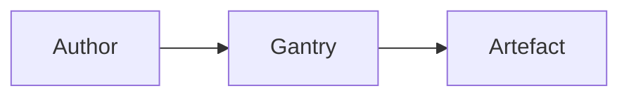

# User Guide

Gantry helps teams capture process information once and use it throughout a staged, gated process. This guide explains the engine's general concepts and uses the `design` definition as a worked example.

## Getting Started

To get Gantry running, clone the repository and run `npm install`, then start the server with `gantry serve`. See README.md for full setup instructions, including the prerequisites (Node.js, Pandoc and Git) and the corporate-proxy caveats.

Start at the **Workspaces** landing page. It shows the instances that Gantry knows about and is also where you create your first one.


Choose **+ New Workspace** to begin. By default this takes you straight into the **Local** flow — see **Local workspaces** below — with no remote-provider step at all. Turn on **Advanced mode** in **Settings** first if you need a Server-hosted Workspace instead; that adds a **Workspace location** choice, **Server-hosted** or **Local**, to the top of the wizard. With **Server-hosted** chosen, you pick one of three: **An existing workspace** already registered with this Gantry server, a **New remote workspace** on a Provider, or a **New server workspace** kept on the Gantry server's own disk or in a Blob container (see **Server workspaces** below). Registering a new remote workspace starts by picking its **Provider** — see **Choosing a Provider** below — which decides which location fields come next (Organization/Project/Repository for Azure DevOps, Owner/Repository for GitHub) and which work-item fields the final step offers. Provide the location, the Workspace Owner, and a Personal Access Token that proves you can actually reach that repository — Gantry checks it before registering anything, and the PAT you typed becomes that workspace's own PAT once registration succeeds.

Next choose a Definition, such as `design`, then provide the Instance's name, directory and initial Assignee. The directory defaults from the name, but you can change it. If the Workspace's Provider tracks work items, the final step can link the Instance to a parent work item (a GitHub workspace's version of this step has no work-item-type field, since GitHub issues are untyped). An Instance in a Local workspace or a server workspace skips that step entirely — neither has a Provider.

### Choosing a Provider

A **Provider** is the external suite a Server-hosted Workspace's repo and work items both come from — **Azure DevOps** (Repos + Boards) and **GitHub** (repos + Issues) today, with **GitLab** (Projects + Issues, `gitlab.com` or self-hosted CE/EE) built at full parity alongside them; **Atlassian** is shown as a known-but-not-yet-available fourth option. A workspace picks exactly one Provider when it is registered, and everything about that workspace — its repository location, its Personal Access Token, its stage branches, its sign-off Pull/Merge Requests, its linked work items — runs through that one Provider from then on. There is no way to mix, for example, a GitHub repository with Azure DevOps work items.

Each Server-hosted Workspace holds its own **Workspace PAT** — there is no global or default token any more. The first request against a workspace with no PAT stored prompts for one, naming that workspace and its Provider so you always know which token to paste; the PAT you submit is stored only for that workspace, in this browser, and is never sent to any other workspace or Provider. Rotating or clearing a token in **Workspace Settings** (see **Settings** below) never affects any other workspace.

The permissions a Personal Access Token needs depend on the Provider:

- **Azure DevOps** needs **Code (Read & write)**, **Work Items (Read & write)** and **Identity (Read)** scope.
- **GitHub** needs a fine-grained token with **Contents**, **Issues** and **Pull requests** permissions set to Read & write, plus **Metadata** set to Read-only. Without all four, GitHub reports the repository itself as **not found** rather than as a permissions error — the same 404 a genuinely misspelled owner or repository name would produce. If a repository you know exists is reported as missing, check the token's permissions before assuming the location is wrong.
- **GitLab** needs a Personal, Project or Group Access Token carrying the **api** scope (or, as a narrower alternative, **read_repository** and **write_repository** together with API access to Issues and Merge Requests). As on GitHub, GitLab returns the same "not found" response for a Project that genuinely doesn't exist and for a token whose scopes don't reach it — check the token's scopes before assuming a namespace or project is misspelled.

A GitHub workspace can also point at a **GitHub Enterprise Server** host instead of the public `github.com`, and a GitLab workspace at a self-hosted **GitLab CE/EE** instance instead of `gitlab.com` — enter the base URL when registering, if your server administrator has enabled that option (it is off by default, the same SSRF protection an Azure DevOps Server base URL already has).

GitLab's own repo-equivalent is called a **Project**, held under a **Namespace** — GitLab's full group/subgroup path, however many levels deep, treated as one opaque string rather than split per level. Gantry stores it internally as `location.repository`, the same key GitHub's own location uses (a GitLab Project is structurally the same thing as a GitHub repository), but the wizard and Settings screens still label the field "Project" to a GitLab user.

GitLab's Merge Requests read a little differently from GitHub's Pull Requests when it comes to sign-off — see **Sign-off** under **Approval workflow** below for exactly how Gantry maps GitLab's approval toggle and discussion threads onto Gantry's own review states.

At the time of writing, GitLab's content store, stage branches, sign-off, work items, identity and Library repos (see **Settings** below) are all built and working — but registering a *brand-new* GitLab workspace isn't offered by the "+ New Workspace" wizard's Provider picker yet, so today a GitLab-backed workspace is added by adopting a Project that already holds instance data, rather than through the wizard's own Register step used for Azure DevOps and GitHub. A GitLab Library repo, by contrast, can already be added directly from **Settings**.

### Choosing a definition version

Each definition has numbered versions — each `draft` or `published` — with its own `CHANGELOG.md`. The New Workspace wizard lists every version for the chosen definition, shows the definition's description and the selected version's changelog underneath, and marks draft versions explicitly. Creating an instance from a draft version requires a confirmation step. Published versions are the default and are labelled "latest".


After creation, open the Instance from the landing page. Its header identifies the definition and current Stage. The stage controls let you browse the process, while each module is where you author the information that the process needs. Use the User Guide link in the header whenever you need to return to these concepts.

## Workspaces & Instances

A **Workspace** is where an Instance's data lives — shared storage for one or more Instances — and comes in three kinds: a **remote** workspace, a repository on a **Provider** (Azure DevOps, GitHub or GitLab — see **Choosing a Provider** above); a **server** workspace, a folder on the Gantry server itself (see **Server workspaces** below); or a **local** workspace, a folder on your own machine picked in the browser (see **Local workspaces** below). Remote and server workspaces are both **Server-hosted**: the Gantry server holds them. For example, a team can keep several `design` initiatives in separate directories in one Server-hosted Workspace while retaining one repository history and access boundary.

An **Instance** is one run of a Definition against one initiative. It has its own module files, current Stage and Assignee. A `design` Instance might represent one system change; another `design` Instance can represent a different change in the same Workspace.

An Instance lives in a workspace, so it lives in one of three kinds of place:

- A **remote** workspace's Instance stores its `instance.yaml` and modules inside a repository on a **Provider**, under `gantry-workspace/<instance-slug>/`. Its changes are made on a Stage branch and reviewed through a Pull Request (a **Merge Request** on GitLab) on that Provider — Azure DevOps, GitHub or GitLab. The mechanics are the same either way; where they differ (how sign-off and review appear, and what a linked work item looks like) is called out in **Approval workflow** below.
- A **server** workspace's Instance stores its files in a folder on the Gantry server's own disk, or in an Azure Blob container its operator has set up, with no Provider at all — see **Server workspaces** below. It is useful for individual work, and for a team that wants one shared place on the server without a repository.
- A **local** workspace's Instance stores its files the same way, under `gantry-workspace/<instance-slug>/`, but inside a folder on your own machine rather than on the server — see **Local workspaces** below. The server never sees it.

"Server" and "local" are easy to mix up because both skip the Provider: a server workspace lives on the machine running Gantry and is shared by everyone who uses that server, while a local workspace lives on yours alone.

The kind changes how stage advancement and ticketing work, but not what a Module or Field means. All three kinds of Instance use the same Definition and the same authoring experience.

### Server workspaces

A **server workspace** is a folder, kept by the Gantry server, that holds one or more Instances. It is kept either on the server's own disk or in an Azure **Blob container** that the server's operator has set up for it. Nothing is registered with a Provider, so there is no repository to create, no Personal Access Token to paste and no work item to link.

To create one on the server's disk, turn on **Advanced mode** in **Settings**, choose **+ New Workspace**, keep **Server-hosted** selected and choose **New server workspace**. Give it a **Name** and choose where to keep it under **Store in**: **Server disk** (which stays behind Advanced mode, along with the Provider options) or, when your operator has set one up, **Blob container: <name>**. Click **Create workspace** and the wizard carries straight on to the Instance step inside it, where you pick a Definition and name the first Instance. The workspace then appears on the Workspaces landing page, and an empty one shows there too, with a **+ New Instance** button, so you can add Instances later without going back through the wizard. A workspace's name must be different from every other server workspace's.

**Store in a Blob container.** When your operator has declared a Blob container (see the README's **Blob containers** section), the wizard asks **Store in** even with Advanced mode off: **A folder on my computer (Local)**, the usual Local workspace, or **Blob container: <name>**. Pick the container, name the workspace and click **Create workspace**. The workspace is kept in a folder of that container rather than on the Gantry server, so it survives the server being redeployed, and every Gantry server that shares the container shows the same workspace with the same short references (`w2i3`). Several people on different servers can work in it. If two of you save the same Stage at the same moment, the second is asked to settle the Fields you both changed, as it is anywhere else (see **When someone else has saved the stage meanwhile** below). A container you can't reach right now is listed but can't be chosen, and says why.

A Save to a workspace in a Blob container is all-or-nothing: the Stage ends up with every Module you saved or none of them. If the server saving it stops part-way, the Stage goes back to how it was before that Save, as soon as the next person opens or saves it (it can take up to half a minute for the stopped server's hold on the Instance to run out, and a Save made in that time simply waits for it). Nothing you or a colleague saved earlier is touched.

**When a Blob container is unavailable.** If the container can't be reached (the credential was rejected, the container was deleted, or it didn't answer), the workspaces kept in it show on the Workspaces landing page as **Unavailable**, with the reason. Their Instances can't be opened or saved until the container is back, and nothing in them is lost. Your other workspaces carry on as normal, and the unavailable ones return on their own when the container does.

A server workspace has no branches, Pull Requests or approvals. Changes you save go straight into the Instance's files, with no review step, and nothing checks who may approve them. It advances like a Local workspace: once the current Stage's gate passes, use **Advance to next stage** to move it on yourself. See **Approval workflow** below.  Rendering a document downloads it to your browser; nothing is written back into the workspace.

The folder uses the same layout as a Local workspace, a `workspace.json` marker plus one subfolder per Instance, so an operator can copy a folder between the server and a Local workspace unchanged. The same holds for a Blob container: an operator copies a workspace folder in or out with Azure's tools, and a folder copied in is found as a new workspace with a new id and new short references. Gantry's own bundled **Examples** workspace is a server workspace too, and has no **+ New Instance** button because it ships with Gantry.

### Local workspaces

The **+ New Workspace** wizard's **Local** option is what creates a Local-workspace Instance. Choose **Local** as the Workspace location, then either **register** a new Local workspace in an empty folder or **pick** an existing one. This needs **Chrome or Edge** — it relies on a browser API (File System Access) that only those two support today; on another browser the wizard shows a clear message and keeps **Server-hosted** available instead.

By default the wizard skips the Workspace-location question altogether and takes you straight into this flow — you only see a choice between **Server-hosted** and **Local** once **Advanced mode** is turned on (see **Settings** below). With Advanced mode off, every Instance you create is a Local-workspace Instance.

**Registering** asks you to pick a new or empty folder, then name the workspace (an owner is optional) — Gantry writes a `workspace.json` marker at the folder's root so the folder is recognisable as a Gantry workspace later. **Picking** an existing one opens a folder that already has that marker and lists the Instances already inside it; a **Recent local workspaces** list remembers folders you've opened in this browser before, so you usually don't have to browse to them again. After a browser restart — or the first time in a different browser — the browser typically needs you to **Grant access** again before it will read or write the folder; that is a normal permission reset, not a sign anything is broken. The Workspaces landing page keeps its own **Local workspaces** panel for the same purpose, so you can often get straight back into one from there without opening the wizard at all.

Editing and saving modules works entirely offline — every change goes straight to the folder through the browser, with no server involved. Checking the gate and rendering an artefact both still need the Gantry server (rendering a `.docx` in particular happens there); if the server isn't reachable, those actions say so rather than failing silently. A rendered artefact is written straight into the folder's own `out/`, the same way a Workspace-backed Instance writes into its Provider's repository.

A Local-workspace Instance has no ticketing at all — no linked work item, no Review or Sign-off, no Stage branch or Pull Request. It advances the same way a server workspace's Instance does: once the current Stage's gate passes, use **Advance to next stage** to move it on yourself. See **Approval workflow** below.

### Numeric references

Every Workspace, Instance and Stage also carries a short numeric reference. Workspaces are numbered from 1 across the server; an Instance is numbered from 1 within its Workspace; a Stage's number is its position in the Instance's Definition, so Stage 1 is always the first Stage. Gantry shows these references on the Workspaces page and in the Instance header, and uses them as the canonical short form in links — for example `/instance/w2i1` opens the first Instance in Workspace 2, and `/instance/w2i1s3` opens that Instance's third Stage. A Workspace-only reference resolves to that Workspace's first Instance, and an Instance-only reference resolves to its first Stage. Older links that use an Instance's directory name still work.

### Dashboard PR status badge

On the Workspaces page, a Workspace-backed instance that has an open sign-off Pull Request shows a **PR OPEN** badge on its card. The badge reflects the persisted PR status — once the PR is completed or abandoned it disappears. Local instances never show a PR badge. Local-workspace instances are shown separately, in the landing page's own **Local workspaces** panel (see **Local workspaces** above) rather than as dashboard cards, so the badge doesn't apply to them either.

### Archive and restore

Workspaces and instances can be archived — hidden from the dashboard's default listing — and restored later, with no data deleted. Archiving is done from **Workspace Settings** or **Instance Settings** respectively. An archived instance still opens read-only at its direct `/instance/<slug>` link, with a banner explaining it is archived and linking to Instance Settings to restore it. On the dashboard, archived items appear in the collapsible **Archived instances** and **Archived workspaces** panels at the bottom of the page. A workspace that still has active instances cannot be archived until those are archived first. A definition can also be archived and restored from the Definitions page's switcher menu, filtered by a "Show archived" checkbox.

### Instance settings

Some choices apply to a whole Instance rather than to one Stage's content. Gantry calls them **Instance settings**, and the Instance's Definition decides which ones there are, what you can choose from and what is chosen if you don't. There are two choices, **Size** (see **Target size and word targets** below) and **Classification** (see **Classification** below), and one upload, the instance's own **Logo** (see **Your instance's own logo** below).

You meet them in three places, always under an **Instance settings** heading:

- **Creating an Instance.** The "+ New Workspace" wizard shows them on the Instance step with the Definition's defaults already selected, so you only change what differs for your initiative. An AI agent can set them in MCP `create_instance`.
- **Instance Settings.** Change any of them later and click **Save**. For a Workspace-backed Instance the change is saved on the current Stage branch and reviewed with the rest of that stage, on every Provider; a Local-workspace Instance saves it straight into its folder. MCP `get_instance` returns each one.
- **The Definitions page.** A Definition that has Instance settings shows an **Instance settings** group at the end of the Outline (and a column at the end of the Map). Select it to see, for each setting, why the Definition offers it, its choices and its default. On a draft you edit them there (see **Editing a Definition's Instance settings** below); a published version shows them read-only.

A Definition with no Instance settings shows none of this anywhere: no heading in the wizard, nothing extra in Instance Settings and no section on the Definitions page. The one exception is a draft on the Definitions page, which always lists **Classification** so its author can add markings.

#### Editing a Definition's Instance settings

On a draft, the Definitions page's **Instance settings** section edits each setting the same way: its choices, and a default. A Local Workspace's Definition editor has the same section, under **Instance settings**.

- **Size.** Its three choices, Small, Medium and Large, are shown but can't be changed, because every field's word targets are written against them. Pick its **Default** instead. That is the size an instance works to until its author chooses one, and the size the wizard pre-selects. A Definition that doesn't set a default works to Medium, as before. In `definition.yaml` the default is written beside the classification markings, as `size: { default: small }` under `instance-settings:`.
- **Classification.** Type a marking and click **+ Add marking** (or **+ Declare markings** for the first one), rename one by editing it, move one with ↑ and ↓, and take one out with **Remove**. The order here is the order the wizard and Instance Settings offer them in. Pick an optional **Default**, or leave it as **None**. If you rename the default marking the default follows it, and if you remove it there is no default. **Stop declaring Classification** takes the setting out of the Definition, so its instances have no Classification.

Click **Save** to keep your changes and **Publish** to publish them with the rest of the draft. A default that isn't one of the choices, a blank or repeated marking, or an empty marking list is shown as a problem at the top of the section and in the toolbar's problem count, and Save and Publish refuse it until it's fixed. In a Local Workspace's Definition editor, Save keeps a draft with problems, as it does for any other problem, and Publish refuses it. An instance already created keeps whatever it chose. Only instances that never chose a value pick up a new default. Assignee and Required reviewer aren't Instance settings. They are about people rather than the documents, and they keep their own places in Instance Settings.

#### Classification

A Definition can give its documents a **Classification**, a marking such as `IN-CONFIDENCE` that tells every reader how to handle them. It applies to every document from the instance, and is printed on each one's cover and in its page header (see [Cover page and table of contents](#cover-page-and-table-of-contents)).

Choose it under **Instance settings** when you create the instance, and change it later in **Instance Settings**. It is optional. Choose **None**, or leave it, and no marking is printed. If the Definition has a default marking, it is already selected, and an instance that never chooses one uses it. You can only choose one of the Definition's own markings: anything else is refused, in the wizard, in Instance Settings and over MCP. A changed marking shows in the next render.

A Definition author lists the markings in `definition.yaml`, with an optional default:

```yaml
instance-settings:
  classification:
    choices: [UNCLASSIFIED, IN-CONFIDENCE, SENSITIVE, RESTRICTED]
    default: IN-CONFIDENCE
```

Each marking is printed exactly as written. The list must have at least one marking, with none blank or repeated, and a default must be one of them. Anything else is a problem that `gantry validate` and a Local Workspace report, the Definitions page shows under its Instance settings and Save and Publish refuse. A Definition an instance already uses keeps loading, but offers no Classification until it is fixed. On a draft, the Definitions page edits the markings and the default (see **Editing a Definition's Instance settings** above).

#### Your instance's own logo

Every rendered document shows a logo in its page header: the Definition's logo (see **Your logo** under *Word styles and your house style* below), which for design version 3 is the Contoso logo until someone replaces it. An instance can have **its own logo** instead, so one Gantry can produce documents for different organisations or clients from the same Definition. It sits under the same **Instance settings** heading:

- **In the wizard**, the Instance step offers an optional **Logo** upload. Choose a PNG or JPEG and a preview shows what you picked; leave it empty to use the Definition's logo. The note beside it is a reminder that this logo is for this instance only: to change the logo for every new instance, change the Definition's logo on the **Definitions page** (the note links there).
- **In Instance Settings**, the **Logo** control shows the logo this instance's documents use and whether it is the instance's own or the Definition's. **Replace** uploads a new one, **Download** saves the current one and **Remove** goes back to the Definition's. Each saves straight away. For a Workspace-backed Instance the change is saved on the current Stage branch, on every Provider, and reviewed with the rest of that stage; a Local-workspace Instance saves it straight into its folder. MCP `get_instance` says whether the instance has its own logo (it can't upload one).

The logo is stored with the instance, in its `assets/` folder as `instance-logo.png` (or `.jpeg`), and `instance.yaml` names it as `logo:`. So a render of a given commit always shows the same logo, wherever and however it is rendered. At render time Gantry gives Word's converter a copy of the artefact's reference document with the header logo swapped, fitted at its own proportions in the space the Definition's logo takes up; the Definition's own reference documents never change. Anything that isn't a PNG or JPEG is refused. A Definition whose reference documents have no picture in their page header has no logo to replace, so it offers no **Logo** in the wizard or in Instance Settings.

### Source documents

A **Source document** is a file you add to an Instance as the evidence its content is drawn from: a client brief, requirements, meeting notes, an existing architecture, a spreadsheet, a screenshot. It is kept with the Instance and cited by name wherever a figure or decision came from it. You can add them before you connect any AI Provider. They are not images: the images you put into a field (see **Adding images** below) are things the content *displays*, a Source document is material it is *drawn from*, and the two are stored and managed separately. Removing one never affects the other.

In the Instance editor, under the toolbar, open **Source documents** to see the list and add to it. This is available on **Local** workspaces, on **Server-hosted** workspaces (whether they live on the Gantry server's disk or in a Blob container) and on **Azure DevOps** and **GitHub** workspaces. GitLab and Atlassian workspaces will have it when saving their modules is supported.

- **Upload documents.** Choose one or more files. Gantry takes Word (`.docx`), PowerPoint (`.pptx`), spreadsheets (`.xlsx`, `.csv`, `.tsv`), PDFs, Markdown and text files, and images (`.png`, `.jpg`, `.gif`, `.webp`). The older `.doc`, `.ppt` and `.xls` formats aren't read: save them in the newer format first. An upload is always a new document with its own place in the list, even if it is named like one already there, so "Client brief v3" sits alongside "Client brief v2" until someone removes the older one.
- **A document can be at most 25 MB.** A bigger file is refused with a message naming the limit, both in the browser and again on the server. Once an Instance's documents add up to more than about 100 MB, the panel shows a warning (it is a warning, not a refusal): remove the ones you no longer need.
- **Gantry reads the text when you add a document.** The reading happens in your browser, using files that come with Gantry, so nothing is fetched from the internet and the document never leaves your machine to be read. Word and PowerPoint (speaker notes included) become Markdown, a spreadsheet becomes one table per sheet (at most 1,000 rows each), and a PDF becomes its text, page by page. The text is stored next to the original, in the Instance's `sources/.text/` folder. A picture, and a scanned PDF with no text in it, get no text; the list says **NO TEXT** for them. **TEXT READ** means there is text.
- **Rename** changes only the title shown in the list. The document keeps the id it was given when it was added, and the name of its stored file never changes, so a citation that names it stays valid. **Download** gives you the original file back.
- **Extract text again** reads the original once more and replaces the stored text. Use it after Gantry has been upgraded or if a read failed. If the new read fails, the text already kept is left alone.
- **Remove** deletes the file and its text. The document stays in the list under **Removed**, with who removed it and when, so anything that mentions it still shows its title.
- **Copy citation** puts a ready-made citation of the document on your clipboard (if the browser won't let Gantry use the clipboard, the message shows it for you to copy). See **Citing a Source document** below.
- **Use as image** copies a picture (a PNG or JPEG) into the Instance's images as a new image. See **Use as image** below.

Behind the panel, each Instance keeps a `sources/` folder next to `modules/` and `assets/`, with a `sources/manifest.yaml` that records for every document its id (made from the filename, unique, and fixed for good), stored filename, title, who added it and when, its size, its text file if it has one, and who removed it and when. Filenames are cleaned to be safe as a path, with `-2` added if the name is taken. In a Local workspace this is all inside the folder you picked, so it is yours to back up like the rest; on a Server-hosted workspace it is in the Instance's folder on the server. A Local workspace sends no document and no extracted text to the Gantry server, not even when you render a document; the one thing a render may send is the title, filename and dates of a document the content cites (see **The Sources appendix** below).

#### Source documents on Azure DevOps and GitHub workspaces

On an Azure DevOps or GitHub workspace the documents are committed to the repository, with these differences from the other kinds:

- **Every change is one commit, made straight away.** Adding a document (the original, its extracted text and the manifest), renaming one, **Extract text again** and **Remove** each make exactly one commit, as soon as you do them. They are not held back for the stage **Save**, and **Save** never includes them. You need write access to the repository, as for any save; without it the panel is read-only.
- **The commit goes on the current Stage's branch**, as images (Assets) do, and the branch is started if it hasn't begun. A refused upload (too big, empty, the wrong type) makes no commit and starts no branch. A later Stage's branch is cut from the earlier Stage's branch, so it carries the documents added on the earlier Stage; they reach `main` when that Stage's Pull Request is merged.
- **Later reads use what was committed.** The list, the download and the stored text come from the branch, so the text Gantry read when you added a document is what the AI will use; it is not read out of the original again.
- **Two people at once are both kept.** If a colleague commits to the same branch between your reading the list and your commit landing, Gantry applies your change again on top of theirs rather than overwriting it.
- **The size limits are the same** (25 MB a document, a warning past about 100 MB in all). The Provider's own limit for a file is 100 MB, so the 25 MB limit is Gantry's. A 25 MB upload is sent as one request, so a slow connection to your Provider can make it take a while.

#### Citing a Source document

Wherever a figure or decision in a field came from a Source document, cite it. A citation is an ordinary Markdown link whose address is `source:` and the document's id (the id is in `sources/manifest.yaml`, and **Copy citation** writes the whole link for you):

```
Median time to payment is 12.4 working days [Client brief, p. 4](source:client-brief).
```

The words in the square brackets are yours, so you can point at a page or a section. Only a link counts as a citation: a picture (``) doesn't, and neither does anything inside a code block.

- **In the editor,** a citation of a document is a link. Click it (in Visual or Split view) and the document opens: a PDF, a picture or a text file in a new tab, a Word, PowerPoint or spreadsheet file, which a browser can't show, is saved to your machine. A citation of a document that has since been **removed** keeps its words, struck back and marked "(removed)", and doesn't link anywhere because the file is gone. A citation of an id the Instance has no document for is marked "(not found)". On workspaces that don't keep Source documents yet (GitLab and Atlassian), a citation is left as the words you wrote.
- **In Word,** the document prints a citation as plain text in brackets, `(Client brief, p. 4)`, with no hyperlink, because the people who read a Word document usually have no access to the repository. If the link's words are empty, Word prints the document's title. The exported `.md` keeps the link as you wrote it.
- **Renaming a document** changes the title in the list but not the words already written in a citation: they are yours.

#### The Sources appendix

A Definition can opt an Artefact in to ending with a list of the Source documents it cites. On the Definitions page, tick **Sources appendix** on the Artefact (it is `source-appendix: true` in `definition.yaml`; on a published version it is shown read-only). The rendered document, in Word and in the exported `.md`, then ends with a **Sources** section: a table of **only the documents that Artefact cites**, in the order they are first cited, each with its title, its original filename and the date it was added. A removed document is still listed, marked "(removed)". Documents the Instance holds but the Artefact never cites are not listed, and an Artefact that cites nothing has no Sources section at all. With the setting off, which is the default (no bundled Definition turns it on), there is no list. A Definition author can only give it `true` or `false`: any other value is reported by `gantry validate` and when you save or publish the Definition, and the list is left out until it is fixed.

On a Local workspace, a render sends the Gantry server only the title, filename and dates of the documents the content cites, so the server can print them. It never sends a document or its text, and sends nothing at all when the content cites no document.

#### Use as image

**Use as image** (a PNG or JPEG in the list) copies the picture into the Instance's images, so a field can show it as a figure. The panel then tells you how to refer to it: `` on a Server-hosted workspace, or `` on a Local, Azure DevOps or GitHub workspace, where the copy's file name is made safe to type (no spaces) and `-2` is added if an image of that name exists. On an Azure DevOps or GitHub workspace the copy is one commit on the current Stage's branch, made straight away like the other changes to Source documents. Use the Image dialog's **Choose existing** tab to insert it. The image is a new one of its own: it is not linked back to the Source document, so removing, renaming or replacing either never changes the other. Pictures of other types (`.gif`, `.webp`) can stay as evidence but can't be used as images.

### Definition versions and the Definitions page

Definitions are versioned. The first version of a definition is published and is the default for new instances; newer versions start as `draft`. Each version has its own `definition.yaml`, module specs, templates and `CHANGELOG.md`. Only the latest published version is used when no explicit version is requested; draft versions are opt-in via the wizard's version picker.

The **Definitions** page — linked from the Workspaces page header — is a first-class editor for a definition's stages, artefacts, modules and fields. It switches between two navigation views over one focus pane: **Outline** (the default) lists Stages, Artefacts and Modules as three flat groups; **Map** lays the pipeline out spatially, stages as columns of module chips with each gate's artefacts hanging underneath. The choice is remembered per browser. In Map view, **Expand map** gives the Map the whole workbench so a large definition reads without scrolling: the focus pane and Library panel are hidden (an unsaved edit in them is kept), and picking something in the Map, or adding a new stage, artefact or module, brings them back; a copy from another definition lands in the expanded Map. That choice is remembered too. A docked **Library** panel on the right lists another definition's elements, which can be copied into a draft.


Click any stage, artefact or module to focus it in the centre pane. A module's fields are compact rows — click one to expand it, edit it, and collapse it again; only one field is expanded at a time. On a published version everything is read-only, with a **View template source** button to inspect each artefact's `.md.tmpl`; on a `draft` version every field is directly editable, and every element (Stage/Artefact/Module/Field — see CONTEXT.md's **Element**) can be reordered, or moved between a stage, an artefact and a module, either by dragging its handle or with an equivalent button (Move ↑/↓, "+ Add module…", "+ Add requirement…", "Move to module…"). A markdown or list field on a draft has three **Word targets** boxes, one per size, for how many words authors should aim for (see **Target size and word targets** below); leave all three blank for no target. On a draft, each module a stage lists has a **read-only** checkbox: tick it when the stage mounts that module only so its documents and gate can use it, and the module is edited at an earlier stage. The instance editor then shows it read-only at this stage, naming the earlier stage it is edited at (see *Modules & Fields* below). The toolbar shows a live problems count — sharing the same validation rules the server runs on Save — that jumps straight to the affected element when clicked. An artefact's **Gate** is picked from the stages' own gates (a new artefact starts on the first one, and a new stage starts with a placeholder gate id such as `new-stage-3-gate` to rename), and an artefact gate or a field's "required at gate(s)" that names no stage's gate is flagged as a problem and refused at Save and Publish; a definition an existing instance already uses keeps loading even if it has one. Template editing opens as its own focus-pane view on a full markdown editor. Other actions: creating a **New draft version**, starting a **New definition** (Blank or cloned from the current one), **archiving / restoring** definitions, and **publishing** a draft (which validates it and flips its status to `published`). Save is a single action for everything changed since the last save, with a Save/Discard/Cancel prompt if you try to navigate away with unsaved changes.

#### Interview instructions

A Definition can tell the AI how to interview the people who fill it in. These **Interview instructions** are free text you write at up to three levels, and they stack from broad to narrow: the Definition's, then a Stage's, then a Module's. Use them for the habits of your organisation, such as what a reviewer always asks first, what to probe, the tone to use and how to spell things. A Field has none of its own, because its **guidance** already does that job.

Interview instructions only ever add. They never replace Gantry's own interview rules, so a Gate still means the same thing in every Definition and every fact in a document is still marked with where it came from.

On a draft, the Definitions page shows an **Interview instructions** box on each Stage and each Module, and an **Interview instructions** entry under **Interview** at the end of the Outline (a column at the end of the Map) for the Definition's own. A Local Workspace's Definition editor has the same boxes. Leave a box empty for none. They are saved and published with the rest of the draft, so a published version's Interview instructions never change: the instances on that version are interviewed by exactly what it said when it was published. A published version shows them read-only, and only where there are some. Starting a new draft, copying a Stage or a Module from another Definition, cloning a Definition and promoting one to a library repo all carry them along.

In `definition.yaml` the key is `interview:` on the Definition and on each Stage, and in a Module's YAML file on the Module. It must be text. Anything else (a number, a list) is a problem that `gantry validate` and a Local Workspace report, the Definitions page marks on a draft, and Save and Publish refuse. A Definition that already has one keeps loading, and the AI reads it as no instructions until it is fixed.

**Gantry's interview rules.** Beside the Interview instructions on the Definitions page (under **Interview**, and in a Local Workspace's Definition editor) a read-only **Gantry's interview rules** view shows what your instructions are added to, so you can write them without repeating or contradicting it. It lists Gantry's own fixed rules (draft first; where every fact comes from; saved content changes only through a card; select Fields offer only the Definition's options; when a Field is done and a Stage is ready; and **Finish with your recommendations**), the two interviewing skills the AI follows after them with their versions, and how the skills' terms map onto Gantry's. The skills are Matt Pocock's `grilling` and `domain-modeling` (MIT licence), bundled unchanged at a pinned release; a Gantry release moves to a newer one on purpose and says so in the CHANGELOG, so an interview behaves the same until Gantry is upgraded.

The AI is given all of this as one **brief** for the Stage: Gantry's rules first, then the skills, then your Interview instructions (the Definition's, the Stage's, the Module's), the Stage's purpose, Gate and the Artefact aimed for, each Field's guidance, word budget, whether the Gate requires it, type and options, what is saved so far, the Glossary's preferred terms, the Source documents and the decisions log. Where two disagree, the earlier wins. The Source documents are included whole when they come to no more than about half the model's context window, and as a catalogue (title, outline and size) when they are larger. The example Instance is never part of it, so there is nothing for the AI to copy a fact from.

### Example instances

The worked example throughout this guide remains the `design` definition, illustrated by the bundled **Examples** workspace: `kiwi-cover-mutual`, a fictitious insurer's design with content for every stage, and `gantry`, Gantry's own hosting proposal written as a complete Full SOAP. Both run on `design` version 3, a draft where the next round of design changes is being made, so their documents can differ from version 2's. New `design` instances still start on version 2, the latest published version, unless you pick version 3 in the wizard. The "Populate example text" button on a version 3 stage fills from `kiwi-cover-mutual`.

The bundled `platform-engineer` example is a worked hire on the `recruitment-onboarding` definition, and it runs on version 4. Version 4 is published and is the default for new `recruitment-onboarding` instances. It is version 3 with the **Glossary** and **Open questions** standard modules mounted on every stage, and with its own Interview instructions, so the AI interviews about HR personal data with care. Open questions are now a table (question, who resolves, by when, status) instead of a list, and *Process gaps* has moved to a Module of its own. The Hire Record ends with a Glossary. Versions 1 to 3 are unchanged, so an instance on one of them keeps rendering exactly as it did. Moving an instance from version 3 to version 4 is a per-instance step: convert its open questions to the table, move its process gaps into the new Module, and add a Glossary.

## Stages & Gates

A **Stage** is an ordered phase of a Definition. It makes the relevant modules available for authoring and ends at one **Gate**.

A **Gate** is the decision point at the end of a Stage. A gate checks the artefact requirements declared by the Definition. Passing a gate permits the next action; it does not advance an Instance by itself. Local Instances — including Local-workspace Instances (see **Local workspaces** above) — advance explicitly, while Workspace-backed Instances advance when their approved Pull Request is merged.

For a Workspace-backed Instance the gate is checked as part of the Work Item Detail card's **Check status** action. An Instance in a server workspace or a Local workspace has no linked work item at all, so its gate is checked as part of **Advance to next stage** itself, with no separate check step. See *Approval workflow* for the full sequence.

A definition lists its stages, and the gate each one ends at, in its `definition.yaml`. The `design` definition, for instance, runs from initial shaping through high-level and detailed design to operational handover, each stage ending at its own gate.

## Modules & Fields

A **Module** is a self-contained area of process content and the source of truth for that content. A Module is made up of **Fields**, which are the individual prompts shown in the editor. A definition combines those fields into documents later, rather than asking authors to maintain separate copies in each document.

For example, one module might capture an initiative's context as separate fields — its driver, the opportunity, what is out of scope — and another might capture security considerations. A field is authored once and reused wherever an artefact needs it, never copied between documents. Each field can carry guidance and can be required only at the gate where it matters.

You normally work through the editor's Module cards and save as you go with the **Save** button at the top left of the toolbar. The available Modules depend on the current Stage, while an artefact's own requirements decide whether that artefact is complete. This lets one set of content support multiple outputs without duplicating authoring work.

Some Stages show a Module **read-only**: it was filled in at an earlier Stage, and this Stage only needs it so its documents and gate can use it. A read-only Module shows its saved content, with no editing controls and no required markers, and a note saying which earlier Stage it is edited at. To change it, open that Stage — Gantry refuses a save of the Module at any Stage that shows it read-only, including through the MCP server. A Definition author decides which Modules a Stage shows read-only (see **Definition versions and the Definitions page** above); most Definitions, including `design`, show none.

### Field types

Most fields are free text (Markdown) or a bulleted list — you type the answer. Three more field types ask for a narrower kind of answer instead:

- A **select** field shows a dropdown of the answers the Definition author has decided are valid — a status, an outcome, a classification. Pick one from the list; there's no way to type something else. It opens with nothing chosen unless the Definition author set a **default** answer, in which case that option is pre-selected the first time you open the module — it still only counts as answered once you save, so an instance nobody has opened can't pass its gate on a default nobody actually chose. A select can also allow **several** answers at once, shown as tick-boxes instead of a dropdown — used where a question genuinely has more than one right answer, such as which pre-employment checks applied to a role.

  If a field already holds a value that isn't on the current option list — someone typed it before the field became a select, or the Definition's options changed since — Gantry keeps it rather than silently dropping it. It's shown as an extra, clearly marked entry so you can see it, and **check** (see *Stages & Gates* above) reports a warning so it doesn't go unnoticed. The gate still passes; it's a warning, not a block.

- A **text** field is a single line — a name, a short label — where a full Markdown field would be more than the answer needs.
- A **date** field is a calendar date, entered with your browser's own date picker rather than typed, so there's no ambiguity about the format. It's stored as `YYYY-MM-DD`; a rendered document that needs to read naturally ("3 November 2026") formats it for display without changing what's stored.

Which fields are which type is set by the Definition, not by you — an author can't turn a select into free text or the reverse from the editor. If a field's permitted answers look wrong or too narrow, that's a Definition change, made by whoever maintains it.

### Standard modules

Some Modules are not written by the Definition's author: **Gantry provides them**. A **standard module** has an id, a set of Fields and a version that Gantry owns, so it looks and behaves the same in every Definition that uses it. There are three:

- **Glossary** has one Field, *Terms and definitions*, a table of **Preferred term | Definition | Avoid**.
- **Open questions** has one Field, *Open questions*, a table of **Question | Who resolves | By when | Status**.
- **Key decisions** has one Field, *Key decisions*, a numbered list of the significant decisions (see **Key decisions** below).

You use one like any other Module: it appears as a card on the Stages that mount it, you fill it in and save it, you mark it `agreed`, and any Artefact that needs it draws on it. What differs is on the Definitions page. A standard module is listed under **Standard modules** in the Outline (and carries a **Gantry-provided** label wherever it appears), and its Fields are shown but can't be edited.

A Definition author, on a draft:

- **Mounts** one with **+ Mount…** under Standard modules, or straight from a Stage's **+ Add module…** list, where each unmounted one is offered as "(Gantry-provided, not mounted yet)". A new mount takes the newest version Gantry has. A Stage that lists it shows it; an Artefact can require it like any Module.
- **Pins the version.** A Definition names the version it mounts, and Gantry will never change that version. When a later Gantry release adds a version 2, a published Definition on version 1 still renders exactly as it did, and its author moves to version 2 only by choosing it on a new draft.
- **Adds guidance and Interview instructions.** *Added guidance* is shown after Gantry's own guidance on every Field of the module; *Interview instructions* steer the AI interview and only ever add to Gantry's rules.
- **Cannot change the shape.** Save and Publish refuse a mount that sets anything besides its version, guidance and interview instructions (Key decisions also takes a prefix and a style, below), that names a version Gantry doesn't provide, or that sits beside a Module of the Definition's own with the same id. The problem is shown against the standard module and counted in the toolbar. In a Local Workspace's Definition editor the same mount is under **Standard modules**, and a Stage lists it by id in its comma-separated Modules.

In `definition.yaml` a mount is a top-level `standard-modules:` list, written as `- id: glossary` with a `version: 1`, and optionally `guidance:` and `interview:`; a Stage then lists the id in its `modules:` like any other. There is no `modules/glossary.yaml` file, because the Module's shape is Gantry's.

#### Key decisions

The **Key decisions** module holds only the decisions that matter: hard to reverse, surprising without their context, and the result of a real trade-off. Routine choices belong elsewhere.

**Numbers.** Each decision gets a number when you add it, such as **AD01**, and keeps it. Moving a decision up or down, or removing one, never renumbers the others, so a document or another decision that refers to "AD03" still means the same decision. A number that has been used is not given out again, even after its decision is removed. The prefix (the letters before the number) is the Definition's. If a later version of the Definition changes it, your decisions keep their numbers and take the new prefix the next time they are saved or printed.

**Editing.** The Stage editor shows one card per decision, with **Add decision**, **↑**, **↓** and **Remove**. The card's fields depend on the Definition's decision style:

- **Default.** Title, *Context*, *Decision*, *Why*, *Considered options* and *Consequences*.
- **WH(Y)** (from [cgbarlow/adr](https://github.com/cgbarlow/adr)). Title, then the six parts of one sentence: *In the context of*, *Facing*, *We decided for*, *And neglected*, *To achieve* and *Accepting that*. Each decision can also have **links** to other Key decisions, each *Depends on*, *Supersedes* or *Relates to*, chosen from a list of the other decisions. WH(Y)'s governance details and Definition of Done are not part of Gantry's version.

**In the Word document.** A default-style decision prints with its labelled parts. A WH(Y) decision prints as its one sentence — "In the context of …, facing …, we decided for … and neglected …, to achieve …, accepting that …." — with a line under it for each kind of link, such as "Depends on AD01, AD04." The sentence leaves out any part you left empty.

**Checks.** *Check* warns, without stopping a Gate, about two decisions with the same number, a link to a decision that is not in the list, a decision linked to itself, a loop in *Depends on* or *Supersedes*, and links in a Definition that uses the default style (which has none). A decision you removed that others still link to is flagged the same way, and the link is left for you to fix.

**Mounting it.** On a draft, **+ Mount…** offers Key decisions like the other standard modules, and its page has **Prefix** (1 to 6 capital letters, "KD" if you don't choose) and **Decision style** (*Default* or *WH(Y)*). In a Local Workspace's Definition editor they are under **Standard modules**. In `definition.yaml`:

```yaml
standard-modules:
  - id: key-decisions
    version: 1
    prefix: AD        # 1 to 6 capital letters
    style: why        # "default" or "why" (WH(Y))
```

Save, Publish and `gantry validate` refuse a prefix that isn't 1 to 6 capital letters and a style that isn't `default` or `why`. Prefix and style belong to Key decisions only; the other standard modules still refuse them. In the instance file the Field is ordinary text, one bold line per decision (`**AD01: Use PostgreSQL**`) followed by its labelled parts, so it reads well in a pull request; an AI agent writing over MCP can write the same text.

### Target size and word targets

Some Definitions tell you roughly how much to write in each field. If yours does, every instance has a **Size**: **Small**, **Medium** or **Large**. Size is one of the instance's **Instance settings** (see **Instance settings** above). Medium is about half of Large, and Small about a fifth. The default is the Definition's, and Medium for a Definition that doesn't set one; an instance that never chooses a size works to it. Pick the size under **Instance settings** when you create the instance in the "+ New Workspace" wizard, and change it later under the same heading in **Instance Settings**. Choose it for the solution's risk and audience: a document reviewers need to read closely in one sitting wants a smaller size than a full reference.

Under each field with a word target, the editor shows the target for the instance's size and a live word count, for example `Target ~100 words (Medium) · 87 words`. Once the count goes over the target it turns amber. Diagrams in Mermaid code blocks, images and Markdown symbols aren't counted as words.

The target is advice, not a limit. You can always save a field that's over its target, it never stops a gate passing, and a document renders exactly what you wrote, at any size. Gantry never shortens your content for you. Changing the size changes the targets you see, not anything already written.

An AI agent writing through the MCP server sees the same targets: `get_instance` gives each field's target for the instance's size, and when `update_instance_modules` saves a field that's over its target, the save still succeeds and its response carries a note such as `nfrs.performance: 420 words, Medium target ~150` so the agent can tighten it.

The `design` definition's v3 draft sets word targets on every field that appears in a document. Its Large targets match the bundled examples' original level of detail, and the examples are now written to Medium, so **Populate example text** shows the default amount. A Medium Solution Architecture Document comes to roughly half the length of a Large one.

A Definition without word targets shows none of this: no Size in the wizard or Instance Settings, no Instance settings section on the Definitions page and no targets in the editor. For a Definition with word targets, the Definitions page's Instance settings section shows Size as offered because a number of fields declare word targets, with its three choices and its default (Medium, unless the Definition sets another; see **Editing a Definition's Instance settings** above). A Definition author sets a field's targets on the Definitions page (see *Definition versions and the Definitions page* above) or in the module's YAML as `target-words: { small: 40, medium: 100, large: 200 }`. Each must be a whole number above zero, all three sizes are needed, and only Markdown and list fields can have them. Anything else is a problem that `gantry validate` and a Local Workspace report, the Definitions page marks and Save and Publish refuse; a Definition an instance already uses keeps loading even if it has one.

### The editor toolbar

Above the modules sits a view-mode bar. It starts with the **Save** button (a disk icon, see **Saving your work** below), then a **Mode ▾** dropdown switches every Markdown field between three views (see **Visual, Split and Markdown views** below); `Ctrl+Shift+V` cycles through them. Next to it is the **Artefact** selector, which appears when the current stage has artefacts with different field requirements; it filters the visible fields to only those the selected artefact needs, preserving drafts in hidden fields when you switch artefacts. An artefact marked "doesn't count toward the gate" is one you still write, and it is still rendered and sent for sign-off, but completing it alone won't pass the gate (see **Artefacts that don't count toward the gate** below). On the right are **Clear all fields** and **Render**, and a **Review / Sign-off** shortcut that scrolls to the Work Item Detail card.


Each Markdown field has its own formatting toolbar (visible while the field has focus) with **Headings ▾**, bold, italic, inline code, link, lists, blockquote, image, table, **Undo** / **Redo** and full-screen controls. The **Table** button opens a size grid: hover to choose rows × columns, click to insert.

### Saving your work

The **Save** button saves every module on the stage that has changed, in one go; `Ctrl+S` (`⌘S` on a Mac) does the same. It is blue only while something differs from what is saved, and greyed out otherwise — undo back to the saved text and it greys out again. It briefly shows **Saving…** and **Saved**, or says what went wrong if a save fails, in which case it stays blue. After a save, each module card shows whether that module is complete or what is still outstanding.

If you have unsaved changes and switch stage, switch instance, follow a link in the header or press the browser's Back button, Gantry asks whether to **Save**, **Discard** or **Cancel**. **Render**, **Advance to next stage** and **Request Sign-off** ask the same question first, so they always work from your latest content. Closing or refreshing the tab shows the browser's own warning. Changing the view mode or the Artefact selector doesn't count as leaving.

On a Workspace-backed instance, on Azure DevOps, GitHub or GitLab alike, one Save is one commit on the stage's branch containing only the modules you changed. Saving doesn't re-render documents: they are rendered and committed only when you click **Render**, so render before requesting sign-off if the Pull Request should include up-to-date documents.

#### When someone else has saved the stage meanwhile

Two people can have the same stage open, and a Save never silently overwrites the other's work. When you open a stage Gantry notes what it contains (its *version*), and before every Save it checks again. If nothing has changed, your Save goes straight through. If someone else saved in the meantime, Gantry compares, Field by Field, what you started from, what is saved now and what you have:

- **Only the other save changed a Field:** theirs is taken, and it appears in your editor.
- **Only you changed a Field:** yours is kept.
- **You both changed the same Field:** a dialog titled *Someone saved changes to this stage while you were editing* lists each such Field with the saved version beside yours. For each one choose **Keep theirs**, **Keep mine**, or **Edit instead** to write your own wording. **Save** stays greyed out until every Field has an answer, and **Cancel** saves nothing and leaves your edits in the editor.

So two people editing different Fields (even in the same module) both save and neither loses anything. After a merge the Save button reads *Saved — merged with changes saved meanwhile*. Uploading an image or other file in the meantime never causes this: only a change to a Field's content does. This works the same on a local workspace, a server workspace, GitHub and Azure DevOps.

An AI agent saving through the MCP server gets the same protection. `get_instance` returns the stage's `stageVersion`, and the agent hands it back to `update_instance_modules`. If you (or anyone) saved the stage after the agent read it, nothing is saved: the agent is told which of the Fields in its call are saved differently now, and is expected to read the stage again and settle the difference with you before saving. An agent that sends no version, as agents written before this check do, still saves as it always did, but the response lists every Field the save overwrote, so you can see what it replaced. Writing the version is strongly preferred, and it will be required once an agent runs a whole interview session.

### Visual, Split and Markdown views

- **Visual** (the default) shows each field the way it will read — headings, bold and italic, code, quotes, links, images and Mermaid diagrams — and you edit it in place. The markdown markers under your caret stay visible on the line you are editing, so you can always see and correct them.
- **Split** puts the raw Markdown beside the Visual view of the same field. An edit in either side appears in the other, and the one formatting toolbar acts on whichever side you are working in.
- **Markdown** is the raw text, exactly as it is stored and as reviewers see it in the Pull Request.

All three edit the same text, so switching never changes your content: a field you open and save without editing is saved back byte for byte, and editing one table cell changes only that row. **Undo** and **Redo** (or `Ctrl+Z` / `Ctrl+Y`) cover every change in the field, whichever view you made it in. On an archived instance every view is read-only.

**Tables in Visual view** are real grids:

- Click anywhere in a cell to type in it; **Tab** and **Shift+Tab** move between cells, and **Tab** from the last cell adds a new row. **Esc** leaves the table.
- Hover the top edge of a table for a handle above each column. Click a handle for **Insert column left / right**, **Cycle alignment** and **Delete column**; drag it sideways to move the column.
- Hover the left edge for a handle beside each row: click for **Insert row above / below** and **Delete row**, or drag it up or down to move the row. The header row can't be dragged; deleting it makes the next row the header.
- The small handle in the top-left corner selects the whole table and offers **Delete table**.

Columns share the table's width evenly: Markdown has nowhere to store a column width, so there is no resizing. A run of pipe lines that isn't a well-formed table (for example, rows with different numbers of cells) stays plain text. In **Markdown** view, a strip of table buttons appears above the toolbar while the caret is inside a table.

To the right of the Artefact selector, a **Navigation ▾** dropdown jumps to any module or section heading in the current stage — useful in stages with many fields. It lists every module title and each field heading in document order.

Use **Insert ▾** below each field to add a new **Section** (a custom Markdown block) or **List** below that field. Custom sections appear as new fields with their own headings and are saved with the module.

### Adding images

To put a picture or diagram into a field, place the cursor where it should go and use the **Image** button on that field's formatting toolbar (see **The editor toolbar** above). This opens a dialog with two tabs:

- **Upload new** — choose an image file (PNG or JPEG), optionally give it a name (the name becomes the image's caption in the rendered document; see **Captioning diagrams** below), and provide its **Source location**: a link to where the original file lives, such as a Draw.io diagram or an export from a design tool. The source location is required — it's what lets anyone reading the finished document trace a picture back to where it came from — and Gantry shows that link as a small citation beneath the image wherever it's used.
- **Choose existing** — reuse a picture already uploaded elsewhere in the same instance instead of uploading it again.

Either way, Gantry inserts the reference into the field for you at the cursor.

For a Workspace-backed Instance (see **Workspaces & Instances** above), images work a little differently: uploading through the editor isn't available, since a picture needs to be committed to the Provider's repository the same way everything else about the instance is. Instead, add the image file straight to the instance's own `assets` folder in the repository (alongside its `modules` folder), then reference it from a field yourself, the same way you would reference any other image, for example ``. Gantry resolves it the same way in both Visual view and rendered documents, on Azure DevOps, GitHub or GitLab, and a rendered artefact's source citation and provenance footer link to the right commit on whichever Provider the instance uses.

### Drawing diagrams with Mermaid

For a diagram you would rather write than draw, put a fenced `mermaid` block in the field:

````markdown

````

Visual view draws the diagram in place of the source; use its **Edit diagram text** button to change the source in a pop-over. When you **Render** with the default WASM Pandoc engine, the Word document carries the diagram as a picture, and the Markdown file written beside it keeps the Mermaid source so it stays editable. If Mermaid cannot parse a block, Visual view keeps the source and shows a short error note under it; the rest of the field and the render are unaffected.

Three things to know:

- The **Native Pandoc** engine exports the block as source text.
- The `gantry render` command draws the diagram the same way the web render does, if the optional headless Chromium is installed (`npx playwright install chromium`; see the README). Without it, the command leaves the block as source text and prints a warning saying how to install it.
- HTML markup inside labels is not supported. Use plain text.

### Captioning diagrams

Give a diagram a caption and the Word document shows it under the figure as **Diagram N. <caption>**, in italics, on the same page as the figure. Diagrams are numbered in one sequence through the document, Mermaid diagrams and images together.

Numbered captions apply to an artefact whose Definition turns them on, with the artefact's **Diagram captions** checkbox on the Definitions page (`diagram-captions: true` in `definition.yaml`). Every design v3 document does. design v1 and v2, and any Definition that doesn't set the key, render their diagrams exactly as they always have: a Mermaid diagram labelled "Diagram N" and an image captioned with its plain name.

- **A Mermaid diagram:** add the caption to the opening line of its block:

  ````markdown
  ```mermaid {caption="Security architecture"}
  flowchart LR
    Member --> Portal --> CRM
  ```
  ````

  Visual view shows the caption under the drawing, whether or not the artefact numbers its diagrams; in an artefact that doesn't, the Word document labels the diagram plain "Diagram N" and the caption isn't printed. **Edit diagram text** changes only the diagram, so the caption stays as you wrote it. To change the caption, edit that first line in **Markdown** view. The Markdown file written beside a render keeps the line exactly as you wrote it. Markdown viewers that follow CommonMark read the first word, `mermaid`, as the block's language and don't print the rest of the line.
- **An image:** its caption is the text in the square brackets, ``. That text is the name you give the image when you upload it, so choose a name that reads well as a caption. An image without a name uses its filename. To get a caption, the image must be on a line of its own, with a blank line above and below. An image inside a sentence, or with empty brackets, gets no caption and no number. An image inside a block quote (a line starting `>`) keeps its plain name as its caption and takes no number.

Type only the title. Gantry adds the "Diagram N." prefix itself, so it would appear twice. The caption, number included, is also the picture's alt text in the Word document, which screen readers announce. A Mermaid diagram without a caption is labelled "Diagram N" as before. The `gantry render` command captions a Mermaid diagram the same way when it can draw it. If the optional headless Chromium isn't installed, it leaves the diagram as source text without a caption, but still counts it, so the images after it are numbered the same as in the browser render.

For a Definition author: `diagram-captions` takes only `true` or `false`. Any other value is reported by `gantry validate` and when you save or publish the Definition, and the artefact renders without numbered captions until it is fixed. On the Definitions page, the **Diagram captions** checkbox on each artefact shows the setting, and on a draft you can tick or untick it there instead of editing `definition.yaml`.

### Laying out a diagram and labelling its state

design v3's field guidance asks for each diagram in a set order, so a reader is never left to work out what a picture means:

1. one introductory sentence ("The following diagram presents…")
2. the diagram
3. its caption
4. a paragraph interpreting it ("The diagram shows how…")
5. the detail, such as goals and then layered controls as bullets.

It also sets three labels for saying what state something is in. They are conventions you type, not fields, and Gantry doesn't check them:

- **Architecture state.** A diagram or section that isn't the enduring design says so in its caption and opening sentence: `current`, `interim`, `target` or `enduring`. For example, the caption `Publishing flow (interim)` renders as "Diagram 3. Publishing flow (interim)".
- **Capability status.** The logical components list and the interfaces table give each entry a Status: `existing`, `implemented`, `in delivery`, `planned` or `future`. Don't present something still to be built as if it runs today.
- **Interim ownership.** Where an owner isn't confirmed yet, put `(interim)` after their name: in the support contacts, the risk register, open issues, and outcomes and deliverables.

The bundled `kiwi-cover-mutual` example shows all three. Its security architecture is a captioned Mermaid diagram labelled `(interim)` and laid out in this order.

## Artefacts & Rendering

An **Artefact** is a rendered output such as a summary, design document or handover document. Artefacts are generated from module data on demand and are never the authored source of truth.

Each artefact declares the module or field content it `requires`. Those requirements determine whether that artefact is complete for its gate. Multiple artefacts can therefore render different views of the same modules without asking authors to duplicate content.

A definition lists its artefacts in `definition.yaml`, each with the gate it renders at and the module or field content it `requires`. One definition can declare several artefacts over the same modules — a short summary and a fuller specification, say — without duplicating any authored content.

### Rendering

Use the **Render** button in the view-mode bar to open the Render dialog. It lists every artefact the current stage can produce — the same dialog whether the stage has one artefact or several sharing a gate.


Toggle the artefacts you want, then press **Render**. Gantry renders each selected artefact in sequence and reports the output path (and, for Workspace-backed instances, the Provider URL) in the dialog. For a Workspace-backed instance the rendered `.docx` is pushed to `gantry-workspace/<instance>/out/` in the repository; for a server-workspace instance it downloads to your browser; for a Local-workspace instance it is written straight into that same `gantry-workspace/<instance>/out/` path, but inside your own folder rather than a repository.

### Document Control and Review & sign-off tables

Straight under its title, a rendered document normally has two tables, both supplied by Gantry. **Document Control** gives the version, the render date, the commit the render was saved as, and the gate's status. **Review & sign-off** lists the stage's reviews and sign-offs, or shows `Pending` if there are none yet. You never fill these in yourself; they come from the instance's history and its pull request.

Some documents are written for people outside the organisation, such as the offer sent to a candidate. For those, both tables are internal detail you would otherwise delete by hand. A Definition author can switch them off for one artefact: untick **Document Control** on that artefact on the Definitions page, or set `document-control: false` on it in `definition.yaml`. That artefact then renders with its title and content only, and neither table. Every other artefact keeps both tables. This applies wherever the document is rendered: locally, on any Provider, in the browser, from the command line, or automatically when you request sign-off. The commit the render was saved as is still in the repository's history, even though the document doesn't print it.

The key accepts only `true` or `false`. Anything else, such as `"no"` (which is also what an unquoted `no` becomes), is a problem. `gantry validate` and a Local Workspace report it, the Definitions page marks it on a draft, and it blocks Save and Publish. A Definition that carries it won't load until it's fixed, and neither will its instances, on any Provider. Until then the other Definitions in the same folder stop listing too. The error names the artefact and the value. A Definition can still leave the tables out of every document at once by shipping an empty `templates/_documentControl.md.tmpl`.

### Cover page and table of contents

A Definition author can give an artefact a cover page, a table of contents, or both. They are off by default, so a document only gets them if its Definition asks for them.

**Cover page.** Tick **Cover page** on the artefact on the Definitions page, or set `cover-page: true` on it in `definition.yaml`. The document then opens with a cover showing the instance's name as the title, the artefact's title as the document type, the version and status from the Document Control table, the instance's assignee as author, and the artefact's cover purpose, followed by a page break. Document Control comes next. Anything without a value is left off the cover. The cover never shows diagrams or section content.

The cover can also show a classification, such as `IN-CONFIDENCE`. It is the instance's [Classification](#classification), an Instance setting, when the Definition lists classification markings. When the instance has none, the cover leaves the classification out.

Definitions written before Instance settings may instead name a field with `cover-classification: <module>.<field>` in `definition.yaml`, a single-choice select or text field the artefact itself requires. That still works for a Definition that lists no classification markings, and is ignored for one that does. The Definitions page no longer offers it: it shows one that is already set, says whether it is still used, and has a **Remove** button.

The cover's purpose line is a short statement for the reader saying what the document is, such as "This document describes the complete solution architecture for build." Write it under **Cover purpose**, or set `cover-purpose` in `definition.yaml`. Leave it empty and the cover has no purpose line. It is separate from the artefact's **Purpose**, which is written for the author and is what this guide and the Definitions page show; the cover never prints that.

With a cover page, Document Control, the table of contents and then the template's own content follow the cover in that order. A template that still starts with its own `#` title line prints it there, after the front matter, so a template written for a cover usually leaves it out.

**Table of contents.** Tick **Table of contents**, or set `table-of-contents: true`. The document gets a "Table of Contents" heading and a contents list of its headings, three levels deep, after Document Control and before the first section, then a page break. If the artefact also leaves out Document Control, the table of contents comes straight after the cover, or first under the title when there is no cover. The list is filled in when the document is rendered: one line per heading at levels 1 to 3, in order, with the heading's number when your reference document numbers headings, each a link to its heading. So the contents read the same in Word, in a preview, in a web viewer and in other editors. It has no page numbers, because only a word processor knows where the pages break. Word adds them when you open the document, rebuilding the list from the headings, and may ask first whether to update the fields in it. You can also update it yourself (right-click it › Update Field). A document with no headings shows a one-line note in place of the list until Word updates it.

The exported `.md` carries the contents as a Word field for Pandoc, not as a list. Headings inside list items or block quotes aren't listed until Word updates the field.

Both work wherever the document is rendered: locally, on any Provider, in the browser, from the command line, or automatically when you request sign-off. The cover's paragraphs use the Word styles `Title`, `Subtitle`, `Cover Classification`, `Cover Details` and `Cover Purpose`, and the contents heading uses `TOC Heading`, so an organisation can restyle them in its reference `.docx`.

`cover-page` and `table-of-contents` accept only `true` or `false`, `cover-classification` must name a field the cover can print, and `cover-purpose` must have some text in it. Anything else is a problem. `gantry validate` and a Local Workspace report it, the Definitions page marks it on a draft, and it blocks Save and Publish. A Definition that already has one keeps loading, and the document renders without that cover, contents, classification or purpose line until it's fixed.

### Word styles and your house style

A rendered Word document takes its look from the definition's **reference Word document**: a `.docx` whose styles (fonts, colours, spacing, heading numbering, the table style) Gantry's text is poured into. Gantry doesn't format anything itself. Each artefact uses its own `templates/reference-<artefact>.docx` when the definition has one, and `templates/reference.docx` otherwise. Headers, footers and page size come from the same file.

To give the documents your organisation's house style, change the styles, not the documents:

1. On the **Definitions** page, open the artefact in your organisation's draft of the definition and press **Download** next to **Reference docx**. If the definition is published, make a new draft first.
2. Open the file in Word and change the styles listed below (Home › Styles › Modify, or Table Design › Modify Table Style). Change the headers and footers too if you like. Keep the style names: Gantry finds the styles by name. The file's own body text is never printed, so you can leave it as it is.
3. Save it as a `.docx` and choose it under **Reference docx** on the same artefact. Repeat for each artefact, or upload the same file to each. You can also copy the file into the definition's `templates/` folder yourself.

The next render uses the new styles. Documents already rendered keep their old look until you render them again.

**Your logo.** The picture in the page header (in design version 3, the Contoso logo) is your definition's logo. You don't need Word to change it: at the top of the **Definitions** page, the **Logo** control shows the current logo with **Download** and, on a draft, **Replace**. Choose a PNG or JPEG under **Replace** and it goes into every reference document of that draft at once, the shared one and each artefact's own. The new logo keeps its proportions inside the space the old one took up, so a square or wide logo isn't stretched, and its alt text becomes "Organisation logo". Any other file is refused. A reference document with no picture in its header is left as it is, and the control names it. The next render of every artefact shows the new logo, wherever it is rendered, except in an instance that has uploaded its own logo (see **Your instance's own logo** above), whose documents keep showing that one. A reference document you upload afterwards under **Reference docx** keeps whatever logo it has, so replace the logo again after uploading one if you want it there too. A published version shows its logo with **Download** only. A Local Workspace's definition editor has the same control. Every picture in a reference document's header counts as the logo, so a second header picture, such as a watermark, is replaced too; keep any other picture in the footer.

| Style | What uses it |
|---|---|
| `Heading 1` to `Heading 6` | Section headings, one level per `#` |
| `Title`, `Subtitle`, `Cover Classification`, `Cover Details`, `Cover Purpose` | The cover page (in design version 3, `Cover Classification` is invisible: the classification shows in the page header instead) |
| `Header Classification` | The classification in the page header (design version 3's reference documents) |
| `TOC Heading`, `TOC 1` to `TOC 3` | The table of contents |
| `First Paragraph`, `Body Text` | Ordinary paragraphs |
| `Compact` | Text in table cells, and the items of short lists |
| `Table` | Every table (a table style; its header row is the "Header Row" part) |
| `Captioned Figure`, `Image Caption` | A captioned diagram or image, and its "Diagram N." caption |
| `Table Caption` | A table's caption |

**Design version 3's reference documents** are ready to start from. All seven share one set of styles, so a change made in one can be uploaded for every artefact:

- **Numbered headings.** Heading 1, 2 and 3 are numbered 1, 1.1 and 1.1.1 by a multilevel list attached to the styles, and the table of contents shows the numbers. Change the list and the table of contents follows: it reads the numbering from the reference document you upload. Headings 4 to 6 aren't numbered. The cover, Document Control, Review & sign-off and the table of contents aren't numbered either.
- **Nothing stranded at a page break.** Every heading, caption and table caption, and the paragraph holding a captioned figure, is set to "Keep with next".
- **One table style.** Every table has a dark grey header row with white bold text, a light grid, and the same font size as the body text in every cell. A table's header row repeats at the top of each page it runs onto, and no row is split across a page break ("Allow row to break across pages" is off in the table style).
- **The classification in the page header, not on the cover.** The classification, such as `IN-CONFIDENCE`, is printed centred and in small grey type in the page header of every page, the cover included. It isn't shown above the cover's title: the cover's classification line is still there, because the header reads it, but the `Cover Classification` style prints it white, 1pt and with no spacing. The footer is unchanged. When the instance has no classification, the header shows nothing.

To change these, change the style: for example, the header row's colour in the `Table` style, or the numbering by editing the list attached to Heading 1 (Home › Multilevel List › Define New Multilevel List). A reference document made from another Word template works too. Any of the styles above that it doesn't define gets a plain default, so a heading or table can look different from the rest of your template until you add the style.

**How the header classification works.** The header can't hold each document's own classification, because every document made from a reference document gets that document's headers exactly as they are. Instead the header holds a Word field, `STYLEREF "Cover Classification"`, which prints whatever the cover's classification line says. Word fills it in as it lays out the pages. A viewer that doesn't update fields, such as some previewers, shows the header empty, and because the cover's line is invisible such a viewer shows the classification nowhere; open the document in Word to see it. To show the classification above the cover's title as well, give the `Cover Classification` style a visible size and colour. Don't format it as hidden: a field that finds hidden text shows blank. To change how the header marking looks, modify the `Header Classification` style: its size, colour, or alignment. To move it, for example to the footer as well, open the header or footer in Word and insert the field with Insert › Quick Parts › Field › StyleRef › Cover Classification. To remove it, delete the field from each header. Do remove it if you use the reference document for an artefact without a cover classification, because with no classification line to read Word shows "Error! No text of specified style in document." in the header. If your organisation's Microsoft Purview sensitivity labels add their own header marking, you will see both: keep one. Gantry doesn't apply sensitivity labels itself.

**A heading you don't want numbered.** Add `{.unnumbered}` after its text, as in `## Revision history {.unnumbered}`. Word then shows it without a number, whatever the reference document numbers. This is how design version 3 leaves Document Control and Review & sign-off unnumbered. The heading keeps its formatting and links, and a link to it still works. This works in documents that use design version 3's cover page, table of contents or diagram captions. Other documents show the heading as they always have.

### Artefacts that don't count toward the gate

A stage's gate passes when any one of its artefacts is complete. That works when each artefact is a full record of the stage, but not for a document written for someone else, such as the confirmation sent to a candidate. That document should carry only what its reader needs, and if it carries less than the internal record, completing it would be the easy way through the gate.

A Definition author can stop one artefact counting: untick **Completing this artefact passes its gate** on that artefact on the Definitions page, or set `satisfies-gate: false` on it in `definition.yaml`. The artefact is still written in the editor, where the Artefact selector marks it "doesn't count toward the gate". When it is complete it is still rendered and linked in the sign-off request beside the document the gate passed on, so the approver sees what will be sent. When it isn't complete it is left out, like any other incomplete artefact. Completing it alone never passes the gate.

When the gate hasn't passed, the message you see (from **Check**, **Advance to next stage**, **Request Sign-off** or `gantry check`) names the closest artefact that *can* pass it and what that artefact still needs. It never names one that doesn't count, even if that one is closer to complete. `gantry check` also lists every artefact at the gate, whether it is complete, what it is missing, and marks any that don't count toward the gate; `gantry check --json` carries this as `satisfiesGate` on each artefact.

If every artefact at a stage's gate is set not to count, the gate can never pass. That is a problem: `gantry validate` and a Local Workspace report it, the Definitions page marks the stage, and it blocks Save and Publish. A Definition an existing instance already uses keeps loading even if it has one. A stage with no artefacts at all isn't flagged.

### What a Word document remembers about where it came from

Every Word document Gantry renders is quietly labelled, so that comments someone makes on it can later be traced back to the right place. You will not see anything in the document itself: it looks exactly as it did before.

- **Custom properties.** In Word, open **File > Info > Properties > Advanced Properties > Custom**. The `gantry-*` entries name the instance, the artefact, the stage, the Definition version (for example `design@3`), the commit the content was at and a render id. The render id is different every time you render. Renders of a server workspace have no commit, so they have no `gantry-commit` entry.
- **Bookmarks.** Each field that is printed in the document is wrapped in a Word bookmark named `gf_` and eight letters and digits. Word hides bookmarks unless you turn on **File > Options > Advanced > Show bookmarks**. A field printed twice gets `_2` on its second copy.

Nothing in your Definition or its templates has to change, and the exported Markdown (`.md`) file is not labelled. Word's Document Inspector, copying the text into a new document, or printing to PDF removes the labels.

### Bringing in review comments

When someone comments on a Word document Gantry rendered and sends it back, bring that **Reviewed copy** into the Instance so the comments sit with the work. This works without any AI.

- **Bring it in.** Click **Bring in review comments** in the editor header, choose one or more `.docx` files (several copies of the same render can come in at once) and click **Bring in**. Gantry reads each file in your browser first and tells you what it found: how many comment threads and tracked changes, and who made them.
- **Only Gantry's own renders are accepted.** A document that carries no `gantry-*` properties was not rendered by Gantry; it is refused and you are told to upload it as a Source document instead. A document rendered from another Instance (or an Artefact this Instance does not have) is refused too, and the message names where it came from. If you choose several files and one is refused, the others can still be brought in; the refused one is simply left out.
- **Where it is kept.** Each copy is saved with the Instance under `reviews/`, with a list in `reviews/manifest.yaml` (an id that never changes, the Artefact, the Stage, the render id and commit, the commenters, the date, and how many comments have been answered). For a Workspace-backed Instance one upload is one commit on the current Stage's branch, whichever Provider; a server workspace and a Local workspace save straight into the Instance's folder. One upload can hold up to 25 MB in all. A Reviewed copy is a record of what came back: it is never cited, and Gantry never changes it or replies to the people who commented.
- **Reading the comments.** The editor's **Review comments** panel lists each copy's threads grouped by the Field they sit on, read-only: the text the comment was on, the comment and its replies, whether the thread was resolved in Word, and any tracked insertions and deletions. A comment that runs across several Fields is listed on the first and says which others it reaches. A comment on a template heading is listed on the Field under it. Comments on the cover page, Document Control or the table of contents, which Gantry supplies, are grouped as **About the document**; any that cannot be matched to a Field are grouped as **Couldn't be placed**.
- **When the bookmarks are lost.** Google Docs renames every bookmark when it exports. Gantry then places each comment by matching its text against the content the document was rendered from (rebuilt from the commit for a Workspace-backed Instance; today's content for a server workspace or a Local workspace, which keep no history) and says so in a notice above the copy. A match on wording that more than one Field holds, or only loosely, is marked **Best guess**.
- **Who can bring one in.** You need the same access as for any other change to the Instance, and an archived Instance cannot take one.

### How a rendered document gets its name

By default a rendered document is named `<Instance name> - <Artefact title>` — for example `Senior Platform Engineer - Offer Pack.docx`. That's fine while the document stays inside its instance folder, but once it's downloaded, emailed or filed alongside documents from other systems, a name built only from the instance and the artefact stops telling anyone what's actually in it.

A Definition author can give an artefact a **filename pattern** instead — a short template drawing on the instance's own content, for example `{selection.candidate-name} - Offer Pack - {contract.start-date}`, which renders as `Jane Smith - Offer Pack - 2026-11-03.docx`. This is a Definition-authoring concern, not something you set per instance — as the person filling in fields, the only thing you notice is that the document you download is already named after the person and the date it's about, with nothing to rename by hand afterwards.

A couple of things worth knowing if a filename looks different from what you expected:

- If a field the pattern uses is still blank — you're rendering a draft partway through a stage — that part of the name simply drops out, tidied up so you don't get stray dashes or spaces. Once you fill the field in and render again, the name catches up.
- A pattern can include the date of the render itself, or the value of a field you go on to correct — a candidate's name, a start date that moves. Re-rendering after either kind of change can produce a different filename from the one already in `out/`, and at the time of writing the earlier file is not automatically removed — check the output folder after a name-affecting change and remove a superseded document yourself if it's no longer wanted.

## Approval workflow

A gate passing permits the next action; it does not advance an Instance by itself.

For an Instance in a server workspace (see **Server workspaces** above), such as a run of the `design` Definition kept on the Gantry server, use **Advance to next stage** once the current gate has passed. Clicking it re-checks the gate and, if it passes, opens a confirmation dialog — confirm to move the Instance on to its next Stage, or decline to leave it where it is. An Instance in a Local workspace (see **Local workspaces** above) works the same way. Neither has a linked work item, so there is no separate check button — **Advance to next stage** is the only action needed.

For a Workspace-backed Instance, such as a `design` initiative stored on Azure DevOps, GitHub or GitLab, everything to do with review and sign-off happens in the **Work Item Detail card** at the top of the Stage screen. There is no separate section further down the page. The card behaves the same way whichever Provider the workspace uses; the differences in what each Provider shows you are called out where they arise below.

### The Work Item Detail card

The card shows this Stage's synced fields — work item type, title, status, assignee and parent work item — alongside its Reviews, its Sign-off Pull Request and its commit history. You edit the title and assignee in place; clearing an override restores the inherited value.

The card's header holds **Show files** (when a workspace is linked), **Show commit history** and the single **Check status** button. The **Reviews** section header holds **Request Review** and the **Sign-off** section header holds **Request Sign-off** — there are no separate sign-off or review panels further down the page.


### Check status

One **Check status** button at the top of the card refreshes everything in a single click: the linked and parent work items, every review request for the Stage, and the sign-off Pull Request. For a Workspace-backed Instance the same click then runs the gate-check-and-sync step — if the current Stage's gate passes and a work item is linked, Gantry offers to push a state update to it. When the sign-off Pull Request has been approved, this is also the click that merges it, advances the Instance and updates the linked work item.

Check status only merges and advances the Instance's current Stage. If a later Stage's Pull Request has been approved while an earlier Stage is still waiting, nothing is merged or advanced, and the card says so: *Stage "…" is approved but waits for the earlier stage "…", the instance's current stage. Nothing was merged or advanced.* Approve the earlier Stage, use **Check status** to merge it, and check the later one again. If the Stage is already behind the current one, the message says that instead. In the `check_status` tool this appears as `merged: false` with a `waitingForStage` field naming the Stage it waits for.

### Reviews

Use **Request Review** in the Reviews section header to ask one or more people to look at the Stage before sign-off. Each request is tracked as its own work item — on Azure DevOps that's a work item per reviewer, and on GitHub and GitLab alike it's an issue per reviewer, even though a GitHub or GitLab issue could technically take several assignees at once: keeping one issue per reviewer is what lets Gantry show "Ana approved, Sam wants changes" as two separate statuses rather than one ambiguous one. Each request shows the reviewer's name. Reviews refresh from the card's **Check status** button, not per row. Once a Stage has more than two reviews, Gantry groups them by outcome — pending, changes requested and approved — so it is easy to see what still needs attention.

On GitHub and GitLab alike, a review's status rides a `gantry:review/<status>` label on its issue — the same vocabulary and slugs on both, since it's one Gantry-owned convention layered onto two Providers' issues, not a per-Provider naming choice. Gantry creates these labels the first time it needs them, so there is nothing to set up on the repository or project first. You can see and filter by them directly in GitHub's or GitLab's own issue list if you want to. (On GitLab, assignment happens by numeric user id rather than by username, since GitLab's Issues API has no assign-by-username field the way GitHub's does — this is invisible in the UI, Gantry looks the person up for you either way.)

### Sign-off

Use **Request Sign-off** in the Sign-off section header after the gate has passed. Gantry opens that Stage's Pull Request (a **Merge Request** on GitLab) into `main` and records the Owner as the reviewer. The Owner reviews and approves it on the workspace's Provider — Azure DevOps, GitHub or GitLab — using that Provider's own review UI; you then return to Gantry and choose **Check status**. A rejection, a request for changes, or an approval invalidated by later commits on the branch must be resolved before sign-off can complete.

On GitHub specifically: an **Approved** or **Changes requested** review maps directly to Gantry's own sign-off states, while a plain comment or a dismissed review reads as still pending, the same way an absent review does — only a real verdict counts. Gantry always merges an approved sign-off Pull Request with a merge commit; if GitHub's branch protection or a required check refuses the merge, Gantry reports that refusal to you exactly as GitHub gave it, and does not retry with a different merge method — the block is resolved on GitHub, not worked around by Gantry.

On GitLab specifically: GitLab's Merge Requests have no separate "changes requested" review verb on Free/CE, only an Approve/unapprove toggle kept apart from discussion-thread resolution — Gantry reads *not approved with an unresolved discussion thread* as the changes-requested equivalent, and *not approved with no unresolved thread* as still pending, the same way an absent review does. On a GitLab Premium/Ultimate project with enforced Approval Rules configured, Gantry honours those instead; elsewhere it falls back to the toggle-plus-threads reading above. As with GitHub, a merge that GitLab's own branch protection or a required approval refuses is reported to you exactly as GitLab gave it, not retried with a different method.

**Stages are signed off in order.** Sign-off always acts on the Instance's current Stage, the one it is up to on `main`. A later Stage can be started while an earlier one waits for its Owner, but it cannot be sent for sign-off until the earlier Stage has been approved and merged. If you try, from Gantry, from the `request_approval` tool in an AI assistant, or by any other route, the request is refused and no Pull Request is opened. The message names the current Stage, for example *the instance's current stage is "SOAP" (stage "shape"), and stages are approved in order — approve it first*. Approve that Stage first, then request sign-off for the next one. A Stage that is already behind the current one is refused too, with a message saying so.

A later Stage that you start before the earlier one is approved builds on the earlier Stage's branch, or on the nearest earlier Stage that has one if some Stages in between have no branch of their own. It therefore carries the earlier Stage's work, but that work reaches `main` only when the earlier Stage's own Pull Request is approved.

The linked work item is a tracking surface, not the approval mechanism. The Pull Request is what gates a Workspace-backed Stage, and there is no separate in-app Request Approval button — the sign-off flow is the approval mechanism.

### Changed since approval

A Stage is approved when its Pull Request is merged. Later Stages can still change what it said, because Modules are shared: a Module mounted at SOAP and again at High-level Design can be edited from either. When a later Stage changes a Field that an earlier approved Stage's Artefacts print, that earlier Stage is flagged **Changed since approval**. Only Fields the earlier Stage's Artefacts print count; a Field that only a later Artefact prints can grow freely without raising the flag. Every earlier approved Stage is checked, not just the one before, and a change that landed on `main` without anyone re-approving it is flagged the same way, including on an Instance approved before this check existed.

The flag shows in five places:

- **The Stage tab.** The earlier Stage's tab in the Stage navigation carries a **Changed since approval** marker.
- **The Stage status.** A line under the Stage heading names each flagged Stage and how many Fields changed, for example *SOAP: 2 Fields*.
- **The Request approval panel.** The Sign-off section of the Work Item Detail card reads, for example, *also re-approves SOAP: 2 Fields*, so you know what a sign-off request is taking on before you make it.
- **The dashboard.** The Instance's row shows a **Changed since approval** badge.
- **MCP.** The `check_status` tool returns the same list as `changedSinceApproval`, each entry giving the Stage, the Pull Request that approved it and the Fields that changed.

Local and server workspaces never show it: they have no Pull Request approval to have changed since.

#### Restore approved text

When you are on the current Stage, a **Changed since approval** panel at the top of the editor lists every flagged Field, grouped by the Stage it was approved on. Each Field shows its **Approved text** and its **Current text** side by side, so you can see exactly what changed. A list Field shows its items one per line.

Click **Restore approved text** on a Field to put the approved wording back. Gantry fills the Field in your editor and saves it, as an ordinary Save on the current Stage's branch, so it goes through the same Save check as any other Save: if a colleague saved meanwhile, your changes are merged Field by Field, and a dialog asks only when you both changed this same Field. Restoring replaces whatever the Field says now, and any other changes you have not saved are saved along with it.

The flag clears as soon as no flagged Field differs from its approved text; the Stage tab, the status line, the Request approval line and the dashboard badge all update. If you would rather keep the change, leave the Field alone: the current Stage's approval then re-approves the earlier Stage.

If the current Stage does not show the Module a flagged Field belongs to, or shows it read-only, the panel still shows both texts but cannot restore from here.

#### Re-approval by the later Stage


You don't re-open the earlier Stage to fix this. The later Stage's own approval re-approves it, so a passed gate still means the right person signed off. When you **Request Sign-off** on a Stage that changed an earlier Stage's printed Fields:

- **The Pull Request lists the Fields.** Its description names each earlier Stage it also re-approves and the Fields that changed, by Module and Field title, and the Sign-off section says who is needed, for example *Needs SOAP Owner to approve SOAP: 2 Fields*.
- **A second reviewer is added.** The person who approved the earlier Stage's own Pull Request is added to this one as an extra required reviewer, alongside this Stage's Required reviewer. Gantry keeps one Required reviewer per Instance, so it reads the earlier approver off that earlier Pull Request, which also works for an Instance approved before this rule existed. If it is the same person as this Stage's reviewer, one vote covers both.
- **Check status waits for both votes.** It won't merge until each of them has approved. While one hasn't, Check status says *Still waiting — Pull Request #7 needs SOAP Owner, whose approval re-approves SOAP, before it can merge*, and an approval from anyone else doesn't stand in. If the earlier Stage's reviewer asks for changes, the Stage waits for that too: either they approve once you've addressed it, or you use **Restore approved text** to put the wording back and ask again.
- **The merge records it.** Once the Pull Request merges, the earlier Stage keeps its original approval and gains a re-approval entry. Open the earlier Stage's tab and a **Re-approved by a later Stage** note lists, for each one, which Stage did it, which Pull Request, which Fields, who approved it and when. Its **Changed since approval** flag clears, because its approved content is now what that merge approved. Only an edit made after the merge flags it again.
- **A linked work item is told.** The earlier Stage's work item gets a comment saying it was re-approved (Azure DevOps History, or a comment on the GitHub or GitLab issue), the same way a re-open leaves one.

This applies to Azure DevOps, GitHub and GitLab Workspaces. A Pull Request that changes nothing an earlier Stage prints re-approves nothing, and looks exactly as it did before.

#### Re-rendering before re-approval

When you request sign-off for the current Stage, that sign-off also re-approves every flagged earlier Stage. Gantry refuses **Request Sign-off** until each document of the earlier Stage that prints a changed Field has been re-rendered on the current Stage's branch. Otherwise the approved Word documents on `main` would stop matching the content they were approved on. The refusal names each document, for example *Solution on a Page (SOAP, 1 Field changed)*, and offers **Render onto this stage** beside it. Documents that print none of the changed Fields, and documents the earlier Stage never rendered, are not asked for.

Rendering an earlier Stage's document onto the current Stage does two things:

- **The approved copy is kept.** The document as it was approved moves to `out/approved/`, with its approval date in the name, for example `SOAP — approved 2026-10-12.docx`. It stays on the branch and, once the Pull Request merges, on `main`.
- **The new render takes the usual name.** The file in `out/` with the usual name always means the currently approved version, and the files in `out/approved/` are the earlier ones.

If a Field the document prints changes again after you render it, it has to be rendered again before you can request sign-off. The render uses the Gantry server's own Pandoc. With MCP, `request_approval` returns the same list as `reRenderRequired`, and the `rerender_earlier_artefact` tool does the render.

### Review and sign-off status

Each review and sign-off item carries a Gantry status — Requested, In review, Changes requested, Approved or Rejected. On Azure DevOps this is kept separate from the native work item state, which continues to drive the board — if a project has not been set up with the custom status field, Gantry falls back to reading the native state instead, so the card still shows a sensible status. On GitHub and GitLab alike, the same five-value status is what the `gantry:review/<status>` label above carries, read straight from the issue.

### Commit history

Use **Show commit history** in the card header to open a dialog listing the commits on the current Stage's branch. This works before a Pull Request exists, so you can see what has been committed to the Stage while it is still in progress.

## Settings

Gantry's Settings are split by scope:

- **Global Settings** holds the **Advanced mode** toggle, off by default — with it off, a browser only ever sees the Local workspace flow (see **Local workspaces** above), with no Provider, work-item or sign-off UI anywhere in the app. It also holds a **default ticketing system** choice, which only ever affects a *new* Azure DevOps Workspace's own ticketing-system override (Jira is listed but disabled). There is no global Personal Access Token here, or anywhere else: every Server-hosted Workspace holds its own **Workspace PAT** (see **Choosing a Provider** above), so there is no credential to set for a Workspace here. It also holds your **AI Providers** (see **AI Providers** below), which do have keys, but those belong to your browser rather than to any Workspace.
- **Global Settings** also lists the **Blob containers** your operator has set up, when there are any. Each shows its name, its address, the kind of credential the server uses to reach it, and whether the server can reach it right now (with the reason when it can't, such as "the container does not exist" or "the credential was refused access"). The list is read-only and never shows a credential: a container belongs to the deployment, so adding or changing one is the operator's job, not something done from this screen. If the section isn't there, no containers have been set up.
- **Workspace Settings** controls the Owner and the Workspace's own PAT — set it, replace it, or clear it, entirely independently of every other workspace's own token — plus, for an Azure DevOps workspace only, a ticketing-system override (Jira is listed but disabled; a GitHub or GitLab workspace has no such choice, since its tracker is fixed by its Provider — GitHub Issues or GitLab Issues respectively). This screen also shows the Workspace's Provider and, at a glance, whether its PAT is set, missing or was rejected on the last request that used it. These settings apply to the Workspace and can be opened from an Instance that belongs to it. The same screen also holds **Archive workspace** / **Restore workspace**.
- **Instance Settings** controls the Instance's Assignee (and, for a Workspace-backed Instance, its Required reviewer) and, under an **Instance settings** heading, whatever Instance settings its Definition offers, such as **Size** when it sets word targets, **Classification** when it lists markings and the instance's own **Logo** (see **Instance settings**, **Classification**, **Your instance's own logo** and **Target size and word targets** above), and shows read-only information about the Instance and its linked work item. The same screen also holds **Archive instance** / **Restore instance**. An archived instance is hidden from the dashboard but still opens at its direct URL.

An override narrows the scope of a setting: a workspace's own PAT and ticketing-system choice apply only to that Workspace, while an Instance's own settings affect only that one run of the Definition — nothing here falls back to a shared default any more.

For example, an architect can give a GitHub `design` Workspace its own PAT while a separate Azure DevOps `design` Workspace keeps its own, entirely unrelated token, and assign one `design` Instance without changing its Workspace or sibling Instances.

### AI Providers

An **AI Provider** is the outside AI service that reads an Instance's source material and interviews you to draft it: Anthropic, OpenAI, OpenRouter, Ollama, LM Studio, or any other OpenAI-compatible service. (It has nothing to do with a **Provider**, the place a Workspace's repo and work items live.) AI Providers are set up under **AI Providers** on **Global Settings**, once, and then used in every Workspace.

They belong to your **browser**, not to a Workspace or to the Gantry server. Like a Workspace PAT, the key is kept in this browser and sent with each request that needs it. Gantry's server passes the request on to the AI Provider and never stores or logs the key. This also means you set your AI Providers up again in another browser.

The table lists each AI Provider's **Name**, **Type**, **Model**, **Question cards**, **Reads images** and **Status**, with **Test**, **Edit** and **Delete** beside it. There is no on/off switch: delete an AI Provider you no longer want. One AI Provider is marked **Default**, and exactly one always is: the first one you add, until you use **Make Default** on another. Deleting the Default hands it to the next AI Provider in the list.

**Add AI Provider** opens a dialog:

- **Name** and **Type**. Choosing a Type fills in the usual **Address**, which you can change (for a proxy, or a self-hosted service).
- **Key**. Needed for every Type except Ollama and LM Studio, where it is optional.
- **Model**. Once the address and key are entered, Gantry asks the AI Provider which models it has and offers them as you type. You can always type a model name of your own, such as one the list leaves out.
- **Temperature** and **Max tokens**.
- **Advanced**: top_p, top_k, min_p, frequency and presence penalties, stop sequences, reasoning effort, and **Context window**. The context window is how much the model can read at once, and Gantry uses it to choose between putting the whole document pack in the prompt and giving the AI a catalogue to look things up in. Gantry fills it in where the AI Provider says (Anthropic, OpenRouter, Ollama and LM Studio) and uses a default otherwise. You can always change it, and once you have, Gantry leaves your number alone.

Changing an AI Provider's **Type**, **Address** or **Model** marks it **Untested**. Changing only its name, key or settings such as temperature leaves the last result alone.

#### Test connection

**Test** runs four checks, in order, and lists what each found under the AI Provider's row:

1. **Key accepted.** The AI Provider answered and did not reject the key.
2. **Model exists.** The model you chose is one the AI Provider lists. (Some custom services don't list their models; for those Gantry checks the model with the calls below.)
3. **Question cards.** Whether the model can ask you questions as cards. See below.
4. **Reads images.** Whether the model can read a picture, so Source documents that are images can be sent to it. Where the AI Provider says so itself (Anthropic, OpenRouter, Ollama and LM Studio) Gantry believes it; otherwise it shows the model a small picture and asks what colour it is. A model that can't read images still passes: pictures are simply left out when you use it.

The results are kept with the AI Provider and shown in the table as **Question cards**, **Reads images** and **Status** (**Ready**, **Failed** or **Untested**). You don't have to press Test before using an AI Provider: an untested one is tested automatically when an AI interview session starts.

**Question cards** are how the AI asks you questions in the AI interview: each has two to four choices, the AI's recommendation (one of them) and often the Source document it is based on. There are two ways a model can produce them, and Test shows which one yours uses:

- **Native.** The model asks for a card through a tool call, the reliable way. Gantry checks every card itself. If the AI sends one that isn't valid (too few or too many choices, a recommendation that isn't one of them, or a Source document that doesn't exist) Gantry sends it back to the AI once to correct, and shows the corrected card.
- **Text fallback.** For a model that doesn't use tools, Gantry asks it to write its questions in a fixed format in the reply, and reads them from there into the same cards. If a reply can't be read that way, it is shown as ordinary chat and you answer in your own words. Gantry never refuses a model for this.

A card appears only when it is complete; until then you see "preparing questions…".

#### When a call fails part-way

Nothing is lost when an AI call fails, because only a stage summary you have confirmed is ever saved.

- **The key is rejected.** Gantry stops and shows an inline prompt with a key field. Enter a key and the same request is sent again. The new key becomes the AI Provider's key.
- **You've run out of credit, or the AI Provider is limiting requests.** Gantry shows the AI Provider's message and a **Retry** button. Add credit or wait a moment, then press Retry.
- **Anything else** (an unreachable address, an unknown model) is shown with the reason, and the AI Provider's Status shows **Failed** after a Test.

#### Models that run on your own computer

For Ollama and LM Studio, say where the model **runs**:

- **This computer** (the default): your browser calls the model directly, so it can reach a model on your laptop even when Gantry is hosted somewhere else. The model's server has to allow requests from the Gantry page. For Ollama, set `OLLAMA_ORIGINS` to include the address you open Gantry at, and restart Ollama. For LM Studio, turn on CORS in its server settings. If a request is blocked, the dialog and **Test** tell you this and name the address to allow.
- **The Gantry server**: the Gantry server calls the model, so it has to be able to reach the address.

#### Private addresses (for whoever runs Gantry)

Every call except a local model on *this computer* goes through the Gantry server. So that a hosted Gantry can't be pointed at its own internal network, the server **refuses private and loopback addresses** (such as `localhost`, `10.x.x.x`, `192.168.x.x` or a cloud metadata address), even when a public name points at one. A person who needs it, for example a model on the Gantry server's own network, asks the operator to set the environment variable `GANTRY_AI_ALLOW_PRIVATE_URLS=1` on the server and restart it.

## Definition Reference Guide

This section is for architects who already know the organisation's reference documents and want to know where each part of them lives in Gantry. There is one guide per definition; each maps the definition's reference documents heading-by-heading onto Gantry stages, modules and fields, and shows which fields are shared across stages.

### Contoso Solution Design

The `design` definition (version 2) reproduces six Contoso design documents from one set of authored content. Content is introduced once and carried forward: a field is authored at the stage where it is first needed, re-opened — never re-typed — at every later stage that needs it, and rendered into whichever documents call for it.

The six documents, the reference each one reproduces, and the stage that produces them:

| Document | Reference document | Produced at stage (gate) |
| --- | --- | --- |
| Solution on a Page (SOAP) | SAMPLE SOAP (Mobile Phone Assistance) — Confluence export | SOAP (`business-case`) |
| Full Solution on a Page (Full SOAP) | JEDI Full SOAP Template | SOAP (`business-case`) |
| High Level Design (HLD) | 2026 TAC Architecture High Level Solution Design Template | High-level Design (`hld-arb-approved`) |
| Solution Architecture Document (SAD) | SAD Template | Detailed Design (`build-ready-checklist`) |
| Solution Support Architecture Document (SSAD) | FV Help Tool SSAD (a filled instance, not a blank template) | Detailed Design (`build-ready-checklist`) |
| As-built | ATLAS – Migration Infrastructure Design – Approved (a filled instance) | Operational Handover (`operational-handover`) |

The rendered documents are deliberately **not** a one-to-one copy of every reference heading. Three decisions shape every table below:

- **Shared modules, not per-document sections.** Scope, assumptions, NFRs, risks, security, dependencies, the glossary, the recovery plan and the security-control register are each one module reused by several documents. A reference heading that appears in two documents maps to one field.
- **Consolidation over sprawl.** Where a reference document has a chapter of viewpoints or a deep product-specific hierarchy (the SAD's Logical Components View, the SSAD's thirty product sub-sections, the ATLAS's fifty-five infrastructure headings), Gantry gives it one field. Put the finer structure inside the field as sub-headings when an instance needs it; a module per heading would mostly sit empty.
- **Document control is the tool's job.** Version, date, commit, gate status and the review / sign-off table are rendered at the top of every document by Gantry from the instance's history and pull request — not authored as fields. Where a reference has a Document Control, Approved By, Consulted or Sign-Off section, that is what it maps to.

**Version 3 (draft).** Every version 3 document opens with a [cover page and a table of contents](#cover-page-and-table-of-contents). The cover's title is the instance's name, not its slug, so the documents no longer start with a `<slug>: <document>` heading; their first heading is section 1. The cover's classification is the instance's [Classification](#classification), chosen from the New Zealand Protective Security Requirements markings `UNCLASSIFIED`, `IN-CONFIDENCE`, `SENSITIVE` and `RESTRICTED` when the instance is created or later in Instance Settings. There is no default. An organisation with a different scheme lists its own markings in its own copy of the definition. It is printed in the page header of every page rather than above the cover's title; see [Word styles and your house style](#word-styles-and-your-house-style). Leave it as None and the header has no classification. No stage has a "Document handling" section any more. An instance that chose a marking there before needs it chosen again in Instance Settings, because version 3 is still a draft. The cover's author is the instance's assignee. Each document's cover purpose is a statement for the reader, such as "This document describes the complete solution architecture …", while its purpose stays the instruction to the author shown below. Version 3's headings are numbered 1, 1.1 and 1.1.1, and its tables share one style with a repeating header row and rows that don't split across pages; see [Word styles and your house style](#word-styles-and-your-house-style).

#### How to read the tables

- **Reference heading** — every heading in the reference document, at every level, in the reference's own order. `H1`/`H2`/`H3` is the level in the source document. A row marked *(gantry-only)* is a section Gantry renders that the reference does not have.
- **Where to find it in Gantry** — the module and field as they are titled in the editor (Module › Field), the field id in code for anyone reading the definition or an instance's module files, and the heading it renders under in the document.
- **Description / rationale** — what the field holds, and why the mapping is what it is when it is not a plain match.

Stage abbreviations used below: **SOAP** — the SOAP stage; **HLD** — High-level Design; **DD** — Detailed Design; **Handover** — Operational Handover. Every field in a table is authored at that document's own stage unless the row says it is *carried* from an earlier one.

#### Solution on a Page (SOAP)

Reference: *SAMPLE SOAP (Mobile Phone Assistance)*, a Confluence export. All fields are authored at the SOAP stage.

**Version 3 (draft)** puts the SOAP in the Full SOAP's order, under the Full SOAP's headings, wherever the two show the same content, so a reader at the business case finds each thing where the Full SOAP puts it: `# Overview` (Problem statement, Affected domains) › `# Design basis` *(only when filled: Assumptions)* › `# High-level requirements` › `# High-level solution overview` (Process flow, Feature breakdown and involved teams) › `# Teams required` › `# Estimates` › `# References` *(only when filled)*. Each shared field sits at the Full SOAP's level, so High-level requirements, the solution overview, Teams required, Estimates and References are chapters. Affected domains, Process flow and Feature breakdown, which only the SOAP renders, sit beside their nearest shared neighbour. The fields and the gate are version 2's. The table below gives version 2's headings, with a *Version 3* note on each row whose heading or place changed. See ADR-0060.

| Reference heading | Where to find it in Gantry | Description / rationale |
| --- | --- | --- |
| `H1` SAMPLE SOAP (Mobile Phone Assistance) *(page title)* | Document title `<instance>: Solution on a Page`, followed by the Document Control and Review & sign-off tables | The title is the instance name. The two control tables are Gantry-only headers on every document; the Confluence page had none. |
| `H1` Background and context | Background and context › Problem statement `background.problem` → `# Background and context` / `## Problem statement`; › Affected domains `background.affected-domains` → `## Affected domains` | The reference writes this as one prose block. Gantry splits it into two headed fields so each can be gated and reused: Problem statement is the same field the HLD renders as "Current state" — write it once here, deepen it for the ARB. *Version 3:* `# Overview` / `## Problem statement`, as in the Full SOAP, then `## Affected domains`. |
| `H1` Solution definition | Solution Definition module → `# Solution definition` | Same section. Gantry opens it with a `## High-level requirements` (`solution-definition.high-level-requirements`) the sample does not have: it is the agreed requirement set that the SAD's Requirements traceability later maps back to. *Version 3:* no `# Solution definition` chapter; `# High-level requirements` and `# High-level solution overview` are chapters of their own, as in the Full SOAP. |
| `H2` Process flow | Solution Definition › Process flow `solution-definition.process-flow` → `## Process flow` | Match. Re-rendered in the SAD's Solution overview, so write the SOAP-level flow once. *Version 3:* `## Process flow` inside `# High-level solution overview`, after the overview's text. |
| `H2` High level solution design | Solution Definition › High level solution overview `solution-definition.high-level-solution-overview` → `## High-level solution design` | Same content. The editor title uses the Full SOAP's wording because one field feeds both SOAPs and opens the HLD's Proposed solution; the rendered heading keeps this reference's wording. *Version 3:* `# High-level solution overview`, the Full SOAP's heading, before the Process flow. |
| `H2` Assumptions and considerations | Design Basis › Assumptions `design-basis.assumptions` → `## Assumptions and considerations` *(only when filled)* | Assumptions live in the cross-stage Design Basis module so they are entered once at SOAP and refined through to handover rather than re-typed at each stage. Optional here, as in the sample. *Version 3:* `# Design basis` / `## Assumptions` *(only when filled)*, after the Overview chapter, as in the Full SOAP. |
| `H2` Feature breakdown and involved teams | Solution Definition › Feature breakdown and involved teams `solution-definition.feature-breakdown` → `## Feature breakdown and involved teams` | Match. *Version 3:* inside `# High-level solution overview`, after the Process flow. |
| `H1` Teams, contact persons, and high-level estimates | Teams, contact persons, and high-level estimates › Teams required `team-and-estimates.teams-required` → `## Teams and contact persons`; › Estimates `team-and-estimates.estimates` → `## High-level estimates` | The reference is a single table. Gantry keeps the team list and the sizing as two fields so the Full SOAP and the HLD's cost-benefit / delivery approach can reuse each on its own. Rendered sub-headings keep this reference's wording; editor titles use the Full SOAP's. *Version 3:* no chapter of its own; `# Teams required` and `# Estimates` are chapters, under the Full SOAP's headings. |
| `H3` References: | Teams, contact persons, and high-level estimates › References `team-and-estimates.references` → `## References` *(only when filled)* | Match; promoted from a note under the table to a section of its own. Reused by the Full SOAP, SAD and SSAD. *Version 3:* `# References`, the last chapter, as in the Full SOAP, still only when filled. |

#### Full Solution on a Page (Full SOAP)

Reference: *JEDI Full SOAP Template*. All fields are authored at the SOAP stage. The Full SOAP and the SOAP share the same modules; the Full SOAP simply renders more of them.

**Version 3 (draft)** gives the Full SOAP the headings the rest of version 3 uses, in the same order, because it is the document the SOAP follows: `# Introduction` is `# Overview`, "High level" is hyphenated as in the SAD (`# High-level requirements`, `# High-level solution overview`), and `# Questions` is `# Open questions`, the field's heading in the HLD. The fields and the gate are version 2's. The table below gives version 2's headings, with a *Version 3* note on each row whose heading changed. See ADR-0060.

| Reference heading | Where to find it in Gantry | Description / rationale |
| --- | --- | --- |
| Metadata block: Epic/Project · Requested/lead by · Request date · Draft agreed date · SOAP/estimate delivered date | Full SOAP Details › the five matching fields `soap-full-details.epic-project` … `.delivered-date` → `# Metadata` table | The reference's front-matter table, reproduced as a table. Only the Full SOAP uses these fields. |
| `H1` Introduction | Overview › Overview `introduction.overview` *(optional)* → `# Introduction` / `## Overview` | The reference opens with an Introduction that had no field in version 1. Version 2 wires in the shared Overview field, so the same text later opens the SAD and the As-built. *Version 3:* `# Overview` / `## Overview`, the chapter name every later document uses. |
| `H2` Problem statement | Background and context › Problem statement `background.problem` → `## Problem statement` | Same field as the SOAP's Problem statement and the HLD's Current state. *Version 3:* under `# Overview`, in the SOAP too. |
| `H1` Opportunity | Background and context › Opportunity `background.opportunity` → `# Opportunity` | The Full SOAP is where this is first asked for; the HLD renders the same field as "Desired future state". |
| `H1` In Scope | Overview › In scope `introduction.in-scope` → `# In scope` | The canonical scope statement. Entered here and re-opened — not re-typed — at HLD, SAD, SSAD and As-built. |
| `H1` Out of Scope | Overview › Out of scope `introduction.out-of-scope` → `# Out of scope` | As above. Silence on out-of-scope is the most common reason a design is sent back with questions. |
| *(gantry-only)* `# Design basis` | Design Basis › Assumptions `design-basis.assumptions`, › Constraints `design-basis.constraints` *(both optional)* → `# Design basis` / `## Assumptions` / `## Constraints` | A deliberate departure from the reference's order: the reference places Assumptions after Dependencies, Gantry renders the Design Basis block straight after scope in every document so the cross-stage backbone reads the same everywhere. This is where the reference's "Assumptions" section (below) lands. |
| `H1` High Level Requirements | Solution Definition › High-level requirements `solution-definition.high-level-requirements` → `# High level requirements` | Match. *Version 3:* `# High-level requirements`, hyphenated as in the SAD. |
| `H1` High level solution overview | Solution Definition › High level solution overview `solution-definition.high-level-solution-overview` → `# High level solution overview`; › Alternatives sketch `solution-definition.alternatives-sketch` *(optional)* → `## Alternatives sketch` | Match. The Alternatives sketch is a Gantry addition: a brief note of what else was considered, which seeds the HLD's Alternatives considered. *Version 3:* `# High-level solution overview`, hyphenated as in the SAD. |
| `H1` Teams required | Teams, contact persons, and high-level estimates › Teams required `team-and-estimates.teams-required` → `# Teams required` | Match. |
| `H1` Dependencies | Dependencies › Dependencies `dependencies.dependencies-overview` → `# Dependencies` | Match. One narrative field carried to the HLD and the SAD, where the structured Dependency list is added. |
| `H1` Assumptions | Design Basis › Assumptions — rendered earlier, under `# Design basis` | Same content, different position (see the Design basis row). Only rendered when filled. |
| `H1` Estimates | Teams, contact persons, and high-level estimates › Estimates `team-and-estimates.estimates` → `# Estimates` | Match. The HLD's cost-benefit and delivery approach refine these rather than restate them. |
| `H1` Sequencing | Full SOAP Details › Sequencing `soap-full-details.sequencing` → `# Sequencing`, preceded by the reference's fixed "possible example" note | Match. |
| `H1` Questions | Open Questions › Open questions `open-questions.questions` → `# Questions` | Version 2 merged the Full SOAP's own questions field into the shared Open Questions module: a question raised at SOAP is the same question the ARB sees in the HLD's Open questions. *Version 3:* `# Open questions`, the HLD's heading. |
| `H1` Caveats | Full SOAP Details › Caveats `soap-full-details.caveats` → `# Caveats` | Defaults to the JEDI template's eight standing caveats; edit only if an initiative needs to vary one. These qualify the *estimate*; caveats about the *design* belong in Design Basis › Caveats. |
| `H1` References | Teams, contact persons, and high-level estimates › References `team-and-estimates.references` → `# References` | Match. Mandatory here, optional on the lightweight SOAP. |

#### High Level Design (HLD)

Reference: *2026 TAC Architecture High Level Solution Design Template*. All fields are authored at the HLD stage unless marked carried. The reference's cover is a table of rows, not headings; Gantry turns it into a headed `# Submission` section so it is navigable.

| Reference heading | Where to find it in Gantry | Description / rationale |
| --- | --- | --- |
| Cover: `H3` [Insert month and year] · `H1` [Insert paper title – as per the agenda] | Document title `<instance>: High Level Design`; date and version in the Document Control table | Title and date come from the instance and the render, not from fields. |
| Cover row: Purpose | HLD Submission › Purpose statement `hld-submission.purpose-statement` → the opening paragraph of `# Submission` (no heading of its own) | On the cover the purpose is a one-line statement above the table; Gantry keeps it as the section's intro paragraph. |
| Cover rows: Author · Contributors | HLD Submission › Authors and contributors `hld-submission.authors-and-contributors` *(optional)* → `## Authors and contributors` | Both cover rows in one list of name and role. |
| Cover row: Technical Architecture Committee are requested to: Endorse / Approve / Discuss / Note | HLD Submission › Decision requested `hld-submission.decision-requested` → `## Decision requested` | Match. |
| Cover row: Consultation | HLD Submission › Consultation `hld-submission.consultation` → `## Consultation` | Match. |
| `H3` Next Steps | HLD Submission › Next steps `hld-submission.next-steps` *(optional)* → `## Next steps` under `# Submission` | Same text. The reference's detached cover heading is grouped with the rest of the submission metadata rather than floating before the body. |
| `H2` Problem Statement | `# Problem statement`, built from the Background and context and Overview modules | Same section; sub-sections follow. |
| `H3` Current state | Background and context › Problem statement `background.problem` *(carried from SOAP)* → `## Current state` | The SOAP's Problem statement re-opened, pre-filled. Deepen it for an ARB reader; do not re-derive it. |
| `H3` Desired future state | Background and context › Opportunity `background.opportunity` → `## Desired future state` | Same field as the Full SOAP's Opportunity. Required at this gate. |
| `H3` In scope / out of scope | Overview › In scope `introduction.in-scope` → `## In scope`; › Out of scope `introduction.out-of-scope` → `## Out of scope` | The shared scope backbone, pre-filled from a Full SOAP if one was produced. Two headings rather than one so each half is gated separately. |
| `H3` Success criteria | Background and context › Success criteria `background.success-criteria` → `## Success criteria` | Match. |
| `H3` Non-functional requirements | Non-Functional Requirements › Performance `nfrs.performance`, › Availability and continuity `nfrs.availability-and-continuity` *(both mandatory at this gate)* → one `## Non-functional requirements` | The reference has one section and makes it mandatory. Only the two headline NFRs are asked for at the ARB gate, at headline depth; the rest of the module — scalability, disaster recovery, other NFRs, requirements traceability — is completed at Detailed Design and does not appear in the HLD form or document. |
| `H2` Proposed solution | `# Proposed solution`, opening with Proposed Solution › Guardrails `proposed-solution.guardrails` as the intro paragraph | Guardrails are prose in the reference too ("note the applicable guardrail(s)…"), so they have no heading. |
| `H3` Alignment with strategy | Proposed Solution › Alignment with strategy `proposed-solution.strategy-alignment` → `## Alignment with strategy` | Match. Show how the SOAP shape aligns with strategy; do not restate the shape. |
| `H3` Dependencies | Dependencies › Dependencies `dependencies.dependencies-overview` *(carried from SOAP)* → `## Dependencies` | Same narrative field as the Full SOAP. The structured Dependency list is a Detailed Design concern and is not asked for here. |
| `H3` Implications | Proposed Solution › Implications `proposed-solution.implications` *(optional)* → `## Implications` | Match. |
| `H3` Trade-offs | Proposed Solution › Trade-offs `proposed-solution.trade-offs` → `## Trade-offs` | Match. |
| `H3` Risks and mitigations | Risks › Risks and mitigations `risks.risk-register` → `## Risks and mitigations` | Match. The same register is completed at Detailed Design; at HLD, include the risks that bear on the decision. Open issues are a Detailed Design concern and are not asked for here. |
| `H3` Security and privacy | Security › Privacy and confidentiality concerns `security.privacy-and-confidentiality` *(mandatory at this gate)* → one `## Security and privacy` | The reference has one section. Only privacy is asked for at the ARB gate — enough to judge whether a security assessment is needed; the rest of the posture (security architecture, identity and access, regulations and standards) is completed at Detailed Design and does not appear in the HLD form or document. |
| `H3` Cost-benefit analysis | Proposed Solution › Cost-benefit analysis `proposed-solution.cost-benefit` → `## Cost-benefit analysis` | Match. Start from the SOAP estimates. |
| `H3` Delivery approach and indicative timeline | Proposed Solution › Delivery approach and indicative timeline `proposed-solution.delivery-approach` → `## Delivery approach and indicative timeline` | Match. Refine the SOAP T-shirt sizes into a timeline. |
| `H2` Alternatives considered | Alternatives considered › Alternatives `alternatives-considered.alternatives` → `# Alternatives considered` | One field for all alternatives. Seeded by the Full SOAP's Alternatives sketch. |
| `H3` Alternative 1 · `H3` Do nothing | Author each alternative as a `###` sub-heading inside the Alternatives field | The reference's headings are placeholders showing the expected shape, not fixed sections. "Do nothing" is worth including explicitly. |
| `H2` Open questions | Open Questions › Open questions `open-questions.questions` *(optional, carried from SOAP)* → `# Open questions` | Same field as the Full SOAP's Questions. |
| `H2` Attachment/s | HLD Submission › Attachments `hld-submission.attachments` *(optional)* → `# Attachment/s`, rendered last | Match. Edited alongside the other submission fields; rendered at the end like the reference. |

#### Solution Architecture Document (SAD)

Reference: *SAD Template* (98 headings). All fields are authored at the Detailed Design stage unless marked carried. Version 2 re-sequenced the document to the reference's own reading order; the biggest consolidations are the Business Architecture and Logical Components viewpoint chapters, which each become a small number of fields.

| Reference heading | Where to find it in Gantry | Description / rationale |
| --- | --- | --- |
| `H1` Executive Summary | Overview › Executive summary `introduction.executive-summary` *(optional)* → `## Executive summary` under `# Overview` | Added in version 2; the SAD and SSAD both open with one. Distinct from Overview, which introduces the subject rather than summarising the document. |
| `H1` Introduction | `# Overview` (Overview module) | The reference has two opening chapters — Introduction and Overview — with overlapping purposes. Gantry renders one. |
| `H2` Document Purpose | Overview › Purpose `introduction.purpose` → `## Purpose` | Match (the reference's Overview › Purpose is the same field). |
| `H2` Background | Overview › Overview `introduction.overview` → `## Overview` | Background and Context both fold into the single Overview narrative, pre-filled if it was written at SOAP. |
| `H1` Tables & Figures | Not modelled | Word generates it; the rendered `.docx` carries its own. |
| `H1` Overview | `# Overview` | Merged with Introduction (see above). |
| `H2` Purpose | Overview › Purpose `introduction.purpose` | As Document Purpose. |
| `H2` Context | Overview › Overview `introduction.overview`, and Architecture › Business context `architecture.business-context` → `## Business context` under `# Business architecture` | The plain-language context lives in Overview; the business-process and regulatory setting that builders need lives in Business context. |
| `H2` Solution Scope | Overview › In scope `introduction.in-scope` → `## In scope`; › Out of scope `introduction.out-of-scope` → `## Out of scope` *(carried from SOAP/HLD)* | The cross-stage scope backbone. |
| `H3` In Scope | Overview › In scope | Match. |
| `H3` Out of Scope | Overview › Out of scope | Match. |
| `H3` Stakeholder Mapping | Support and Operations › Stakeholders and support contacts `support-and-operations.stakeholders` *(optional here)* → `## Stakeholders` under `# Business architecture` | Shared with the SSAD, where it is mandatory. Version 2 wired it into the SAD at the reference's position. |
| `H1` Business Architecture View | `# Business architecture` | The reference's viewpoint chapter condenses to two sub-sections (Stakeholders, Business context). A full viewpoint tree would be modules most instances leave empty. |
| `H2` Business Concept View | Architecture › Business context `architecture.business-context` | Write the concept view as part of the Business context narrative. |
| `H2` Business Process | Solution Definition › Process flow `solution-definition.process-flow` *(optional here, carried from SOAP)* → `## Process flow` under `# Solution overview` | The SOAP-stage process flow re-opened; deepen it rather than re-describe it. |
| `H3` Solution Users | Architecture › Solution users `architecture.solution-users` *(optional, list)* → `## Solution users` | Added in version 2 for the reference's User / Description table. Business roles only — security roles are under Identity and access management. |
| `H3` Acts & Regulations | Security › Regulations and standards `security.regulations-and-standards` → `## Regulations and standards` under `# Security` | Regulations are held once, with the security posture, rather than in two chapters. |
| `H3` Wider Government Context | Architecture › Business context | Part of the Business context narrative. |
| `H2` Relevant Functional Requirements | Solution Definition › High-level requirements `solution-definition.high-level-requirements` *(optional here, carried from SOAP)* → `## High-level requirements` under `# Solution overview` | The agreed SOAP requirement set, carried forward. The detailed functional requirements are a separate artefact outside this definition. |
| `H2` Non-Functional Requirements | Non-Functional Requirements module → rendered under `# Operating considerations` (and `# Requirements traceability`) | The reference states NFRs twice (here and in Operating Considerations). Gantry renders them once, where the detail sits. |
| `H1` Solution Overview | `# Solution overview`, opened by Architecture › Solution description | Same chapter. It also carries the High Level Architectural View content (rows below) so the architecture reads in one place. |
| `H2` Dependencies | Dependencies › Dependencies `dependencies.dependencies-overview` *(carried from SOAP/HLD)* → `## Dependencies overview`; › Dependency list `dependencies.dependency-list` → `## Dependency list` | The overview is pre-filled; the structured list is new at this gate. Version 2 moved both to the reference's early position. |
| `H1` High Level Architectural View | Continues `# Solution overview` (Design decisions → Applicable standards) | Merged into Solution overview; the sub-sections keep the reference's order. |
| `H2` Design Decisions | Architecture › Design decisions `architecture.design-decisions` → `## Design decisions` | Match. Deepen the SOAP sketch to build-ready depth. In version 3, write it as an `AD \| Decision \| ADR` table: every decision gets an AD id, and only a decision that needs governance endorsement names an ADR (`ADRYYY` until registered). Don't assume ARB endorsement — a decision is not an ADR, and an ADR is not an ARB item. |
| `H2` Architectural Risks | Architecture › Architectural risks `architecture.architectural-risks` → `## Architectural risks` | Match. Structural risks only; delivery and operating risks are in the Risks module. |
| `H2` Solution Description | Architecture › Solution description `architecture.solution-description` → `## Solution description` | Match. Expands the SOAP overview and process flow. |
| `H2` Architectural Goals | Architecture › Constraints and goals `architecture.constraints` → `## Constraints and goals` | Goals and constraints are one short passage in practice; three headed sections would mostly be empty. |
| `H2` Architectural Constraints | Architecture › Constraints and goals | As above — architecture-specific limits only. |
| `H2` Architectural Assumptions | Design Basis › Assumptions `design-basis.assumptions` *(optional, carried from SOAP/HLD)* → `## Assumptions` under `# Design basis` | Solution-wide assumptions live in the cross-stage Design Basis. Anything specific to the architecture's shape goes in Constraints and goals. |
| `H2` Solution Standards | Architecture › Applicable standards `architecture.standards` *(list)* → `## Applicable standards` | One list covers solution and architectural standards. |
| `H2` Architectural Standards | Architecture › Applicable standards | As above. |
| `H1` Open Issues | Risks › Open issues `risks.open-issues` *(carried from HLD)* → `# Open issues` | Version 2 gave it the reference's own top-level position. It is followed by a gantry-only `# Risks` / `## Risk register` (`risks.risk-register`) — the register carried from the HLD, which the reference has no chapter for. |
| `H1` Logical Components View | Architecture › Logical components `architecture.logical-components` *(list)* → `# Logical components view` | One list of components, each marked new or existing. In version 3, each gives its Status straight after its name: `existing`, `implemented`, `in delivery`, `planned` or `future`. The four viewpoints below are a Word navigation device, not separate content. |
| `H2` Layered Viewpoint | Architecture › Logical components — add a sub-heading inside the field if the viewpoint is needed | Collapsed into the component list. |
| `H2` Product Viewpoint | Architecture › Logical components | As above. |
| `H2` Application Usage Viewpoint | Architecture › Logical components | As above. |
| `H2` Service Realisation Viewpoint | Architecture › Logical components | As above. |
| `H2` Logical Existing Components | Architecture › Logical components — mark each item existing | Same list. |
| `H2` Logical New Components | Architecture › Logical components — mark each item new | Same list. |
| `H1` Requirements Realisation | Non-Functional Requirements › Requirements traceability `nfrs.requirements-traceability` → `# Requirements traceability` | Realisation and traceability are one mapping back to the SOAP requirement set. |
| `H1` Requirements Traceability | Non-Functional Requirements › Requirements traceability | Match. |
| `H2` Compliance with Requirements | Non-Functional Requirements › Requirements traceability — map against Solution Definition › High-level requirements | Same field. |
| `H2` Compliance with Non Functional Requirements | Non-Functional Requirements › Requirements traceability — map against the NFR fields | Same field. |
| `H1` Technology Architecture View | `# Technology architecture` (Integration module) | Same chapter. It opens with a gantry-only `## Interfaces` (`integration.interfaces`), the integration points themselves, which the reference has no heading for. |
| `H2` Network Architecture | Integration › Network and infrastructure architecture `integration.network-and-infrastructure` → `## Network and infrastructure architecture` | Network, infrastructure and hosting are one umbrella narrative; the Deployment View details have their own fields. |
| `H2` Infrastructure Architecture | Integration › Network and infrastructure architecture | As above. |
| `H2` Hosting & Sites | Integration › Network and infrastructure architecture | Folded into the umbrella narrative by decision. |
| `H1` Deployment View | `## Deployment view` under `# Technology architecture` *(rendered only when one of its fields is filled)* | Kept as a sub-section of Technology architecture rather than its own chapter. |
| `H2` Application Software View | Integration › Software and licences `integration.software-and-licences` *(optional)* → `## Software and licences` | Added in version 2: software, version, count and licences per environment. |
| `H2` Infrastructure View | Integration › Network and infrastructure architecture | Same narrative as Network Architecture. |
| `H2` Hardware | Integration › Hardware `integration.hardware` *(optional)* → `### Hardware` | Match. |
| `H2` Bandwidth | Integration › Bandwidth `integration.bandwidth` *(optional)* → `### Bandwidth` | Match. |
| `H2` Network Devices | Integration › Network Devices `integration.network-devices` *(optional)* → `### Network devices` | Match. |
| `H2` Communication & Network Protocols | Integration › Communication & Network Protocols `integration.communication-and-network-protocols` *(optional)* → `### Communication and network protocols` | Match. |
| `H2` SAN (Database, Application Server, Backup, DR) | Integration › SAN (Database, Application Server, Backup, DR) `integration.san` *(optional)* → `### SAN (Database, Application Server, Backup, DR)` | Match. |
| `H1` Failure & Recovery | `# Failure and recovery` (Recovery Plan module + Non-Functional Requirements › Disaster recovery and backup) | Same chapter. Version 2 moved it before the Information view, as in the reference. |
| `H2` DR, Backup & Archiving | Split across the two sub-sections below | The reference's grouping heading. |
| `H3` Disaster Recovery | Recovery Plan › Recovery approach `recovery-plan.recovery-approach` → `## Recovery approach`; › Resiliency, › Test scenarios, › RACI *(optional)* → their own `##` | The failover *mechanism*. Shared with the As-built, where it is re-opened rather than re-written. |
| `H3` Backup & Archiving Policy | Non-Functional Requirements › Disaster recovery and backup `nfrs.disaster-recovery-and-backup` *(carried from HLD)* → `## Backup and archiving policy` | The recovery *targets*: RTO/RPO, backup schedule and retention. Started at HLD, completed here, pulled through to the As-built. |
| `H1` Information View | `# Information view` (Data module) | Same chapter. |
| `H2` Information Structure View | Data › Logical data model `data.logical-data-model` → `## Logical data model` | Different name, same content. |
| `H2` Data Classification | Data › Data classification `data.data-classification` → `## Data classification` | Match. Shared with the SSAD. |
| `H2` Data Replication | Data › Data replication `data.data-replication` → `## Data replication` | Match. |
| `H2` Data Storage Archiving & Retention | Data › Data retention, archiving and records management `data.data-retention-and-archiving` → `## Data retention, archiving and records management` | Retention and records management are authored together. |
| `H2` Data Migration | Data › Data migration `data.data-migration` → `## Data migration` | Match. |
| `H2` Records Management | Data › Data retention, archiving and records management | Merged (see Data Storage Archiving & Retention). |
| `H2` Environments | Support and Operations › Environments, URLs and domains `support-and-operations.environments-and-domains` → `# Environments, URLs and domains` | Version 2 merged the SAD's environment list with the SSAD's, so one list serves both documents. |
| `H1` Security View | `# Security` (Security + Data Security Controls modules) | Same chapter. |
| `H2` Identity & Access Management | Security › Identity and access management `security.identity-and-access` → `## Identity and access management` | Carries IAM, security roles, authentication and user roles in one field. |
| `H2` Security Roles | Security › Identity and access management | Merged. |
| `H2` Authentication | Security › Identity and access management | Merged. |
| `H2` User Roles | Security › Identity and access management (security roles); Architecture › Solution users for the business user catalogue | Merged. |
| `H2` Security Architecture | Security › Security architecture `security.security-architecture` → `## Security architecture` | Carries its own goals, constraints and assumptions (the three `H3`s below). |
| `H3` Security Architecture Goals | Security › Security architecture | Merged. |
| `H3` Security Architecture Constraints | Security › Security architecture | Merged. |
| `H3` Security Assumptions | Security › Security architecture | Merged. |
| `H3` Regulations & Standards | Security › Regulations and standards `security.regulations-and-standards` *(list)* → `## Regulations and standards` | Match. |
| `H3` Privacy & Confidentiality Concerns | Security › Privacy and confidentiality concerns `security.privacy-and-confidentiality` *(carried from HLD)* → `## Privacy and confidentiality concerns` | Match. |
| `H3` Security Concerns | Data Security Controls › Controls `data-security-controls.controls` → `## Security concerns`; › Inheritance and dependencies *(optional)* → `## Security control inheritance and dependencies` | The concrete control register (encryption, networking, access management…), shared with the SSAD and re-opened for the As-built. Kept separate from the design-time posture above. |
| `H1` Operating Considerations | `# Operating considerations` | Same chapter. Version 2 moved the NFR detail here to match. |
| `H2` Terms & Conditions and Contracts | Support and Operations › Operational accounts and licenses `support-and-operations.operational-accounts-and-licenses` *(optional)* → `## Operational accounts and licenses`, rendered at the end of `# Security` | The accounts, subscriptions and contracts a support team must hold. Shared with the SSAD. In version 3 the heading is `## Operational accounts and licences`, in both documents, and so is the field's title in the editor; its id is unchanged. |
| `H2` Scalability | Non-Functional Requirements › Scalability and capacity `nfrs.scalability-and-capacity` → `## Scalability and capacity` | Scalability and capacity are one field. |
| `H2` Performance | Non-Functional Requirements › Performance `nfrs.performance` *(carried from HLD)* → `## Performance` | Match. Headline set at HLD, testable figures here. |
| `H2` Capacity | Non-Functional Requirements › Scalability and capacity | Merged. |
| `H2` Continuity | Non-Functional Requirements › Availability and continuity `nfrs.availability-and-continuity` *(carried from HLD)* → `## Availability and continuity` | Availability and continuity are one field. |
| `H2` Availability | Non-Functional Requirements › Availability and continuity | Merged. |
| `H2` Systems Management & Monitoring | Support and Operations › Monitoring and alerting `support-and-operations.monitoring-and-alerting` *(optional)* → `## Monitoring and alerting` | Shared with the SSAD, where it is mandatory. |
| `H2` Future Considerations | Non-Functional Requirements › Other non-functional requirements `nfrs.other-nfrs` → `## Other non-functional requirements` | Folded. |
| `H2` Decommission | Support and Operations › Decommission `support-and-operations.decommission` *(optional)* → `## Decommission` | Added in version 2: end of life is an operational commitment, not a quality attribute. |
| *(gantry-only)* `# Operational readiness` | Support and Operations › Support handover readiness `support-and-operations.support-handover-readiness` → `# Operational readiness` | The SAD carries only the handover summary; full support detail is the SSAD's job. In version 3 the SSAD heads the same field `## Operational readiness` too. |
| `H1` Glossary | Glossary › Terms and definitions `glossary.terms-and-definitions` → `# Glossary` | Match. Shared with the SSAD and As-built. |
| `H1` Document Control | Document Control table at the top of the document | Not a field: version, date, commit and gate status come from the instance's history. |
| `H2` Version History | Document Control table and the instance's commit history | As above. |
| `H2` Template Information | Definition version, shown in Instance Settings | As above. |
| `H2` Approved By | Review & sign-off table (pull-request sign-off) | As above. |
| `H2` Consulted | Review & sign-off table (review requests) | As above. |
| `H2` Distribution | Not modelled | Handled outside the document. |
| `H2` References | Teams, contact persons, and high-level estimates › References `team-and-estimates.references` *(optional, carried from SOAP)* → `# References` | Reuses the SOAP's references list. |
| `H1` Appendix | Not modelled, by decision | Attach supporting material to the work item; the As-built has its own Appendix field. |

#### Solution Support Architecture Document (SSAD)

Reference: *FV Help Tool SSAD* — a filled instance for one product family, not a blank template, so most of its headings are product names. All fields are authored at the Detailed Design stage; the SSAD is a second rendering of the same design data as the SAD, focused on what a support team needs.

**Version 3 (draft)** puts the SSAD in the SAD's order, under the SAD's headings, so a reviewer reading both finds each thing in the same place: `# Overview` › `# Design basis` *(only when filled)* › `# Business architecture` (Stakeholders and support contacts) › `# Solution overview` (Solution description, Dependency list, Architectural risks) › `# Open issues` › `# Risks` (Risk register) › `# Logical components view` › `# Technology architecture` (Interfaces) › `# Support and operations` › `# Glossary` › `# References`. All the support material, from Environments, URLs and domains to Operational readiness, stays together in the one `# Support and operations` chapter. A field the SAD also renders takes the SAD's heading, so Disaster recovery and backup is `## Backup and archiving policy` and Support handover readiness is `## Operational readiness`; Stakeholders and support contacts keeps its name. Operational accounts and licences is spelt the New Zealand way, `## Operational accounts and licences`, in both documents. Like the SAD, the SSAD opens with the Overview paragraph (Overview › Overview `introduction.overview`) and the Design basis Assumptions and Constraints, which the SAD already asks for at the same gate; otherwise the fields are version 2's. The table below gives version 2's headings; for version 3, read each field's heading from this outline. See ADR-0057.

| Reference heading | Where to find it in Gantry | Description / rationale |
| --- | --- | --- |
| `H1` Executive Summary | Overview › Executive summary `introduction.executive-summary` *(optional)* → `## Executive summary` under `# Overview` | Added in version 2. Same field as the SAD's. |
| `H1` Document Control | Document Control table at the top of the document | Tool-supplied, not a field. |
| `H2` Revision History | Document Control table and the instance's commit history | As above. |
| `H2` Sign-Off | Review & sign-off table (pull-request sign-off) | As above. |
| `H1` Solution Products | Architecture › Logical components `architecture.logical-components` *(list)* → `# Logical components`, opening the document | The reference's product catalogue is the component list. Version 2 moved it to the front to match. |
| `H2` Are You OK | An item in Logical components | Product names from the FV instance; the template is generic. |
| `H2` Service Finder Tool | An item in Logical components | As above. |
| `H2` In Your Hands | An item in Logical components | As above. |
| `H2` Change is Possible | An item in Logical components | As above. |
| `H2` Change is Possible Community Forum | An item in Logical components | As above. |
| `H1` Architectural Risks | Architecture › Architectural risks `architecture.architectural-risks` → `# Architectural risks`; then Risks › Risks and mitigations `risks.risk-register` → `# Risks` / `## Risk register` and › Open issues `risks.open-issues` → `## Open issues` | Structural risks, then the register carried from the HLD. |
| `H1` Introduction | `# Overview` (Overview module) | Same section, named for the module. |
| `H2` Purpose | Overview › Purpose `introduction.purpose` → `## Purpose` | Shared with the SAD. |
| `H2` Scope | Overview › In scope `introduction.in-scope` → `## In scope`; › Out of scope `introduction.out-of-scope` → `## Out of scope` | The scope backbone. |
| `H2` Content Standards | Overview › Content standards `introduction.content-standards` *(optional)* → `## Content standards` | Only the SSAD renders this field — conventions a reader needs (diagram provenance, notation, relation to the SAD). |
| `H1` Solution Overview | `# Solution overview`, opened by Architecture › Solution description `architecture.solution-description` → `## Solution description` | The reference's thirty product sub-sections are abstracted to the generic support fields below. Product-specific detail is written as sub-headings inside those fields. |
| `H2` Stakeholders | Support and Operations › Stakeholders and support contacts `support-and-operations.stakeholders` *(list)* → `## Stakeholders and support contacts` | Stakeholders and the support map are one list with the escalation path. |
| `H2` Solution Domains | Support and Operations › Environments, URLs and domains `support-and-operations.environments-and-domains` *(list)* → `## Environments, URLs and domains` | Domains, URLs and environments are one list, shared with the SAD. |
| `H2` Whakarongorau | Dependencies › Dependency list `dependencies.dependency-list` → `## Dependency list`; the integration itself in Integration › Interfaces | Third-party services are dependencies and interfaces, not sections. |
| `H2` Mailchimp | Dependencies › Dependency list; Support and Operations › Operational accounts and licenses if an account is held | As above. |
| `H2` AWS | Dependencies › Dependency list; hosting detail belongs in the SAD's Technology architecture | As above. |
| `H2` Support Map | Support and Operations › Stakeholders and support contacts | Merged with Stakeholders (support tiers and escalation). |
| `H2` URL’s, Domains and redirections | Support and Operations › Environments, URLs and domains | Match, in generic wording. |
| `H2` Service Finder Tool Environments | Support and Operations › Environments, URLs and domains | Match. |
| `H2` Solution Context Model | Architecture › Solution description `architecture.solution-description` | Describe the context model here; embed the diagram in the field. |
| `H2` Widget | Architecture › Solution description or › Logical components — as a sub-heading | Component-level detail inside the generic fields. |
| `H2` Public zone | Architecture › Solution description — as a sub-heading | As above. |
| `H2` Web hosting | Architecture › Solution description — as a sub-heading | As above. |
| `H2` Web hosting diagram | Architecture › Solution description — embed the image | As above. |
| `H2` Search API | Integration › Interfaces `integration.interfaces` → `## Interfaces` | An integration point. |
| `H2` Search API diagram | Integration › Interfaces — embed the image | As above. |
| `H2` Ingest process | Integration › Interfaces | As above. |
| `H2` Ingest process diagram | Integration › Interfaces — embed the image | As above. |
| `H2` Solution Components | Architecture › Logical components | Same list as Solution Products. |
| `H2` Media Viewing in RUOK, CiP and IYH | Architecture › Solution description or Integration › Interfaces | Product-specific behaviour. |
| `H2` AWS Partner Licences | Support and Operations › Operational accounts and licenses `support-and-operations.operational-accounts-and-licenses` *(list)* → `## Operational accounts and licenses` | Licences are one list. In version 3 the heading is `## Operational accounts and licences`. |
| `H2` Silverstripe Security | Data Security Controls › Controls `data-security-controls.controls` → `## Security concerns` | Version 2 removed the SSAD's separate operational-security field: product security notes are rows in the control register, shared with the SAD. |
| `H2` OWASP | Data Security Controls › Controls (and Security › Regulations and standards in the SAD) | As above. |
| `H2` Spotify Embed | Integration › Interfaces | An integration point. |
| `H2` Somar Licenses – Operational | Support and Operations › Operational accounts and licenses | As AWS Partner Licences. |
| `H2` Security | Data Security Controls › Controls; Security › Identity and access management `security.identity-and-access` → `## Identity and access management`; › Privacy and confidentiality concerns `security.privacy-and-confidentiality` → `## Privacy and confidentiality concerns` | Design-time posture (Security module, carried from HLD) and the concrete controls (Data Security Controls) are two layers, both rendered here. |
| `H2` Healthpoint API flow | Integration › Interfaces | An integration point. |
| `H2` Release Procedures | Support and Operations › Release procedures `support-and-operations.release-procedures` → `## Release procedures` | Match. Version 2 moved it late, as in the reference. |
| `H2` Whakarongorau *(second occurrence)* | Dependencies › Dependency list; Integration › Interfaces | As the first. |
| `H2` Google Maps Integration | Integration › Interfaces | An integration point. |
| `H1` Glossary | Glossary › Terms and definitions `glossary.terms-and-definitions` → `# Glossary` | Match. |
| `H1` References | Teams, contact persons, and high-level estimates › References `team-and-estimates.references` *(optional, carried from SOAP)* → `# References` | Version 2 wired the shared references list in. |
| *(gantry-only)* `## Data classification` · `## Availability and continuity` · `## Disaster recovery and backup` · `## Scalability and capacity` · `## Monitoring and alerting` · `## Support handover readiness` | Data › Data classification; Non-Functional Requirements › Availability and continuity, › Disaster recovery and backup, › Scalability and capacity; Support and Operations › Monitoring and alerting, › Support handover readiness | The reference scatters these concerns across its product sections. Gantry gives the support team one place for each, under `# Solution overview`. |

#### As-built

Reference: *ATLAS – Migration Infrastructure Design – Approved* — a filled, approved design for one migration, so its lower headings are that migration's services. Fields are authored at the Operational Handover stage; the Overview, Design Basis, Glossary, Recovery Plan and Data Security Controls content is carried from Detailed Design and re-opened, not re-typed.

**Version 3 (draft)** puts the As-built in the SAD's order, under the SAD's headings, wherever the two show the same content, so a reviewer at Operational Handover finds each thing where the SAD and SSAD put it: `# Overview` (Executive summary *(only when filled)*, Overview, Purpose, In scope, Out of scope) › `# Design basis` *(only when filled: Assumptions, Constraints, Caveats, Design principles, Outcomes and deliverables)* › `# As-built design` › `# Failure and recovery` (Recovery approach, then Resiliency, Test scenarios and RACI when filled, then Backup and archiving policy) › `# Security` (Security concerns, and Security control inheritance and dependencies when filled) › `# Appendix` *(only when filled)* › `# Changes from the agreed design` › `# Acceptance criteria` › `# Operational notes` *(only when filled)* › `# Handover confirmation` › `# Glossary`. The As-built's own chapters, from As-built design to Handover confirmation, keep their place. The only new field is the optional Executive summary (Overview › Executive summary `introduction.executive-summary`), the one the SAD and SSAD open with; otherwise the fields and the gate are version 2's. The table below gives version 2's headings, with a *Version 3* note on each row whose heading or place changed. See ADR-0060.

| Reference heading | Where to find it in Gantry | Description / rationale |
| --- | --- | --- |
| `H1` Table of Contents | Not modelled | Word generates it. |
| `H1` Terms & Definitions | Glossary › Terms and definitions `glossary.terms-and-definitions` *(carried)* → `# Terms & Definitions` | Match. *Version 3:* `# Glossary`, the last chapter, as in the SAD and SSAD. |
| `H1` Introduction | `# Overview` (Overview module, carried) | Named for the module. |
| `H2` Overview | Overview › Overview `introduction.overview` → `## Overview` | Match. |
| `H2` Purpose | Overview › Purpose `introduction.purpose` → `## Purpose` | Match. |
| `H2` Scope | Overview › In scope and › Out of scope | The scope backbone. |
| `H3` In Scope | Overview › In scope `introduction.in-scope` → `## In scope` | Match. |
| `H3` Out of Scope | Overview › Out of scope `introduction.out-of-scope` → `## Out of scope` | Match. |
| `H2` Constraints | Design Basis › Constraints `design-basis.constraints` *(optional)* → `## Constraints` under `# Design basis` | Match; carried from SOAP onward. *Version 3:* after Assumptions, as in the SAD. |
| `H2` Assumptions | Design Basis › Assumptions `design-basis.assumptions` *(optional)* → `## Assumptions` | Match. *Version 3:* the first section of `# Design basis`, as in the SAD. |
| `H2` Caveats | Design Basis › Caveats `design-basis.caveats` *(optional)* → `## Caveats` | Match. |
| `H2` Design Principals | Design Basis › Design principles `design-basis.design-principles` *(optional)* → `## Design principles` | Match; the reference's spelling is corrected. |
| `H2` Outcomes / Deliverables | Design Basis › Outcomes and deliverables `design-basis.outcomes-and-deliverables` *(optional)* → `## Outcomes and deliverables` | Match. |
| `H1` Migration Infrastructure Design | `# As-built design` (As-Built Notes module) | The ATLAS's product chapter becomes the generic as-built design chapter. |
| `H2` Overview | As-Built Notes › Design overview `as-built-notes.design-overview` → `## As-built overview` | Renamed so the document does not carry two "Overview" headings. |
| `H2` Architecture Decisions | As-Built Notes › Architecture decisions `as-built-notes.architecture-decisions` *(optional)* → `## Architecture decisions` | Match. |
| `H2` Data Migration Flows | As-Built Notes › Data migration and process flows `as-built-notes.process-flows` → `## Data migration and process flows` | The twelve flow headings below are authored inside this one field, as sub-headings. |
| `H3` Migration Approach | As-Built Notes › Data migration and process flows — sub-heading | Instance-specific flow. |
| `H3` Migration Infrastructure Flows | As-Built Notes › Data migration and process flows — sub-heading | As above. |
| `H3` Consultant Flows | As-Built Notes › Data migration and process flows — sub-heading | As above. |
| `H4` ShareGate Flow | As-Built Notes › Data migration and process flows — sub-heading | As above. |
| `H4` Door Server (VM) Flow | As-Built Notes › Data migration and process flows — sub-heading | As above. |
| `H4` Migration Server (VM) Flow | As-Built Notes › Data migration and process flows — sub-heading | As above. |
| `H4` Bastion | As-Built Notes › Data migration and process flows — sub-heading | As above. |
| `H3` Data Extraction Flows | As-Built Notes › Data migration and process flows — sub-heading | As above. |
| `H4` From Migration VM | As-Built Notes › Data migration and process flows — sub-heading | As above. |
| `H4` From Objective Document Store | As-Built Notes › Data migration and process flows — sub-heading | As above. |
| `H4` From Migration VM *(second occurrence)* | As-Built Notes › Data migration and process flows — sub-heading | As above. |
| `H3` Document Load into SharePoint Online | As-Built Notes › Data migration and process flows — sub-heading | As above. |
| `H4` From ShareGate VM | As-Built Notes › Data migration and process flows — sub-heading | As above. |
| `H2` Migration Services | As-Built Notes › Infrastructure and configuration `as-built-notes.infrastructure-and-configuration` → `## Infrastructure and configuration` | The fifty-five service headings below are authored inside this one field. A module per service would fit exactly one instance. |
| `H3` On-Premises Services | As-Built Notes › Infrastructure and configuration — sub-heading | Instance-specific service. |
| `H4` Objective Servers | As-Built Notes › Infrastructure and configuration — sub-heading | As above. |
| `H4` Objective Database | As-Built Notes › Infrastructure and configuration — sub-heading | As above. |
| `H4` Objective Document Store | As-Built Notes › Infrastructure and configuration — sub-heading | As above. |
| `H5` Uploading Objective files | As-Built Notes › Infrastructure and configuration — sub-heading | As above. |
| `H4` Virtual Machines | As-Built Notes › Infrastructure and configuration — sub-heading | As above. |
| `H4` Migration Tools | As-Built Notes › Infrastructure and configuration — sub-heading | As above. |
| `H4` Azure Copy (AzCopy) | As-Built Notes › Infrastructure and configuration — sub-heading | As above. |
| `H5` Azure Storage | As-Built Notes › Infrastructure and configuration — sub-heading | As above. |
| `H5` Security Controls | Data Security Controls › Controls `data-security-controls.controls` → `# Data security controls` | Control statements go in the control register, not the infrastructure narrative. *Version 3:* `## Security concerns` under `# Security`. |
| `H4` Azure Storage Explorer | As-Built Notes › Infrastructure and configuration — sub-heading | Instance-specific service. |
| `H4` Python (Programming Language) | As-Built Notes › Infrastructure and configuration — sub-heading | As above. |
| `H4` Oracle Ports | As-Built Notes › Infrastructure and configuration — sub-heading | As above. |
| `H3` Cloud Services | As-Built Notes › Infrastructure and configuration — sub-heading | As above. |
| `H4` Roles & Permissions | Data Security Controls › Controls (access-management rows); build detail in Infrastructure and configuration | Who can do what is a control; how it is provisioned is infrastructure. |
| `H5` Privileged Roles & Permissions | Data Security Controls › Controls | As above. |
| `H5` Standard Roles & Permissions | Data Security Controls › Controls | As above. |
| `H5` Service Principals & Authentication | Data Security Controls › Controls | As above. |
| `H4` Resource Groups | As-Built Notes › Infrastructure and configuration — sub-heading | Instance-specific service. |
| `H4` Virtual Networks | As-Built Notes › Infrastructure and configuration — sub-heading | As above. |
| `H4` Network Security Groups (NSG) | As-Built Notes › Infrastructure and configuration — sub-heading | As above. |
| `H5` NSG Rules | As-Built Notes › Infrastructure and configuration — sub-heading (or the Appendix if long) | As above. |
| `H4` Cloud Connectivity | As-Built Notes › Infrastructure and configuration — sub-heading | As above. |
| `H4` Routing & User defined Routes | As-Built Notes › Infrastructure and configuration — sub-heading | As above. |
| `H4` Azure Firewall | As-Built Notes › Infrastructure and configuration — sub-heading | As above. |
| `H5` Policies | As-Built Notes › Infrastructure and configuration — sub-heading | As above. |
| `H5` Rule Collections | As-Built Notes › Infrastructure and configuration — sub-heading | As above. |
| `H5` Network Rules | As-Built Notes › Infrastructure and configuration — sub-heading (the full rule set belongs in the Appendix) | As above. |
| `H4` Virtual Machines (VM) | As-Built Notes › Infrastructure and configuration — sub-heading | As above. |
| `H5` Management | As-Built Notes › Infrastructure and configuration — sub-heading | As above. |
| `H5` Backups | Non-Functional Requirements › Disaster recovery and backup `nfrs.disaster-recovery-and-backup` *(carried)* → `## Backup and archiving policy` under `# Recovery plan` | The backup policy lives with the recovery targets it serves. *Version 3:* the last section of `# Failure and recovery`, after the recovery approach, as in the SAD. |
| `H4` Azure File (Storage Account) | As-Built Notes › Infrastructure and configuration — sub-heading | Instance-specific service. |
| `H5` File Shares | As-Built Notes › Infrastructure and configuration — sub-heading | As above. |
| `H4` Private Endpoint(s) | As-Built Notes › Infrastructure and configuration — sub-heading | As above. |
| `H5` Private Endpoint DNS | As-Built Notes › Infrastructure and configuration — sub-heading | As above. |
| `H4` Key Vault | As-Built Notes › Infrastructure and configuration — sub-heading | As above. |
| `H4` Logging | As-Built Notes › Infrastructure and configuration — sub-heading | As above. |
| `H4` Monitoring & Alerting | As-Built Notes › Infrastructure and configuration — sub-heading, or › Operational notes | The As-built does not mount the Support and Operations module; monitoring as built is infrastructure detail, and support quirks go in Operational notes. |
| `H5` Alerting | As-Built Notes › Infrastructure and configuration — sub-heading | As above. |
| `H3` ShareGate | As-Built Notes › Infrastructure and configuration — sub-heading | Instance-specific service. |
| `H4` Role Permissions | Data Security Controls › Controls; build detail in Infrastructure and configuration | Permissions are controls. |
| `H4` Application Permissions | Data Security Controls › Controls; build detail in Infrastructure and configuration | As above. |
| `H3` SharePoint Online Sites | As-Built Notes › Infrastructure and configuration — sub-heading | Instance-specific service. |
| `H4` AvePoint Online Services | As-Built Notes › Infrastructure and configuration — sub-heading | As above. |
| `H3` Server Message Block | As-Built Notes › Infrastructure and configuration — sub-heading | As above. |
| `H3` Network File System | As-Built Notes › Infrastructure and configuration — sub-heading | As above. |
| `H3` Identity | Data Security Controls › Controls (access-management rows); group and role names in Infrastructure and configuration | Identity design is a control; the concrete groups are configuration. |
| `H4` Azure Security Groups | Data Security Controls › Controls; Infrastructure and configuration | As above. |
| `H4` Azure Roles | Data Security Controls › Controls; Infrastructure and configuration | As above. |
| `H3` Recovery Plan | Recovery Plan › Recovery approach `recovery-plan.recovery-approach` *(carried)* → `# Recovery plan` / `## Recovery approach` | Extracted from the infrastructure tree to its own chapter, shared with the SAD's Failure and recovery. *Version 3:* `# Failure and recovery` / `## Recovery approach`, the chapter's first section, as in the SAD. |
| `H4` Azure Platform | Recovery Plan › Recovery approach | The platform's failover model. |
| `H4` Azure Resiliency | Recovery Plan › Resiliency `recovery-plan.resiliency` *(optional)* → `## Resiliency` | Match. |
| `H4` Azure Test Scenarios | Recovery Plan › Test scenarios `recovery-plan.test-scenarios` *(optional)* → `## Test scenarios` | Match. |
| `H4` RACI | Recovery Plan › RACI `recovery-plan.raci` *(optional)* → `## RACI` | Match. |
| `H1` Data Security Controls | Data Security Controls › Controls `data-security-controls.controls` *(carried)* → `# Data security controls` | Match. *Version 3:* `# Security` / `## Security concerns`, the SAD's headings. |
| `H2` Inheritance & Dependencies | Data Security Controls › Inheritance and dependencies `data-security-controls.inheritance-and-dependencies` *(optional)* → `## Inheritance and dependencies` | Match. *Version 3:* `## Security control inheritance and dependencies` under `# Security`, the SAD's heading. |
| `H1` Appendix A | As-Built Notes › Appendix `as-built-notes.appendix` *(optional)* → `# Appendix` | A generic container for reference material that would clutter the body. |
| `H2` Azure Firewall Rules | As-Built Notes › Appendix — sub-heading | Instance-specific. |
| `H3` Test Use Case | As-Built Notes › Appendix — sub-heading | As above. |
| `H2` Security Risk Assessment (SRA) | As-Built Notes › Appendix — sub-heading | As above. |
| *(gantry-only)* `# Changes from the agreed design` · `# Acceptance criteria` · `# Operational notes` · `# Handover confirmation` | As-Built Notes › Changes from the agreed design, › Acceptance criteria, › Operational notes *(optional)*, › Handover confirmation | Rendered after the Appendix. The ATLAS is an approved *design*; these four sections are what turns an as-built record into an operational handover, and have no counterpart there. *Version 3:* unchanged, followed by `# Glossary`. |
| *(gantry-only, version 3)* `## Executive summary` | Overview › Executive summary `introduction.executive-summary` *(optional, carried)* → `## Executive summary`, opening `# Overview` | The ATLAS has no executive summary; the SAD and SSAD open with one, so the As-built does too when it is filled. |

#### Fields by stage

The table below is the field-level view of "content is introduced once and carried forward". One row per field, in editor order; one column per stage.

- **●** — required at that stage: the gate will not pass without it. The documents that render it are listed.
- **○** — available at that stage but not required: it is in the editor, and is rendered by the documents listed when it is filled. *Editor only* means the module is open for editing at that stage but no document produced there renders the field yet — typically a field you may start early that a later stage's document will render.
- **—** — not available at that stage.
- **Carried across** — the first and last stage the field is available at. A field that spans more than one stage is one file that every listed stage re-opens; nothing is copied. A field can be unavailable at a stage in between: the Design Basis fields, for example, are open at SOAP, Detailed Design and Handover but not at HLD, because the TAC HLD paper has no section for them.

| Module › Field | SOAP | High-level Design | Detailed Design | Operational Handover | Carried across |
| --- | --- | --- | --- | --- | --- |
| Background and context › Problem statement `background.problem` | ● SOAP, Full SOAP | ● HLD | — | — | SOAP → HLD |
| Background and context › Affected domains `background.affected-domains` | ● SOAP | — | — | — | SOAP |
| Background and context › Opportunity `background.opportunity` | ● Full SOAP | ● HLD | — | — | SOAP → HLD |
| Background and context › Success criteria `background.success-criteria` | ○ editor only | ● HLD | — | — | SOAP → HLD |
| Overview › Executive summary `introduction.executive-summary` | ○ editor only | ○ editor only | ○ SAD, SSAD | ○ editor only; As-built in version 3 | SOAP → Handover |
| Overview › Overview `introduction.overview` | ○ Full SOAP | ○ editor only | ● SAD; SSAD in version 3 | ● As-built | SOAP → Handover |
| Overview › Purpose `introduction.purpose` | ○ editor only | ○ editor only | ● SAD, SSAD | ● As-built | SOAP → Handover |
| Overview › In scope `introduction.in-scope` | ● Full SOAP | ● HLD | ● SAD, SSAD | ● As-built | SOAP → Handover |
| Overview › Out of scope `introduction.out-of-scope` | ● Full SOAP | ● HLD | ● SAD, SSAD | ● As-built | SOAP → Handover |
| Overview › Content standards `introduction.content-standards` | ○ editor only | ○ editor only | ○ SSAD | ○ editor only | SOAP → Handover |
| Design Basis › Constraints `design-basis.constraints` | ○ Full SOAP | — | ○ SAD; SSAD in version 3 | ○ As-built | SOAP → Handover |
| Design Basis › Assumptions `design-basis.assumptions` | ○ SOAP, Full SOAP | — | ○ SAD; SSAD in version 3 | ○ As-built | SOAP → Handover |
| Design Basis › Caveats `design-basis.caveats` | ○ editor only | — | ○ editor only | ○ As-built | SOAP → Handover |
| Design Basis › Design principles `design-basis.design-principles` | ○ editor only | ○ editor only | ○ editor only | ○ As-built | SOAP → Handover |
| Design Basis › Outcomes and deliverables `design-basis.outcomes-and-deliverables` | ○ editor only | ○ editor only | ○ editor only | ○ As-built | SOAP → Handover |
| Solution Definition › High-level requirements `solution-definition.high-level-requirements` | ● SOAP, Full SOAP | — | ● SAD | — | SOAP → DD |
| Solution Definition › Process flow `solution-definition.process-flow` | ● SOAP | — | ● SAD | — | SOAP → DD |
| Solution Definition › High level solution overview `solution-definition.high-level-solution-overview` | ● SOAP, Full SOAP | — | ○ editor only | — | SOAP → DD |
| Solution Definition › Feature breakdown and involved teams `solution-definition.feature-breakdown` | ● SOAP | — | ○ editor only | — | SOAP → DD |
| Solution Definition › Alternatives sketch `solution-definition.alternatives-sketch` | ○ Full SOAP | — | ○ editor only | — | SOAP → DD |
| Teams, contact persons, and high-level estimates › Teams required `team-and-estimates.teams-required` | ● SOAP, Full SOAP | — | ○ editor only | — | SOAP → DD |
| Teams, contact persons, and high-level estimates › Estimates `team-and-estimates.estimates` | ● SOAP, Full SOAP | — | ○ editor only | — | SOAP → DD |
| Teams, contact persons, and high-level estimates › References `team-and-estimates.references` | ● Full SOAP · ○ SOAP | — | ○ SAD, SSAD | — | SOAP → DD |
| Dependencies › Dependencies `dependencies.dependencies-overview` | ● Full SOAP | ● HLD | ● SAD | — | SOAP → DD |
| Dependencies › Dependency list `dependencies.dependency-list` | ○ editor only | — | ● SAD, SSAD | — | SOAP → DD |
| Full SOAP Details › Epic/Project `soap-full-details.epic-project` | ● Full SOAP | — | — | — | SOAP |
| Full SOAP Details › Requested/lead by `soap-full-details.requested-lead-by` | ● Full SOAP | — | — | — | SOAP |
| Full SOAP Details › Request date `soap-full-details.request-date` | ● Full SOAP | — | — | — | SOAP |
| Full SOAP Details › Draft agreed date `soap-full-details.draft-agreed-date` | ● Full SOAP | — | — | — | SOAP |
| Full SOAP Details › SOAP/estimate delivered date `soap-full-details.delivered-date` | ● Full SOAP | — | — | — | SOAP |
| Full SOAP Details › Sequencing `soap-full-details.sequencing` | ● Full SOAP | — | — | — | SOAP |
| Full SOAP Details › Caveats `soap-full-details.caveats` | ● Full SOAP | — | — | — | SOAP |
| Open Questions › Open questions `open-questions.questions` | ● Full SOAP | ○ HLD | — | — | SOAP → HLD |
| HLD Submission › Purpose statement `hld-submission.purpose-statement` | — | ● HLD | — | — | HLD |
| HLD Submission › Authors and contributors `hld-submission.authors-and-contributors` | — | ○ HLD | — | — | HLD |
| HLD Submission › Decision requested `hld-submission.decision-requested` | — | ● HLD | — | — | HLD |
| HLD Submission › Next steps `hld-submission.next-steps` | — | ○ HLD | — | — | HLD |
| HLD Submission › Consultation `hld-submission.consultation` | — | ● HLD | — | — | HLD |
| HLD Submission › Attachments `hld-submission.attachments` | — | ○ HLD | — | — | HLD |
| Proposed Solution › Guardrails `proposed-solution.guardrails` | — | ● HLD | — | — | HLD |
| Proposed Solution › Alignment with strategy `proposed-solution.strategy-alignment` | — | ● HLD | — | — | HLD |
| Proposed Solution › Implications `proposed-solution.implications` | — | ○ HLD | — | — | HLD |
| Proposed Solution › Trade-offs `proposed-solution.trade-offs` | — | ● HLD | — | — | HLD |
| Proposed Solution › Cost-benefit analysis `proposed-solution.cost-benefit` | — | ● HLD | — | — | HLD |
| Proposed Solution › Delivery approach and indicative timeline `proposed-solution.delivery-approach` | — | ● HLD | — | — | HLD |
| Alternatives considered › Alternatives `alternatives-considered.alternatives` | — | ● HLD | — | — | HLD |
| Non-Functional Requirements › Scalability and capacity `nfrs.scalability-and-capacity` | — | — | ● SAD, SSAD | ○ editor only | DD → Handover |
| Non-Functional Requirements › Performance `nfrs.performance` | — | ● HLD | ● SAD | ○ editor only | HLD → Handover |
| Non-Functional Requirements › Availability and continuity `nfrs.availability-and-continuity` | — | ● HLD | ● SAD, SSAD | ○ editor only | HLD → Handover |
| Non-Functional Requirements › Disaster recovery and backup `nfrs.disaster-recovery-and-backup` | — | — | ● SAD, SSAD | ● As-built | DD → Handover |
| Non-Functional Requirements › Other non-functional requirements `nfrs.other-nfrs` | — | — | ● SAD | ○ editor only | DD → Handover |
| Non-Functional Requirements › Requirements traceability `nfrs.requirements-traceability` | — | — | ● SAD | ○ editor only | DD → Handover |
| Risks › Risks and mitigations `risks.risk-register` | — | ● HLD | ● SAD, SSAD | — | HLD → DD |
| Risks › Open issues `risks.open-issues` | — | — | ● SAD, SSAD | — | DD |
| Security › Identity and access management `security.identity-and-access` | — | — | ● SAD, SSAD | — | DD |
| Security › Security architecture `security.security-architecture` | — | — | ● SAD | — | DD |
| Security › Regulations and standards `security.regulations-and-standards` | — | — | ● SAD | — | DD |
| Security › Privacy and confidentiality concerns `security.privacy-and-confidentiality` | — | ● HLD | ● SAD, SSAD | — | HLD → DD |
| Architecture › Business context `architecture.business-context` | — | — | ● SAD | — | DD |
| Architecture › Solution users `architecture.solution-users` | — | — | ○ SAD | — | DD |
| Architecture › Design decisions `architecture.design-decisions` | — | — | ● SAD | — | DD |
| Architecture › Architectural risks `architecture.architectural-risks` | — | — | ● SAD, SSAD | — | DD |
| Architecture › Solution description `architecture.solution-description` | — | — | ● SAD, SSAD | — | DD |
| Architecture › Constraints and goals `architecture.constraints` | — | — | ● SAD | — | DD |
| Architecture › Applicable standards `architecture.standards` | — | — | ● SAD | — | DD |
| Architecture › Logical components `architecture.logical-components` | — | — | ● SAD, SSAD | — | DD |
| Integration › Interfaces `integration.interfaces` | — | — | ● SAD, SSAD | — | DD |
| Integration › Network and infrastructure architecture `integration.network-and-infrastructure` | — | — | ● SAD | — | DD |
| Integration › Software and licences `integration.software-and-licences` | — | — | ○ SAD | — | DD |
| Integration › Hardware `integration.hardware` | — | — | ○ SAD | — | DD |
| Integration › Bandwidth `integration.bandwidth` | — | — | ○ SAD | — | DD |
| Integration › Network Devices `integration.network-devices` | — | — | ○ SAD | — | DD |
| Integration › Communication & Network Protocols `integration.communication-and-network-protocols` | — | — | ○ SAD | — | DD |
| Integration › SAN (Database, Application Server, Backup, DR) `integration.san` | — | — | ○ SAD | — | DD |
| Data › Logical data model `data.logical-data-model` | — | — | ● SAD | — | DD |
| Data › Data classification `data.data-classification` | — | — | ● SAD, SSAD | — | DD |
| Data › Data replication `data.data-replication` | — | — | ● SAD | — | DD |
| Data › Data retention, archiving and records management `data.data-retention-and-archiving` | — | — | ● SAD | — | DD |
| Data › Data migration `data.data-migration` | — | — | ● SAD | — | DD |
| Support and Operations › Stakeholders and support contacts `support-and-operations.stakeholders` | — | — | ● SAD, SSAD | — | DD |
| Support and Operations › Environments, URLs and domains `support-and-operations.environments-and-domains` | — | — | ● SAD, SSAD | — | DD |
| Support and Operations › Operational accounts and licenses *(licences in version 3)* `support-and-operations.operational-accounts-and-licenses` | — | — | ● SSAD · ○ SAD | — | DD |
| Support and Operations › Monitoring and alerting `support-and-operations.monitoring-and-alerting` | — | — | ● SSAD · ○ SAD | — | DD |
| Support and Operations › Release procedures `support-and-operations.release-procedures` | — | — | ● SSAD | — | DD |
| Support and Operations › Support handover readiness `support-and-operations.support-handover-readiness` | — | — | ● SAD, SSAD | — | DD |
| Support and Operations › Decommission `support-and-operations.decommission` | — | — | ○ SAD | — | DD |
| Glossary › Terms and definitions `glossary.terms-and-definitions` | — | — | ● SAD, SSAD | ● As-built | DD → Handover |
| Recovery Plan › Recovery approach `recovery-plan.recovery-approach` | — | — | ● SAD | ● As-built | DD → Handover |
| Recovery Plan › Resiliency `recovery-plan.resiliency` | — | — | ○ SAD | ○ As-built | DD → Handover |
| Recovery Plan › Test scenarios `recovery-plan.test-scenarios` | — | — | ○ SAD | ○ As-built | DD → Handover |
| Recovery Plan › RACI `recovery-plan.raci` | — | — | ○ SAD | ○ As-built | DD → Handover |
| Data Security Controls › Controls `data-security-controls.controls` | — | — | ● SAD, SSAD | ● As-built | DD → Handover |
| Data Security Controls › Inheritance and dependencies `data-security-controls.inheritance-and-dependencies` | — | — | ○ SAD, SSAD | ○ As-built | DD → Handover |
| As-Built Notes › Design overview `as-built-notes.design-overview` | — | — | — | ● As-built | Handover |
| As-Built Notes › Architecture decisions `as-built-notes.architecture-decisions` | — | — | — | ○ As-built | Handover |
| As-Built Notes › Data migration and process flows `as-built-notes.process-flows` | — | — | — | ● As-built | Handover |
| As-Built Notes › Infrastructure and configuration `as-built-notes.infrastructure-and-configuration` | — | — | — | ● As-built | Handover |
| As-Built Notes › Appendix `as-built-notes.appendix` | — | — | — | ○ As-built | Handover |
| As-Built Notes › Changes from the agreed design `as-built-notes.changes-from-design` | — | — | — | ● As-built | Handover |
| As-Built Notes › Acceptance criteria `as-built-notes.acceptance-criteria` | — | — | — | ● As-built | Handover |
| As-Built Notes › Operational notes `as-built-notes.operational-notes` | — | — | — | ○ As-built | Handover |
| As-Built Notes › Handover confirmation `as-built-notes.handover-confirmation` | — | — | — | ● As-built | Handover |

Reading the table by module gives the carry-forward picture in the definition:

- **Background and context** is written at SOAP and completed for the ARB at HLD; it does not travel further because the SAD's Overview and Business context are written for a builder, not a committee, and are deliberately separate framings. Affected domains is the exception: it is SOAP-only, because the TAC HLD template has no section for it.
- **Overview** (scope, purpose, overview) is open from SOAP to handover; scope is required from HLD onward, the rest become required only when the SAD and As-built render them. **Design Basis** (constraints, assumptions, caveats, design principles, outcomes) is open at SOAP, Detailed Design and handover but not at HLD — the TAC template has no home for assumptions or constraints, so the HLD neither asks for them nor renders them. They are still entered once and refined, and the Full SOAP, SAD and As-built all render them.
- **Solution Definition** and **Teams, contact persons, and high-level estimates** are SOAP content that the SAD quotes: the requirements, process flow and references all reappear there. None of it appears at HLD — the HLD's Proposed solution is written for the ARB in its own words.
- **Dependencies, Non-Functional Requirements, Risks and Security** open at HLD with only the fields the TAC template asks for — the dependencies narrative, the two headline NFRs, the risk register and privacy — and are completed in full at Detailed Design.
- **Glossary, Recovery Plan, Data Security Controls** and the recovery targets in **Non-Functional Requirements › Disaster recovery and backup** are written at Detailed Design and re-opened at handover.
- **HLD Submission, Proposed Solution, Alternatives considered, Architecture, Integration, Data, Support and Operations, Full SOAP Details** and **As-Built Notes** belong to one stage each.

The definition's own change history (`definitions/design/2/CHANGELOG.md`) records each move and merge behind these tables, and the per-document audits under `docs/reconciliation/` in the repository hold the full heading-by-heading comparison they were derived from.
