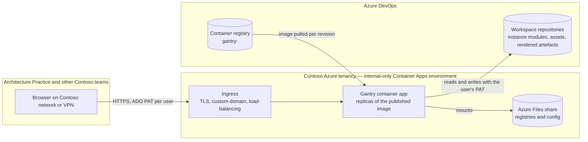

# Overview

## Overview

This SOAP proposes hosting Gantry as an internal service on **Azure Container Apps** in the Contoso UAT and Production tenancies. Each is an internal-only Container Apps environment running the published Gantry image, with an Azure Files share for persistent data. UAT runs one replica; Production runs at least two behind the environment's built-in ingress, so losing one replica doesn't take the service down.

Instance data lives in Azure DevOps workspace repositories, not in the container, so replicas stay disposable. Virtual machines, an earlier proposal, are under Alternatives sketch.

## In scope

- A UAT environment: an internal-only Container Apps environment, the Gantry container app at one replica, a file share, DNS name and certificate.
- A Production environment of the same shape with at least two replicas.
- Reachability from the Contoso network and VPN only; outbound HTTPS to Azure DevOps and the container registry.
- Deployment of each image as a new revision, Production behind an approval, with rollback.
- Phase-1 monitoring and one workspace repository per environment.

## Out of scope

- **User authentication and single sign-on.** Users supply their own Azure DevOps PAT and the network boundary controls access; Container Apps authentication is a later decision.
- **Backup and disaster recovery beyond the Azure Files share.** Instance data is protected by Azure DevOps.
- Changes to Gantry the application.
