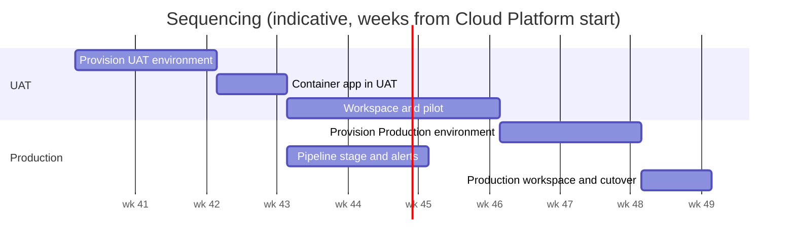

# Full SOAP Details

## Epic/Project

## Requested/lead by

Chris Barlow, Architecture Practice (requester and lead)

## Request date

10 September 2026

## Draft agreed date

Pending: set when the Architecture Practice agrees the draft.

## SOAP/estimate delivered date

Pending Business Case Approved.

## Sequencing

| Requirement | Team | Estimate | Notes |
| --- | --- | --- | --- |
| UAT environment | Cloud Platform team, Network / security team | S | Step 1; everything else waits on it |
| Gantry container app in UAT | Cloud Platform team, Architecture Practice | S | Step 1; proves the image, share, registry pull and egress |
| UAT workspace and pilot | Architecture Practice | S | Step 2; settles sizing and the open questions |
| Production environment | Cloud Platform team, Network / security team | S | Step 3, after UAT sign-off |
| Deployment pipeline stage and alerts | Architecture Practice, Cloud Platform team | S | Step 3, built against UAT first |
| Production workspace and cutover | Architecture Practice | S | Step 4 |

## Caveats

- Gantry is beta software. Breaking changes are likely between releases, and an upgrade may need a data migration.
- Production resilience covers compute only: the Azure Files share and Azure DevOps are each single dependencies.
- Sizing is unvalidated until the UAT pilot.
- Anyone with access to the workspace repository can edit its instances; the audit trail is its commit history.
- Container Apps fixes the request timeout at 240 seconds, and an internal-only environment can't later be made public.
- No security scanning of the codebase or image is included in these estimates (Q7).
