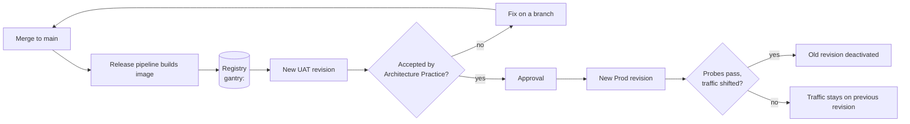
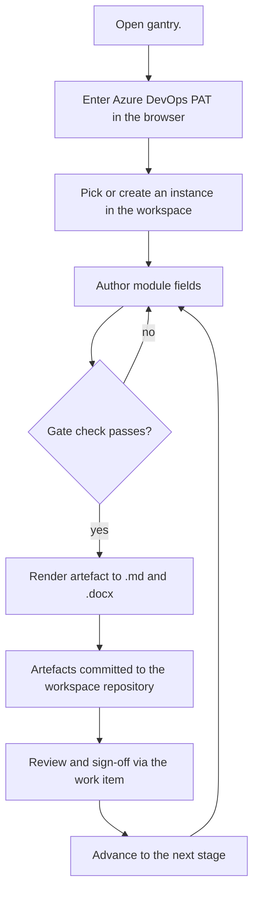
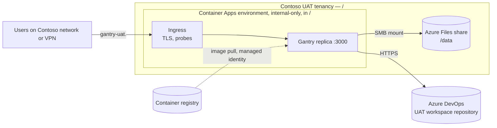
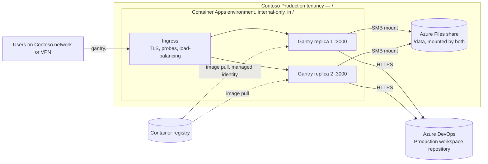

# Solution Definition

## High-level requirements

| # | Requirement | Environment |
| --- | --- | --- |
| R1 | The service is reachable only from the Contoso network and VPN; there is no public endpoint. | UAT, Prod |
| R2 | Each environment has a stable, common DNS name (`gantry-uat.<internal-domain>`, `gantry.<internal-domain>`) that does not change when a replica or revision is replaced. | UAT, Prod |
| R3 | Workspace registry and configuration survive a replica or revision being replaced: the container is disposable, the data is not. | UAT, Prod |
| R4 | Production tolerates the loss of one replica with no operator action; users keep working through the common DNS name. | Prod |
| R5 | A published image version can be deployed to UAT, exercised, and then promoted to Production unchanged, with rollback to the previous version. | UAT, Prod |
| R6 | Service health is visible to the operators without attaching to a container. | UAT, Prod |

## Process flow

Two flows matter: how a change reaches Production, and how a person uses the service.

The following diagram presents the release and deployment flow.

The diagram shows how a merge to `main` publishes an image that rolls out to UAT as a new revision, then to Production behind an approval; a failing revision leaves traffic on the previous one.

The following diagram presents how a person uses Gantry.

The diagram shows how a user enters their Azure DevOps PAT once, authors module fields, passes the gate check and renders artefacts back to the workspace repository.

## High level solution overview

Gantry runs as its published container image in Azure Container Apps. Ingress terminates TLS, probes each replica and spreads requests across healthy ones; every replica mounts the Azure Files share for the workspace registry and configuration.

The following diagram presents UAT: one replica.

The following diagram presents Production: the same design with two replicas sharing one share.

The diagrams show how requests carry each user's own PAT and replicas hold no session state, so any replica can answer any request.

## Feature breakdown and involved teams

| Feature | What it delivers | Teams |
| --- | --- | --- |
| UAT environment | Subnet, internal-only Container Apps environment, file share, Log Analytics, DNS name and certificate | Cloud Platform team, Network / security team |
| Production environment | The same, in the Production tenancy | Cloud Platform team, Network / security team |
| Gantry container app | The image on the share mount, minimum replicas, health probe | Cloud Platform team, Architecture Practice |
| Deployment path | A pipeline stage deploying each image as a revision | Architecture Practice |
| Monitoring | Logs in Log Analytics; alerts on restarts and failed revisions | Cloud Platform team |
| Workspace set-up | One workspace repository per environment | Architecture Practice |

## Alternatives sketch

**Linux virtual machines with a separate load balancer** was this SOAP's first proposal. Rejected on engineering review: Container Apps provides the load balancing, health probing, restarts, deployment and log collection the VM design assembled by hand. The trade-off is a managed host and a fixed 240-second request timeout, neither of which affects Gantry.

**Azure App Service for containers** would also work, but Container Apps' internal-only environments, revisions and per-replica probes fit the requirements more directly.

**Azure Kubernetes Service** is far more platform than one small web app needs.

The Azure Files mount protocol and the Production workload profile are left to the HLD (Q1, Q2).
