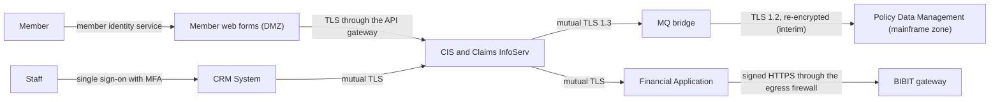

# Security

## Identity and access management

Staff sign in to the CRM System and the Financial Application through KCM's enterprise identity provider, with single sign-on and multi-factor authentication. The shared services authenticate callers by mutual TLS, with a service account per consuming application. Members sign in through the member identity service and can act only on their own policies.

Roles: Claims Handler, Senior Claims Handler, Claims Payment Approver (separated from valuation by rule), Contact Centre Agent, Finance Operator, Claims Support Administrator and Auditor (read-only). Roles are Active Directory groups. Policy Data Management authorises the calling service account and records the end user for audit.

## Security architecture

The following diagram presents the interim security architecture, which holds until the mainframe MQ upgrade.

The diagram shows how every hop is authenticated and encrypted, and that the only path out of KCM's network is the payment instruction to the BIBIT gateway. Only the mainframe leg is interim: the MQ bridge re-encrypts to TLS 1.2 until the upgrade, and the enduring architecture is otherwise as drawn.

Goals: no member data leaves KCM except payment instructions; a handler can't both valuate and pay a claim; the audit record is complete and tamper-evident. The threat model is reviewed at each increment gate.

Layered controls:

- Identity: single sign-on with MFA for staff, the member identity service for members, mutual TLS for services.
- Network: firewalls separate the DMZ, application and mainframe zones; egress is open only to the BIBIT gateway.
- Application: valuation and payment release are separate roles, and routing rules sit in Claims InfoServ.
- Audit: every claim state change and every read of a member record is logged.

## Regulations and standards

- Privacy Act 2020
- Fair Insurance Code 2020
- Insurance (Prudential Supervision) Act 2010
- New Zealand Information Security Manual (NZISM), the control baseline
- PCI DSS v4.0, scoped to the BIBIT gateway integration
- KCM guardrails G4 and G8

## Privacy and confidentiality concerns

The solution processes members' contact, policy and claim details (sometimes including health information), bank accounts and documents. The shared services put this in one place for more roles than today, so access is limited by role and authority limit and every read is logged. CIS supports Privacy Act access and correction directly. Payment instructions to the BIBIT gateway carry name and bank account. Whether the data mart feed needs its own PIA is Q5. The PIA must be complete before increment 1 go-live.
