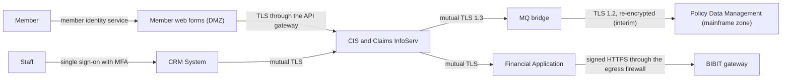

# Security

## Identity and access management

Staff authenticate to the CRM System and the Financial Application through KCM's enterprise identity provider (Active Directory with single sign-on and multi-factor authentication). The shared services authenticate their callers with mutual TLS and service accounts issued per consuming application; no service is callable anonymously. Members authenticate to the web claim and policy intake forms through the existing member identity service (email plus one-time code), and a member can only act on their own policies.

Security roles: Claims Handler (register, accept, valuate claims within their authority limit), Senior Claims Handler (all claims, approve valuations above the limit), Claims Payment Approver (release payments; separated from valuation by rule), Contact Centre Agent (register claims and policy requests, no acceptance), Finance Operator (reconcile payments), Claims Support Administrator (routing rules and reference data), Auditor (read-only across claims and audit records). Roles are groups in Active Directory mapped to CRM and Financial Application profiles; the Policy Data Management exposures authorise by the calling service account, not by the end user, and pass the end user's identity for the audit record.

User roles in the business sense (who uses the system for what) are catalogued in the Architecture module's Solution users.

## Security architecture

The following diagram presents the interim security architecture, which holds until the mainframe MQ upgrade.

The diagram shows how every hop between components is authenticated and encrypted, and that the only path out of KCM's network is the Financial Application's payment instruction to the BIBIT gateway. Only the mainframe leg is interim: the MQ bridge re-encrypts to TLS 1.2 because the mainframe's MQ channels support nothing newer. After the upgrade the bridge carries TLS 1.3 to the mainframe, and the enduring architecture is otherwise as drawn.

Goals: no member data leaves KCM's network except payment instructions to the gateway; every hop between components is authenticated and encrypted; a handler cannot both valuate and pay the same claim; the audit record is complete and tamper-evident. Constraints: the mainframe's MQ channels support TLS 1.2 only, so the integration layer terminates TLS 1.3 from the services and re-encrypts to the mainframe; the CRM vendor's extension framework runs with the application's own privileges, so routing rules are held in Claims InfoServ rather than in the CRM. Assumptions: the enterprise identity provider and the network segmentation between the DMZ, the application zone and the mainframe zone are already assessed and remain in place; the BIBIT gateway holds PCI DSS certification for the payment data it processes. The threat model (STRIDE, held in the security repository) is reviewed at each increment gate.

Layered controls:

- Identity: staff through the enterprise identity provider with multi-factor authentication, members through the member identity service, and services by mutual TLS with a service account per consuming application (see Identity and access management).
- Network: firewalls separate the DMZ, the application zone and the mainframe zone; the egress firewall allows only the Financial Application's connection to the BIBIT gateway.
- Transport: every hop is encrypted, with mutual TLS between components and TLS 1.2 on the interim mainframe leg.
- Application: valuation and payment release are separate roles by rule, and routing rules sit in Claims InfoServ, outside the CRM's privileges.
- Audit: every claim state change is recorded in Claims InfoServ's tamper-evident audit trail, and every read of a member record is logged.

## Regulations and standards

- Privacy Act 2020 and the Privacy Commissioner's guidance on health and financial information
- Fair Insurance Code 2020 (claims-handling timeframes and communication)
- Insurance (Prudential Supervision) Act 2010 — record keeping and outsourcing (payment gateway)
- Financial Markets Conduct Act 2013 — fair dealing obligations affecting claims communication
- New Zealand Information Security Manual (NZISM) — used as the control baseline
- PCI DSS v4.0 — scoped to the payment gateway integration
- KCM Information Security Policy and Architecture Guardrails G4 and G8

## Privacy and confidentiality concerns

The solution processes members' personal information: contact details, policy and insured-item details, claim circumstances (which for contents, travel and liability claims can include health information and third-party details), bank account details for payment, and supporting documents. The shared services make this information available to more staff roles in one place than the current fragmented systems do, which is a privacy consideration in itself: access is limited by role and by authority limit, every read of a member record is logged, and the Customer Information Service supports the access and correction rights of the Privacy Act directly. The claims data mart feed carries claim events with member identifiers for Finance and Actuarial; whether it needs its own PIA is open question Q5. Payment instructions to the BIBIT gateway contain the member's name and bank account, processed in Australia and New Zealand under the gateway's contract. The Privacy Officer has assessed the design at HLD and requires the PIA to be completed before increment 1 go-live.
